# Поиск тепловых аномалий на оптическом волокне

Прибор Raman DTS снимает температуру вдоль кабеля: раз в 10–240 секунд приходит профиль, в каждой точке — метр и температура. Если сложить профили, получается карта «время × расстояние». Задача кода — найти на этой карте локальный нагрев или охлаждение и не спутать их с суточным ходом помещения, кондиционером и сбоем прибора.

В репозитории три рабочих контура. Их запускают отдельно, цифры одного не переносят на другой.

| Сначала смотреть | Папка | Что делает |
| --- | --- | --- |
| `fiber` | `fiber/`, `scripts/` | Без обучения: предобработка, очистка `median_x3`, зоны `spatial_z_halo`, класс по форме пятна |
| `ens_gen2` | `field_ensemble/` | Ансамбль по полю как по картинке. Текущий релиз. Откат — `ens_u2ft_tcn_lgbm` |
| `larpathon` | `solutions/larpathon/` | Статистика, патч-автоэнкодер на этом же файле и сегментация OpenCV |

Общий вход трёх контуров — `ml_common/`. Сырых `1.csv`–`6.csv` в git нет: их кладут в каталог `MGTS_data`. Значение `−300` в профиле — пропуск измерения, не температура и не холод. Имя причины (насос, протечка, пожар) из одной температуры не выводится.

Нужен Python 3.11 или новее.

## Схемы

Общий путь данных: поле температуры, три рабочих контура, один список зон.

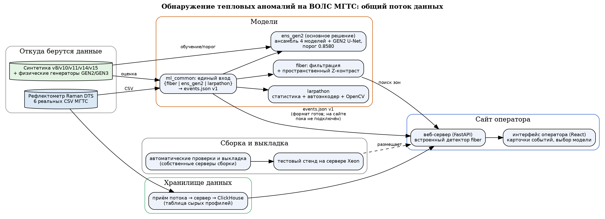

### fiber: предобработка, очистка, аномалия, класс

Эталонный контур без обучения. Сначала маска качества отбрасывает пропуски и обрывы профиля. Затем `median_x3` — медиана по трём соседним точкам вдоль кабеля. Зона строится по spatial Z: температура сравнивается с кольцом соседей (внутренний радиус 8 м, внешний 40 м, бин 2 м, пол масштаба 0.30 °C). Кандидат — там, где модуль Z не ниже 3.5, ширина не меньше 3 м, не меньше 6 профилей и 24 клеток, разрыв по времени не длиннее 300 с. Подпись формы — гипотеза, не подтверждённое событие.

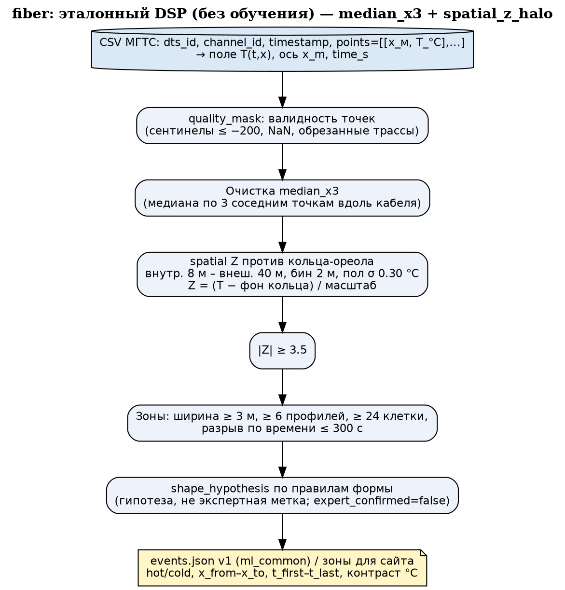

Параметры собраны в `fiber/pipeline.py`, класс `PipelineConfig`. Сборка шагов — `analyze_field`.

### ens_gen2: пять карт скора, смешивание, порог, семь классов

Объёмная схема релиза. Серые плиты — карты скора 1×128×256 каждого члена, цифры над блоками — число каналов и параметров.

Слева пять моделей:

- `unet_w24` (det0), U-Net ширины 24, 1 283 931 параметр;
- `unet_v810ft` (det1), U-Net ширины 16, 571 539 параметров;
- TCN (det2), 78 723 параметра;
- пиксельный LightGBM (det3);
- GEN2 U-Net ширины 16, та же архитектура, что det1, дообученная на физическом генераторе, 571 539 параметров.

Первые четыре карты усредняются (`mean4`, это ансамбль `ens_u2ft_tcn_lgbm`). Дальше скор смешивается со скором GEN2. На схеме узел смешивания подписан 0.5/0.5: в выпущенном релизе коэффициент равен 0.5, `score = 0.5 · (ens_u2ft_tcn_lgbm + GEN2)`. Откат `gen2=off` оставляет только `ens_u2ft_tcn_lgbm` и порог 0.8608.

Клетка тревожная, если скор не ниже 0.8580. Порог поставлен так, чтобы на чистом фоне синтетической проверки v8 ложной была одна клетка из тысячи (FAR 10⁻³). Соседние клетки собираются в зоны (`zones=cc`). Ветви `static` и `mae` в релизе выключены.

Справа тип зоны. EventNet — свёрточная сеть на кропе зоны: три блока Conv 3×3 (24, 48 и 96 каналов) с BatchNorm и ReLU, два MaxPool, AdaptiveAvgPool, 80 775 параметров, сумма по слоям сходится. Рядом stage-2 LightGBM по 19 скалярам кропа. Две вероятности смешиваются как `w · P_EventNet + (1 − w) · P_LightGBM`. Вес `w` код читает из чекпоинта; если в чекпоинте его нет, берётся 0.5. Поэтому на схеме написано «по умолчанию 0.5», а не жёсткая развилка 0.5/0.5. На выходе softmax по семи классам: `Local_Heating`, `Extended_Heating`, `Contact_Trace`, `Local_Cooling`, `Extended_Cooling`, `HVAC_Diurnal`, `Sensor_Artifact`.

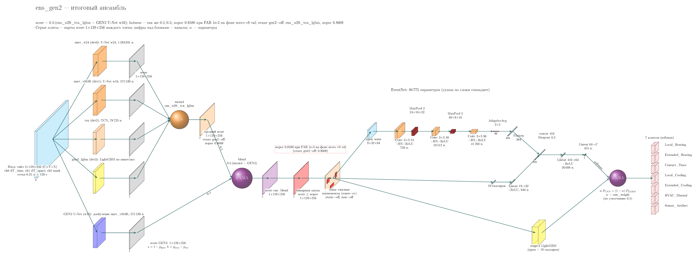

Плоский путь тех же шагов:

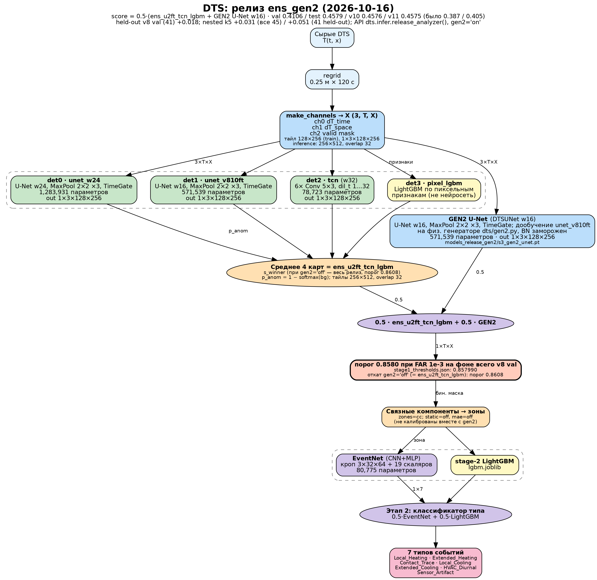

В коде релиз собирает `dts.infer.release_analyzer()`: флаги `op=far_1e-3`, `zones=cc`, `static=off`, `mae=off`, `gen2=on`. `Analyzer()` без флага и `release_analyzer(gen2="off")` возвращают прежний ансамбль `ens_u2ft_tcn_lgbm`.

### larpathon: автоэнкодер и OpenCV

Патч-автоэнкодер учится на том же файле, который разбирает. Вход патча `1×32×64` (время × длина). Энкодер: `1×32×64 → 16×32×64 → 16×16×32 → 32×16×32 → 32×8×16`. Декодер возвращает `1×32×64`. Потеря MSE, Adam, lr 10⁻³, 6 эпох, batch 32. Свёртка k=3, padding 1, ReLU. Красные блоки на схеме — MaxPool 2×2. Транспонированная свёртка k=2, stride 2. Латентный объём `32×8×16` = 4096 чисел против 2048 чисел на входе.

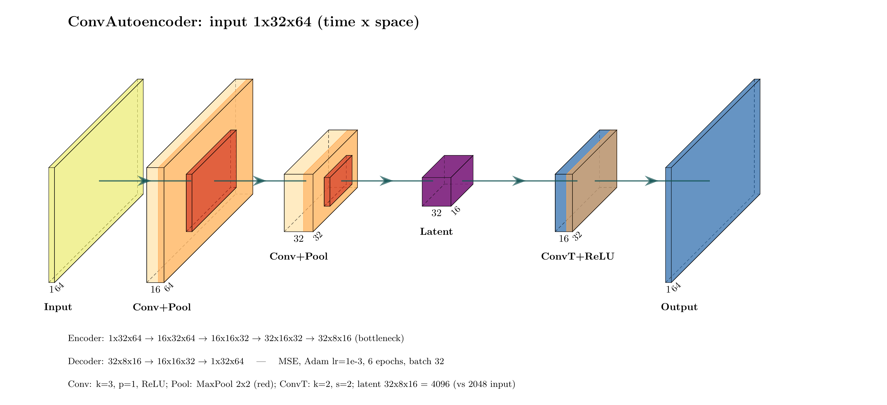

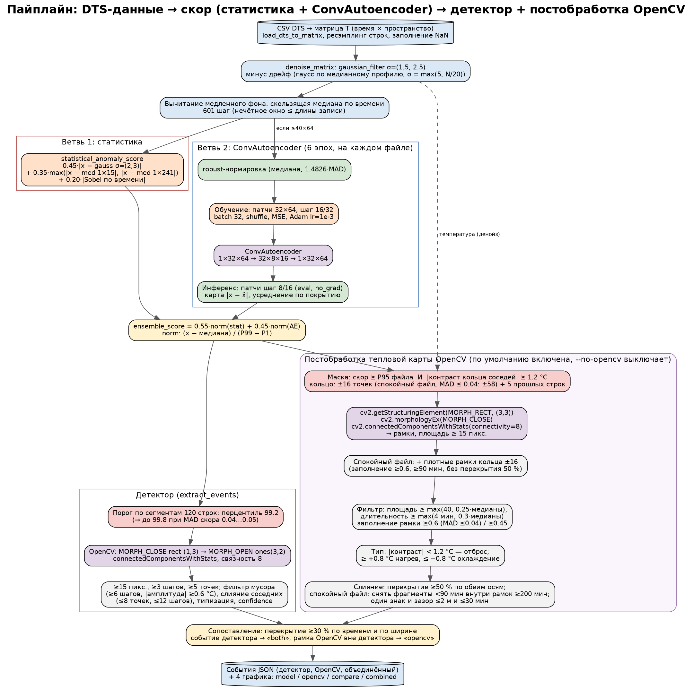

OpenCV включён сам: маска скора (процентиль 95) и маска контраста к соседнему кольцу (1.2 °C), закрытие `morphologyEx`, компоненты `connectedComponentsWithStats`. Флаг `--no-opencv` этот шаг выключает. `--use-opencv` оставлен для старых команд и ничего не меняет.

### Общий слой

`ml_common` приводит три контура к одному списку зон и сам аномалии не ищет. Отдельной модели у него нет: лист схемы в пакете сдачи совпадает с путём `ens_gen2` выше, потому что наружу выходит тот же список зон.

## Тепловые карты

Фрагмент синтетического поля, на котором сравнивали контуры. Модель смотрела весь файл 570 м × 21 ч, на рисунке окно 200–275 м и первые 10 часов. Горячий прямоугольник около 230 м — посаженное событие. Вертикальные полосы справа — устойчивый фон кабеля, его не надо принимать за короткое событие.

До рамок:

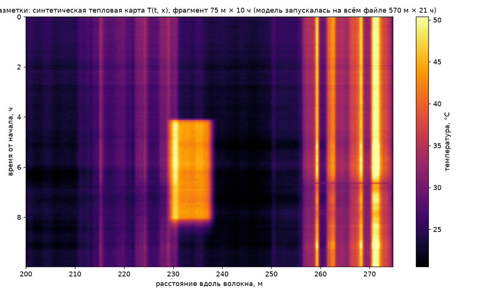

После `fiber`. Зелёная рамка — найденная зона, голубой пунктир — посаженная разметка этого синтетического фрагмента.

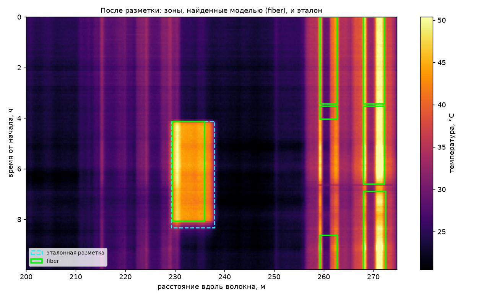

После `ens_gen2` на том же фрагменте. Ансамбль захватывает широкие вертикальные полосы, fiber режет их на более узкие рамки.

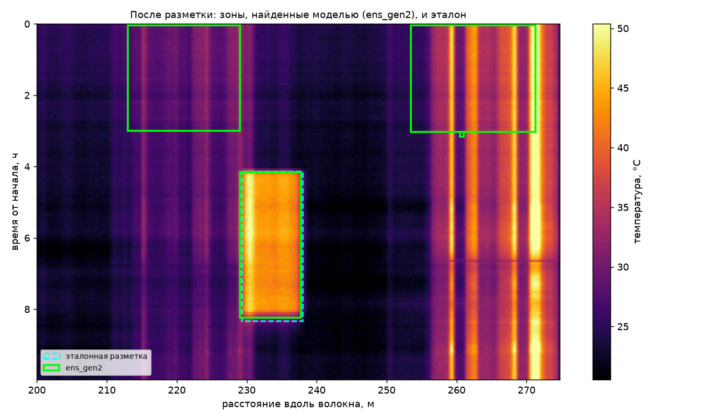

Реальный фрагмент `5.csv`, метры 290–310. Сверху сырое поле, снизу то же после `median_x3`. Горизонтальные тёплые полосы — ход по времени, вертикальная структура около 297–303 м остаётся после медианы.

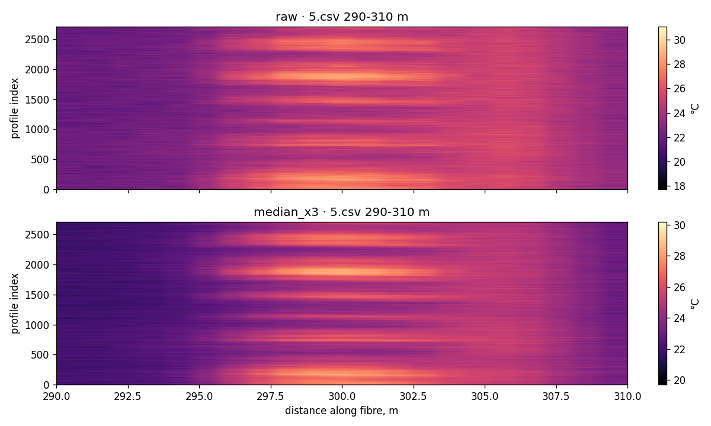

Тот же файл, окно 280–320 м. Сверху очищенное поле, снизу spatial Z против кольца 8/40 м. Красное — локально теплее соседей, синее — холоднее. Постоянный сдвиг всего участка в Z почти гасится.

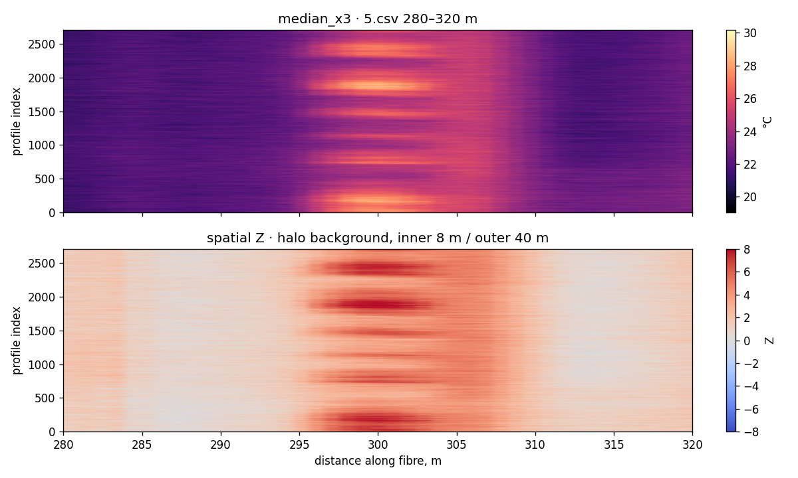

Реальный `4.csv` глазами ансамбля. Слева перепад температуры без общей моды, рамки — классы сети. Справа вероятность аномалии U-Net, белые рамки — зоны `median_x3` + `spatial_z`. Это сравнение двух контуров на одной трассе, не общая оценка качества.

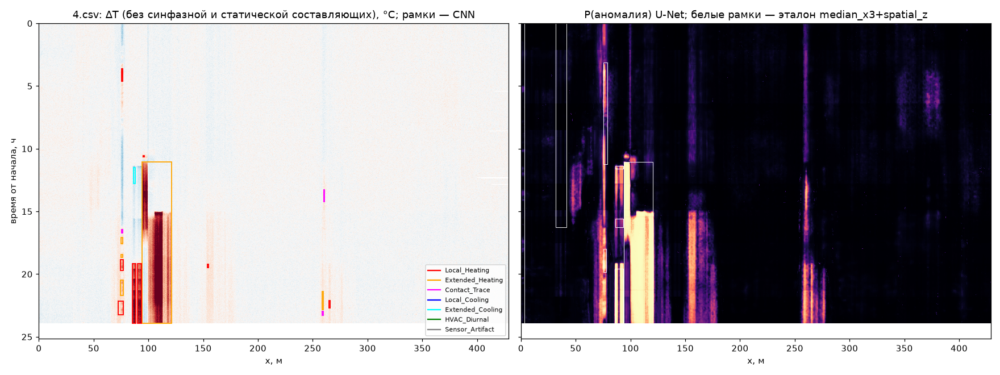

Тот же `4.csv`, аннотация OpenCV из `field_ensemble`: контур зоны и линия фронта (преобразование Хафа). Порог ансамбля эта картинка не меняет.

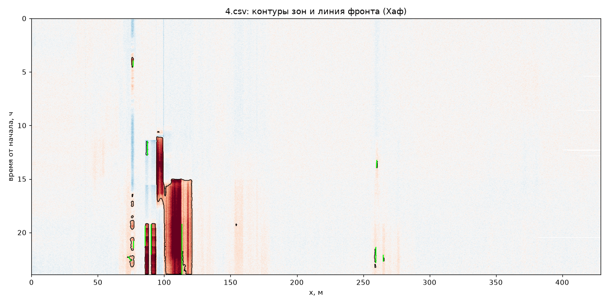

Карта `larpathon` с рамками событий и кольцом соседнего фона. Подписи в легенде — правила формы этого прототипа (`local_heating`, `local_cooling`), не классы `fiber` и не классы `ens_gen2`.

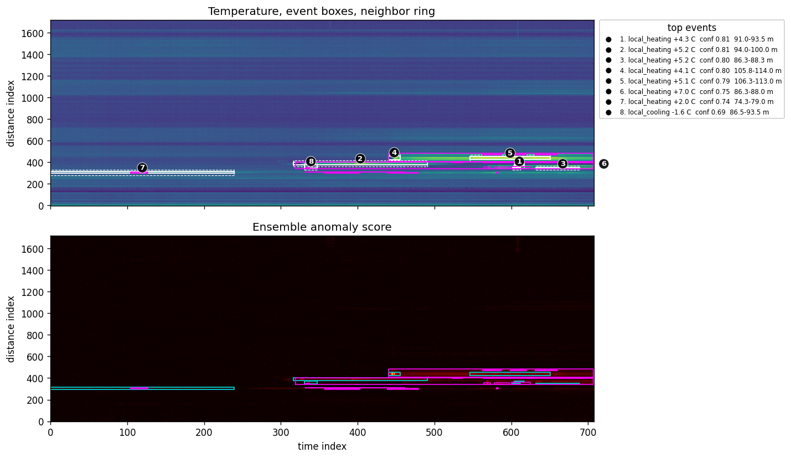

Остальные карты шести файлов лежат рядом: `field_ensemble/docs/figures/real_1.png` … `real_6.png` и `real_cv_1.png` … `real_cv_6.png`.

## 1. Предобработка

Каждая строка CSV — один профиль. В ячейке `points` список пар «метр вдоль кабеля, температура». Шесть файлов не склеивают: разные приборы, разный шаг по длине (около 0.10 м, 0.25 м или 1 м) и разный шаг по времени. Ось — метры кабеля, не карта города.

Команда из корня репозитория пишет на каждую трассу `raw_c.npy`, `valid.npy`, `x_m.npy`, `time_s.npy`, `meta.json`. Индекс — `artifacts/records/index.json`. Пропуски `−300` попадают в маску `valid` и дальше не считаются температурой. Каталог `artifacts/` создаёт прогон, в git его нет.

```powershell
python -m pip install -e ".[dev]"
python scripts/transform_csv.py --raw-root MGTS_data --out-root artifacts/records
```

Чтение поля — `fiber/io.py`, маска — `fiber/quality.py`.

## 2. Очистка

Рабочий метод — `median_x3`. Рядом, для сравнения, считаются `median_xt`, `savgol_x`, `bilateral_x`, `wavelet_x`, `tv_x`. Решение о зоне читает поле `median_x3`, остальные каналы его не заменяют.

```powershell
python scripts/denoise_records.py
python scripts/denoise_records.py --only 5 --methods median_x3 wavelet_x
python scripts/score_denoise.py
```

Код методов — `fiber/denoise/`. Таблица скоров на синтетическом спайке и на контрасте `5.csv` — `docs/DENOISE_SCORES.md`.

Необязательный API только этой очистки, без интерфейса:

```powershell
python -m pip install -e ".[api]"
python -m uvicorn fiber.api:app --host 127.0.0.1 --port 8082
```

Адреса: `GET /health`, `GET /methods`, `POST /denoise/profile`.

## 3. Определение аномалий

Детектор рабочего контура — `spatial_z_halo`. Локальный контраст к соседним метрам того же кабеля. Одиночный скачок уже метра и постоянный сдвиг всего метра зоной не становятся. Решение ячейки — норма или кандидат зоны.

```powershell
python scripts/detect_anomalies.py
python scripts/plot_anomaly.py
```

Код — `fiber/anomaly/`. Описание порога, ширины и разрыва по времени — `docs/ANOMALY.md`.

## 4. Классификация

Класс ставится уже найденной зоне и описывает форму, не причину. Правила заморожены в `fiber/classify/rules.py` и на окнах-свидетелях не подгонялись.

Классы: `Background`, `Local_Heating`, `Local_Cooling`, `Periodic_Thermal`, `Broad_Shift`, `Sensor_Fault`.

Узкий скачок сильнее 12 °C и уже 1.5 м читается как `Sensor_Fault`. Пятно шире 40 м или четверти измеренного кабеля, со сдвигом профиля от 1.5 °C, читается как `Broad_Shift`. Повтор коротких пятен с близким шагом — `Periodic_Thermal`.

```powershell
python scripts/classify_zones.py
```

Подробности — `docs/CLASSIFY.md`. Вся цепочка команд — `docs/PIPELINE.md`.

Проверки рабочего контура не требуют шести CSV и видеокарты:

```powershell
python -m pytest tests -q
```

## 5. OpenCV

Два входа. Оба рисуют рамки по картинке «время × метры» и не подменяют порог `spatial_z_halo`.

Прототип `solutions/larpathon`. Из корня:

```powershell
python -m pip install -r solutions/larpathon/requirements.txt
python -m pip install opencv-python-headless
python -m pytest solutions/larpathon/tests -q
python solutions/larpathon/main.py path\to\file.csv --no-ae --device cpu
```

Полезные флаги: `--opencv-score-percentile` (95), `--opencv-contrast-min` (1.2 °C), `--events-dir`, `--plot-path`, `--plot-dir`, `--temporal-window`, `--segment-rows`, `--epochs`, `--device cpu|cuda`. Без `--no-ae` на файле доучивается патч-автоэнкодер. Вес синтетической патч-сети уже в git: `solutions/larpathon/weights/synth_patch_net.pt`. Пояснение порогов и имён пятен — `solutions/larpathon/NOTE.md`.

В `field_ensemble` OpenCV аннотирует уже найденные зоны ансамбля: контур, вытянутость, фронт, период. Порог не двигает.

```powershell
cd field_ensemble
python -m pip install -r requirements.txt
python -m pip install -r requirements-cv.txt
python scripts/run_real.py --real-root path\to\MGTS_data --cv-annot --gen2 on
```

Классический разбор остатка без обучения сети — `field_ensemble/experiments/cv/cv_pipe.py`, ядро `field_ensemble/dts/cv_common.py` (медиана, Гаусс, морфология). Проверка аннотации: `python -m pytest tests/test_zone_cv.py -q` из каталога `field_ensemble`.

## Ансамбли

Оба живут в `field_ensemble`. Поле считается картинкой и приводится к сетке 0.25 м × 120 с. Из поля делают три слоя: отклонение точки от её обычного уровня в единицах шума, контраст к соседним ±20 м и маска надёжных измерений. Это другой контур, не замена `median_x3` + `spatial_z_halo`.

Числа IoU ниже сняты с синтетического протокола команды (генератор сажает события с известными координатами). У шести реальных CSV такой разметки нет. Карточки оператора — мнение одного человека: 15 «да» и 5 «нет».

### ens_gen2 — смотреть первым

Состав: среднее скора `ens_u2ft_tcn_lgbm` и GEN2 U-Net ширины 16. Порог 0.8580. В коде `gen2="on"`.

На синтетике, относительно прежнего лидера (val IoU 0.378 на 41 отложенной последовательности, test IoU 0.405, v10/v11 0.404):

| проверка | ens_gen2, два независимых обучения |
| --- | --- |
| отложенные 41 последовательность v8 | +0.018 и +0.018, интервалы включают 0 |
| вложенная проверка k5 / k2 | +0.051 / +0.008 и +0.050 / +0.011 |
| тест v8 | +0.053 и +0.049, интервал не включает 0 |
| тест v10 / v11 | +0.054 / +0.054 и +0.049 / +0.049 |

В едином протоколе сравнения (другой набор файлов, поэтому абсолютные числа выше): v8 val IoU 0.411 [0.297–0.565], v8 test 0.458 [0.371–0.546], v10 test 0.458 [0.375–0.552]. Карточки: 7 из 15 «да», 0 из 5 «нет». Число зон на реальных файлах в том прогоне 95 против 138 у предыдущего релиза. Наборы v8, v10 и v11 сильно пересекаются, это не три независимых экзамена.

Решение и оговорки — `field_ensemble/docs/RELEASE_DECISION.md`. Записка метода — `field_ensemble/docs/NOTE.md`.

### ens_u2ft_tcn_lgbm — предыдущий релиз

Четыре карты: U-Net ширины 24, дообученный U-Net ширины 16, TCN, пиксельный LightGBM. Порог 0.8608. В коде `gen2="off"`. На том же протоколе val IoU около 0.387 и test IoU около 0.405. Карточки того прогона: 8 из 15 «да», 0 из 5 «нет».

### Как запустить весь ансамбль

С нуля, если есть синтетический корень и папка реальных CSV. Скрипт `scripts/run_all.sh` строит кэш, учит stage 1 (`unet`, `tcn`, `dilated`), считает matched filter и пиксельный LightGBM, оценивает stage 1, учит stage 2, собирает релиз, гоняет реальные CSV и пишет отчёт.

```bash
cd field_ensemble
python -m pip install -r requirements.txt
SYNTH=/path/to/synth_v8/d REAL=/path/to/MGTS_data bash scripts/run_all.sh
```

Продолжить с места остановки: `bash scripts/run_resumable.sh`.

Только инференс уже собранного релиза. Крупных чекпоинтов в git нет: в `models_release*` лежат пороги. Файлы весов кладёт обучение, без них сеть собрать не из чего. `gen2 on` — `ens_gen2`, `gen2 off` — `ens_u2ft_tcn_lgbm`.

```powershell
cd field_ensemble
python scripts/run_real.py --real-root path\to\MGTS_data --gen2 on --cv-annot
python scripts/run_real.py --real-root path\to\MGTS_data --gen2 off
```

Из Python, рабочий каталог `field_ensemble`:

```python
from dts.infer import release_analyzer
current = release_analyzer()             # ens_gen2, gen2=on
previous = release_analyzer(gen2="off")  # ens_u2ft_tcn_lgbm
```

Проверки пакета: `python -m pytest tests -q` из `field_ensemble`.

## Ресерч

Сюда попадает то, что учили и не поставили вместо трёх контуров выше. Смотреть после `fiber`, `ens_gen2` и `larpathon`.

### Сети очистки и поиска в fiber

Обучение пишет `*.pt` в `models/weights/` и требует `python -m pip install -e ".[train]"`. На измеренных прогонах опубликованным детектором остался `spatial_z_halo`. Логистические модели контекста пишут вес только если witness pass count строго выше 7/8. Этот порог не был пройден, поэтому класс рабочего контура по-прежнему ставят правила формы.

| Файл | Что пробовали | Запуск |
| --- | --- | --- |
| `fiber/models/conv1d_denoise.py` | 1D CNN, Noise2Self | `python scripts/train_conv1d_n2self.py --device cuda --epochs 8` |
| `fiber/models/unet2d_denoise.py` | 2D U-Net очистки | `python scripts/train_unet2d_denoise.py --device cuda --epochs 6 --crops 4000` |
| `fiber/models/conv_ae.py` | свёрточный автоэнкодер | `python scripts/train_conv_ae.py --device cuda` |
| `fiber/models/patch_classifier.py` | CNN кропа | `python scripts/train_patch_classifier.py --device cuda --epochs 16` |
| `fiber/models/residual_net.py` | остаточная CNN | `python scripts/train_residual.py --device cuda` |
| `fiber/models/column_graph.py` | граф колонок | `python scripts/train_column_graph.py --device cuda` |
| `fiber/models/column_transformer.py` | трансформер колонок | `python scripts/train_column_transformer.py --device cuda` |
| `fiber/models/depth_cnn.py` | CNN по глубине | `python scripts/train_depth_cnn.py --device cuda` |
| `fiber/models/blindspot_x.py`, `n2n_tsr.py`, `zsn2n.py` | слепые схемы очистки | соседние `scripts/train_*.py` |
| `fiber/classify/` | контекст комнаты, текстуры, плато, режима, бустинг | `scripts/train_*_context.py` |

Шесть маленьких CNN повторного прогона, по одной на файл, лежат в `research/ml-test-review/weights/1.pt` … `6.pt`. Тревогу не ставят. Проверка: `python scripts/verify_ml_test_weights.py`. Рядом ridge только на реальных измерениях: `research/real-data-v2/real_masked_ridge.json`.

Сравнение пространственного и временного разреза на файлах 4, 5 и 6:


### Что перебирали внутри field_ensemble и не выпустили

Журнал отбора — `field_ensemble/STATE.md` и `field_ensemble/docs/S3_*.md`. Ниже схемы тех опытов, где блок рисовали объёмом. Плоские опыты без объёмной схемы перечислены текстом. Общая причина отказа одна: на синтетической проверке они не обошли `ens_gen2`, либо выигрыш был внутри разброса.

Объёмные схемы:

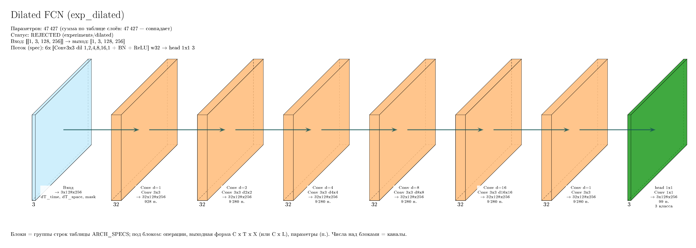

Разреженная свёрточная сеть. Папка опыта `field_ensemble/experiments/dilated`, записка рядом с кодом.


Сеть подстраивают под фон реального кабеля, не под посаженные события. `field_ensemble/experiments/realnet`.

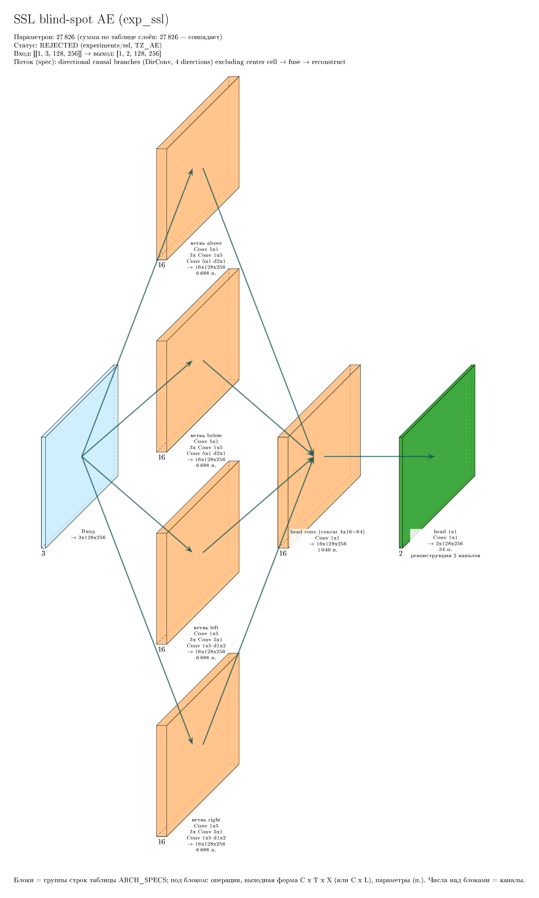

Сеть восстанавливает скрытые куски поля. `field_ensemble/experiments/ssl`.

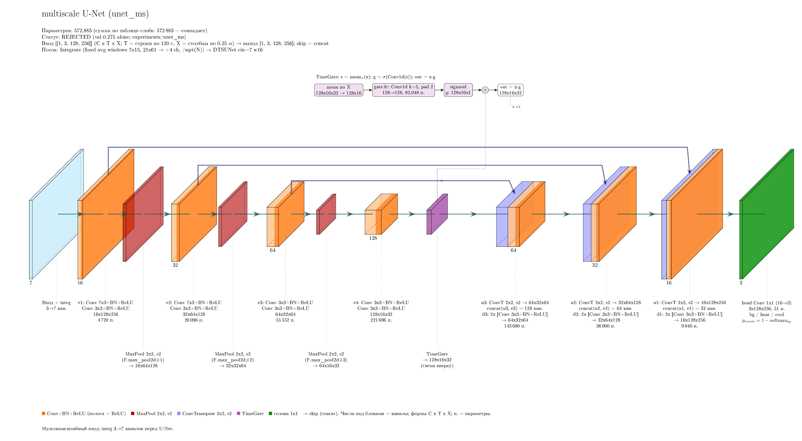

К входу U-Net добавляют уже сглаженные копии поля. `field_ensemble/experiments/unet_ms`.

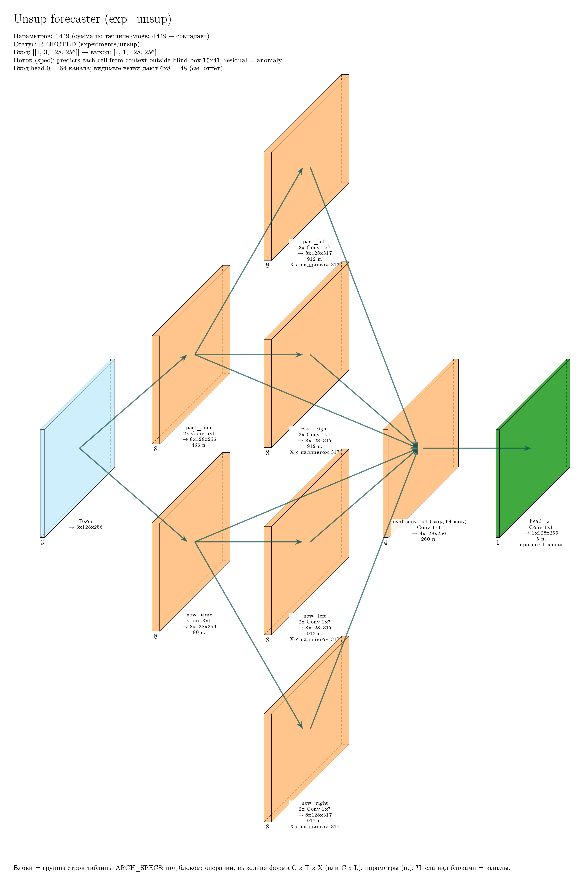

Учат «как выглядит обычное», аномалия — остаток. `field_ensemble/experiments/unsup`.

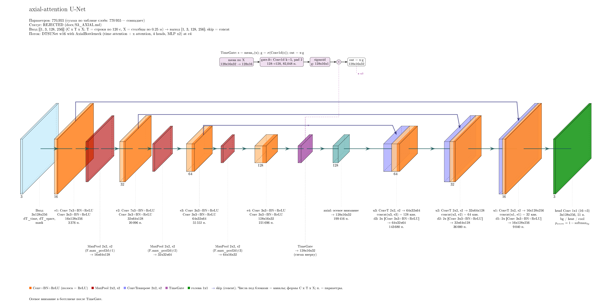

U-Net с вниманием вдоль осей времени и длины. `field_ensemble/docs/S3_AXIAL.md`.


Потеря сильнее штрафует край зоны, чем середину. `field_ensemble/docs/S3_BOUNDARY.md`.

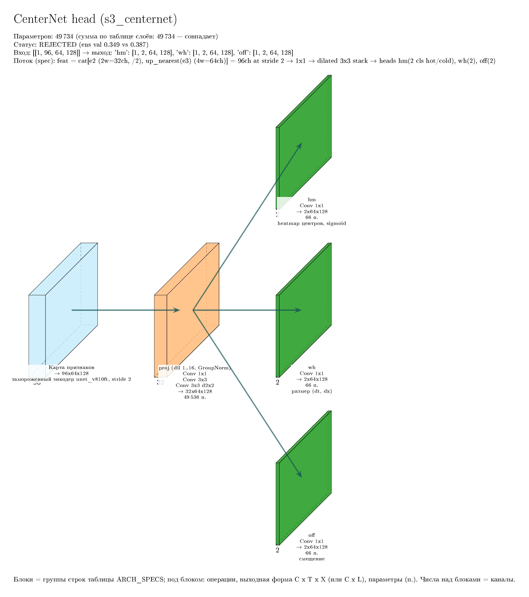

Событие ищут как точку-центр, а не как маску клеток. `field_ensemble/docs/S3_CENTERNET.md`.

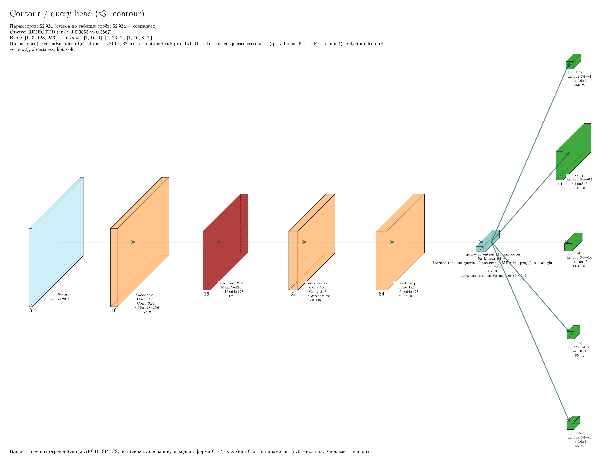

Голова предсказывает контур. В релиз не вошла: OpenCV-контур в `ens_gen2` считается после порога и порог не двигает. `field_ensemble/docs/S3_CONTOUR.md`.

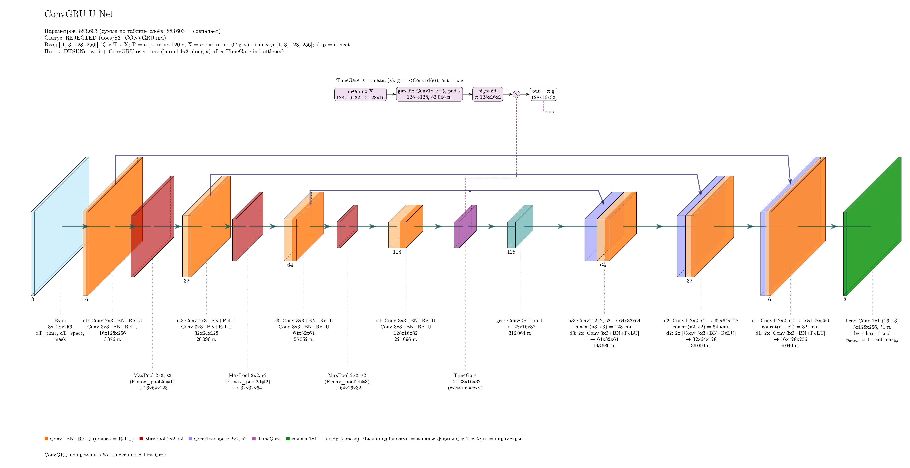

Память по времени внутри U-Net. `field_ensemble/docs/S3_CONVGRU.md`.


Обучение на шуме разного стиля, чтобы не прилипнуть к одному прибору. `field_ensemble/docs/S3_DG.md`.


Одна сеть учится повторять карту ансамбля. `field_ensemble/docs/S3_DISTILL.md`.


Дообучение на шуме, похожем на реальный кабель. В релиз не поставлен. `field_ensemble/docs/S3_DOM.md`.


Генеративная модель нормального фона. `field_ensemble/docs/S3_FLOW.md`.

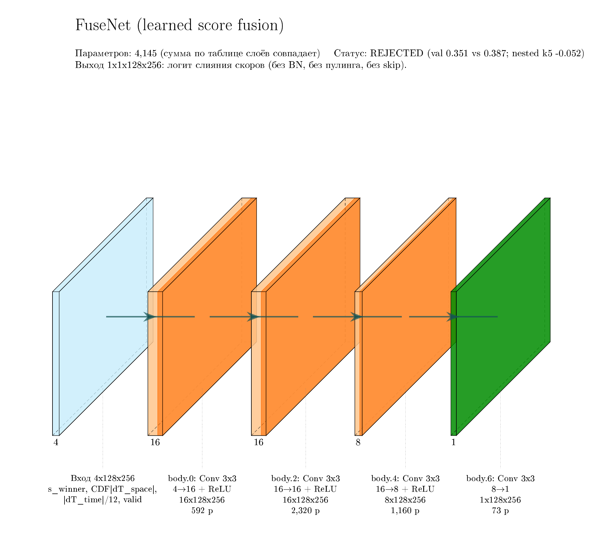

Вместо фиксированного среднего — обучаемый смеситель. `field_ensemble/docs/S3_FUSENET.md`.

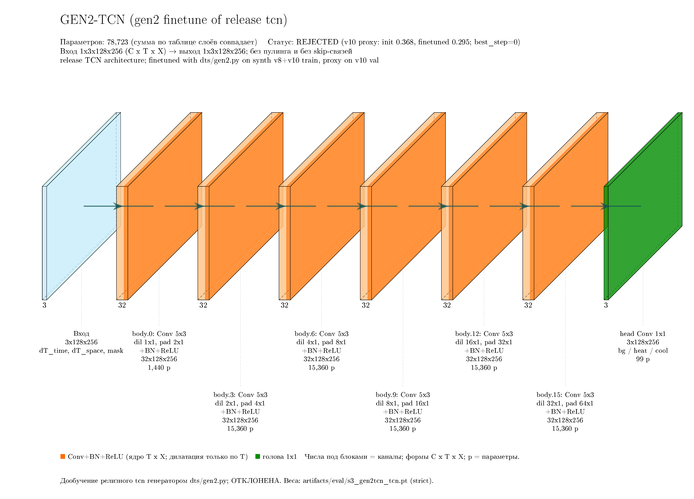

Временная сеть, дообученная тем же генератором, что GEN2 U-Net. Слабее выпущенной пары. `field_ensemble/docs/S3_GEN2TCN.md`.


U-Net ширины 24, дообученная генератором GEN2. `field_ensemble/docs/S3_GEN2W24.md`.

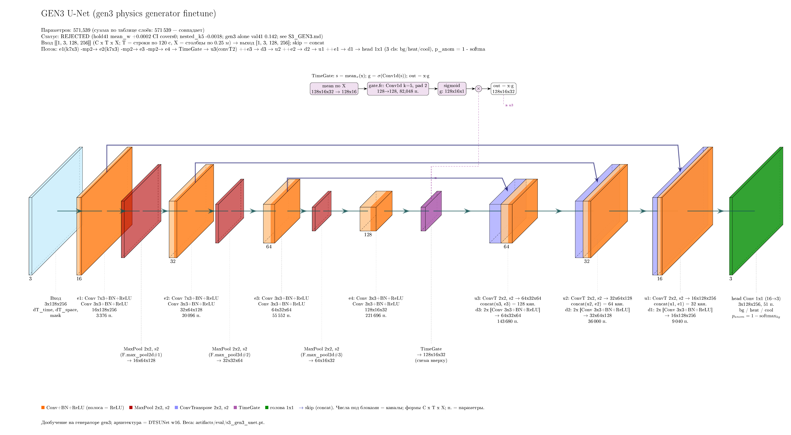

Следующий физический генератор. Релиз не сменил. `field_ensemble/docs/S3_GEN3.md`.


Прямая оптимизация IoU вместо обычной бинарной потери. `field_ensemble/docs/S3_LOVASZ.md`.

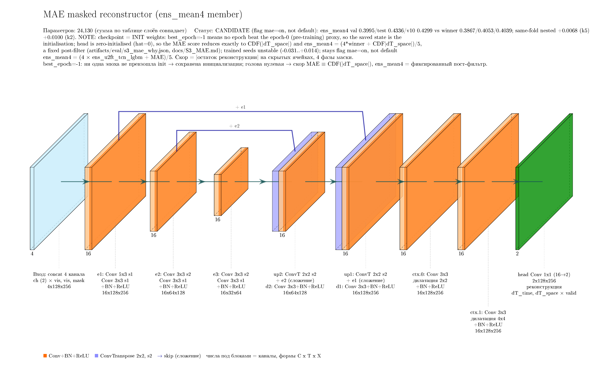

Восстановление скрытых полос. В релизе флаг `mae=off`. `field_ensemble/docs/S3_MAE.md`.


Энкодер инициализируют весами автоэнкодера и доучивают. `field_ensemble/docs/S3_MAEFT.md`.

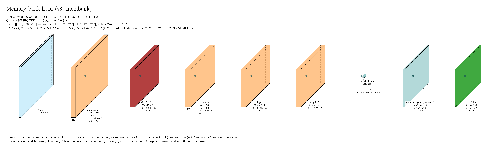

Аномалия — далёкий от банка «обычных» кропов фрагмент. `field_ensemble/docs/S3_MEMBANK.md`.

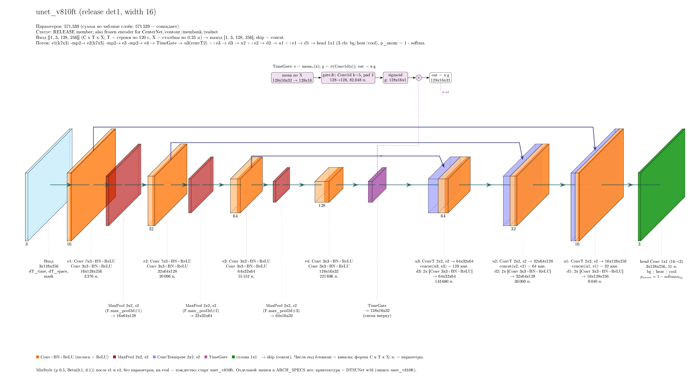

Перемешивание статистик внутри сети. `field_ensemble/docs/S3_MIXSTYLE.md`.


Одна голова ищет зону, вторая оценивает градусы. `field_ensemble/docs/S3_MTL.md`.


На вход накладывают случайные свёртки, чтобы сеть не запомнила текстуру одного прибора. `field_ensemble/docs/S3_RANDCONV.md`.


Model soup: среднее весов нескольких обучений. `field_ensemble/docs/S3_SOUP.md`.

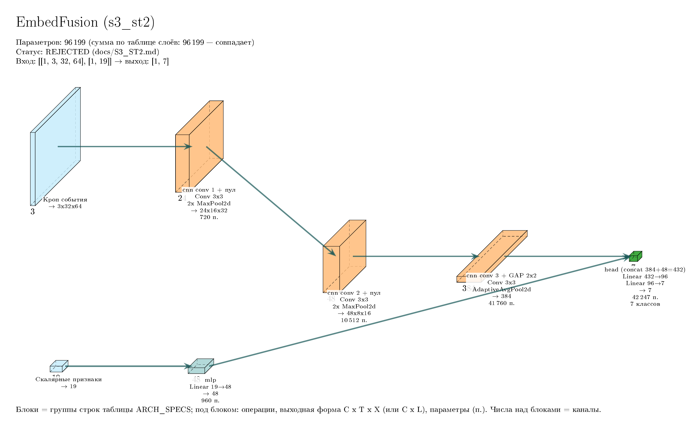

Классификатор типа читает признаки U-Net, а не кроп. В релизе тип ставит EventNet вместе с LightGBM. `field_ensemble/docs/S3_ST2.md`.

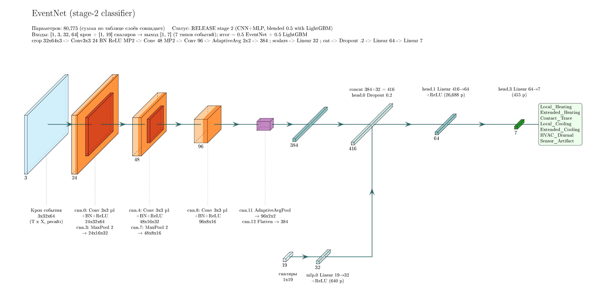

Несколько копий классификатора и мета-модель поверх них. `field_ensemble/docs/S3_ST2SEED.md`.

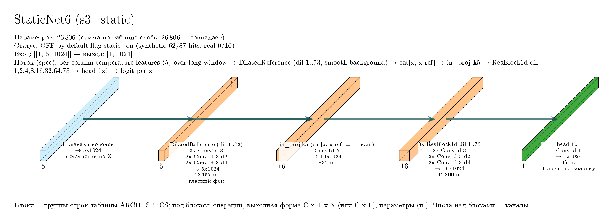

Отдельная ветвь для пятен, которые горячие с первого профиля. В релизе `static=off`: такое пятно лучше видит `fiber`, потому что первый слой ансамбля считает отклонение от обычного уровня точки. `field_ensemble/docs/S3_STATIC.md`.


Дообучение на событиях маленькой амплитуды. `field_ensemble/docs/S3_WEAK.md`.

Без объёмной схемы, тем же порядком «посмотрели и не выпустили»:

- классическое зрение без сети, `field_ensemble/experiments/cv`;
- согласованный фильтр, `field_ensemble/experiments/matched_filter`;
- многомасштабное сглаживание уже готовой карты, `field_ensemble/experiments/multiscale`;
- накопление слабых сигналов, `field_ensemble/docs/S3_ACCUM.md`;
- смесь GEN2 и простого пространственного контраста, `field_ensemble/docs/S3_COMBO.md`;
- раздельные пороги нагрева и охлаждения, `field_ensemble/docs/S3_POLTHR.md`;
- подбор весов ансамбля с отдельным учётом охлаждения, `field_ensemble/docs/S3_SEL.md`;
- отдельный класс статичной точки на втором этапе, `field_ensemble/docs/S3_ST2STATIC.md`;
- усреднение по отражениям и сдвигам входа, `field_ensemble/docs/S3_TTA.md`.

## Чего в репозитории нет

- Исходных `1.csv`–`6.csv` и каталога `artifacts/`, пока его не создал локальный прогон.
- Крупных чекпоинтов `models/weights/*.pt` и обучающих кэшей `field_ensemble/artifacts/`. В слотах релиза лежат пороги, не гигабайтные веса.
- Секретов и паролей стенда.
