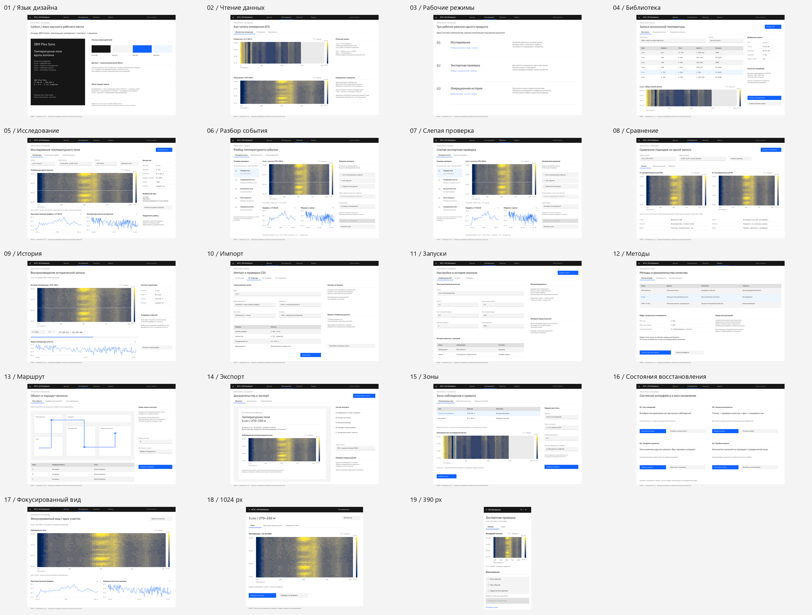
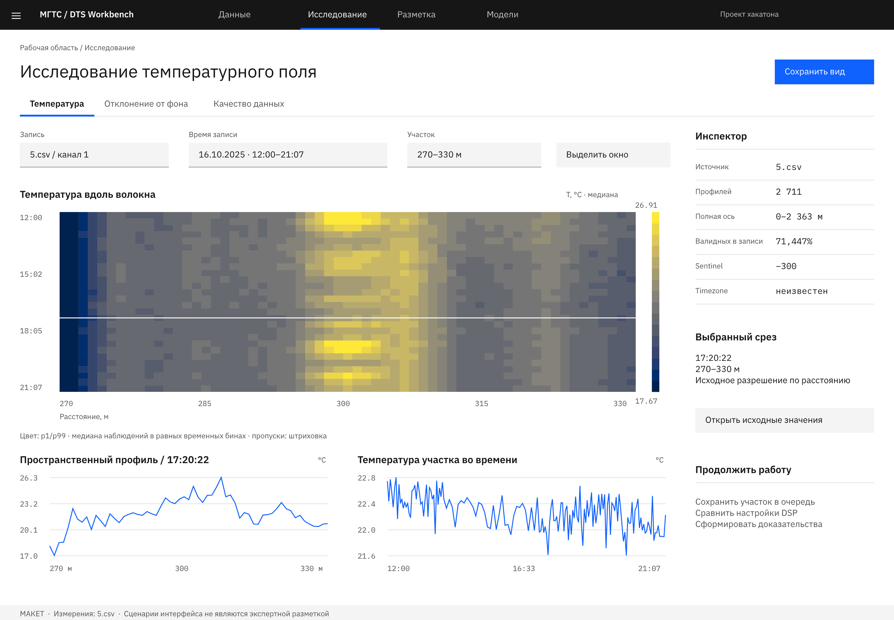
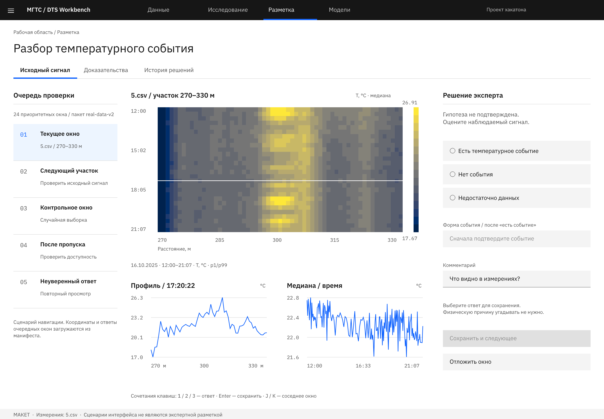
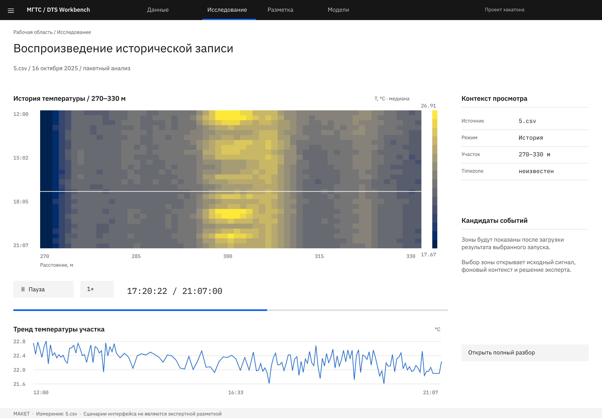
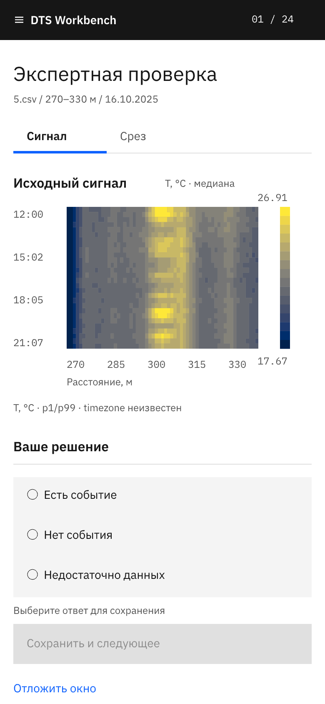

> **ИСТОРИЧЕСКИЙ АРХИВ.** Не источник актуального веб-дизайна и не часть обычной frontend-задачи. Читать/менять только по прямому поручению пользователя про архив. Текущая точка входа: [design/README](../../README.md). Слова «актуальный» и старые инструкции ниже относятся к прежнему этапу.

# DTS Workbench — дизайн для фронтенда / Carbon R2

Актуальная версия от 7 октября 2026, ветка `web`. Здесь собраны описание стиля и проверенный PNG-экспорт для фронтенда и Захара. Видео в пакет не включено.

Для редактирования начните с [инструкции установки Pen и работы с агентами](PEN_GUIDE.md). Основной проект: [pen/dts-workbench.pen](pen/dts-workbench.pen). Затем прочитайте [описание стиля и референсов](STYLE.md). Затем открыть нужный PNG из таблицы ниже. Это статичные макеты для обсуждения и реализации: переходы, сохранение ответов и экспорт отчёта в приложении ещё не подтверждены этим пакетом.

## Что находится в папке

| Файл / каталог | Назначение |
|---|---|
| [STYLE.md](STYLE.md) | Почему выбран IBM Carbon, официальные референсы, композиция, графики и правила реализации |
| [tokens.json](tokens.json) | Цвета, шрифты и базовый шаг отступов из макетов |
| [PEN_GUIDE.md](PEN_GUIDE.md) | Установка, ручная правка, MCP, CLI и сохранение в Git |
| [pen/dts-workbench.pen](pen/dts-workbench.pen) | Общий редактируемый проект |
| [pen/screens/](pen/screens/) | 19 отдельных редактируемых экранов |
| [pen/validation.json](pen/validation.json) | Проверка сохранности слоёв при переносе в .pen |
| [AGENTS.md](AGENTS.md) | Контекст и правила для агента |
| `png/` | 19 актуальных экранов и проектных досок с понятными именами |
| `originals/` | Три исходных экрана Захара, отдельно от Carbon R2 |
| [manifest.json](manifest.json) | Идентификаторы Pen, размеры PNG и SHA-256 |
| [all-screens.png](all-screens.png) | Общий обзор всех новых макетов |

## Экраны

Первые три изображения — проектные доски; 04–17 — desktop-макеты, 18 — tablet, 19 — mobile.

| № | Экран | PNG | Pen | Размер |
|---|---|---|---|---|
| 01 | Язык дизайна | [Открыть](png/01-design-language.png) | [Редактировать](pen/screens/01-design-language.pen) | 2880 × 2000 |
| 02 | Чтение данных | [Открыть](png/02-reading-data.png) | [Редактировать](pen/screens/02-reading-data.pen) | 2880 × 2000 |
| 03 | Рабочие режимы | [Открыть](png/03-working-modes.png) | [Редактировать](pen/screens/03-working-modes.pen) | 2880 × 2000 |
| 04 | Библиотека | [Открыть](png/04-records.png) | [Редактировать](pen/screens/04-records.pen) | 2880 × 2000 |
| 05 | Исследование | [Открыть](png/05-research.png) | [Редактировать](pen/screens/05-research.pen) | 2880 × 2000 |
| 06 | Разбор события | [Открыть](png/06-event-review.png) | [Редактировать](pen/screens/06-event-review.pen) | 2880 × 2000 |
| 07 | Слепая проверка | [Открыть](png/07-blind-review.png) | [Редактировать](pen/screens/07-blind-review.pen) | 2880 × 2000 |
| 08 | Сравнение | [Открыть](png/08-comparison.png) | [Редактировать](pen/screens/08-comparison.pen) | 2880 × 2000 |
| 09 | История | [Открыть](png/09-history.png) | [Редактировать](pen/screens/09-history.pen) | 2880 × 2000 |
| 10 | Импорт | [Открыть](png/10-csv-import.png) | [Редактировать](pen/screens/10-csv-import.pen) | 2880 × 2000 |
| 11 | Запуски | [Открыть](png/11-analysis-runs.png) | [Редактировать](pen/screens/11-analysis-runs.pen) | 2880 × 2000 |
| 12 | Методы | [Открыть](png/12-methods.png) | [Редактировать](pen/screens/12-methods.pen) | 2880 × 2000 |
| 13 | Маршрут | [Открыть](png/13-fiber-route.png) | [Редактировать](pen/screens/13-fiber-route.pen) | 2880 × 2000 |
| 14 | Экспорт | [Открыть](png/14-export.png) | [Редактировать](pen/screens/14-export.pen) | 2880 × 2000 |
| 15 | Зоны | [Открыть](png/15-zones.png) | [Редактировать](pen/screens/15-zones.pen) | 2880 × 2000 |
| 16 | Состояния восстановления | [Открыть](png/16-recovery-states.png) | [Редактировать](pen/screens/16-recovery-states.pen) | 2880 × 2000 |
| 17 | Фокусированный вид | [Открыть](png/17-focused-research.png) | [Редактировать](pen/screens/17-focused-research.pen) | 2880 × 2000 |
| 18 | 1024 px | [Открыть](png/18-tablet-1024.png) | [Редактировать](pen/screens/18-tablet-1024.pen) | 2048 × 1800 |
| 19 | 390 px | [Открыть](png/19-mobile-390.png) | [Редактировать](pen/screens/19-mobile-390.pen) | 780 × 1688 |

## Основные виды

### Исследование

### Разбор события

### История

### 390 px

## Пользовательский путь

Импорт CSV → библиотека → исследование → выбор зоны → запуск анализа → экспертный разбор → сравнение подходов / история → экспорт доказательств. Слепая проверка — отдельный маршрут независимой оценки. На узком экране показываем один рабочий вид с переключением сигнала и среза.

## Что исправлено в R2

- Рабочая поверхность светлая на всех новых экранах, включая историю; чёрной остаётся общая навигационная оболочка Carbon.
- Карты подписаны как медианная агрегация. Отдельные пределы p1/p99 обзора и увеличения объяснены; при сравнении методов шкалы одинаковые.
- В экспертном разборе показаны пространственный и временной графики, а выбранный момент отмечен курсором.
- Сохранение ответа визуально недоступно, пока не выбран вариант. Форма события активируется после подтверждения наличия события.
- Диапазон 270–330 м отмечен контуром на полной оси; контур не выдаётся за результат детектора.
- Экспорт не включает отсутствующие экспертные ответы. Количество наблюдаемых профилей не называется длительностью в секундах.

## Данные и ограничения

Графики построены из реальных измерений 5.csv. Временная зона неизвестна. Sentinel −300 исключён из валидных измерений; пустые интервалы не интерполируются. Обзорная медиана может скрывать экстремумы: для экспертного решения нужен доступ к нативному сигналу.

Доля 71,447% относится ко всей записи 5.csv, а не только к увеличенному участку. План помещений, привязки волокна, очередь и будущие состояния запуска — проектные сценарии. В опубликованном пакете экспертных ответов пока нет. Два графика сравнения показывают один исходный источник, без выдуманных предсказаний моделей.

## Передача в разработку

Использовать один UI kit Carbon, IBM Plex и семантические токены. Общие координаты, viewport и курсоры графиков должны управляться единым состоянием. Координаты разметки сохраняются в системе исходных данных. Поле миллионов DTS-ячеек требует отдельного подхода к рендерингу; макет не выбирает за разработчика готовую библиотеку.

Реализовать клавиатурное управление, focus/hover/disabled, доступные таблицы, сохранение черновика и ревизии ответов. Desktop-композиция не должна просто сжиматься до mobile: инспектор и срезы переключаются отдельно.

## Проверка экспорта

Экспортирован непосредственно из актуального Pen с масштабом 2×. Проверены 19 корней без clipping, декодирование PNG, размеры, SHA-256 и светлая рабочая поверхность. Общий лист и основные исправленные экраны просмотрены. Общий Pen повторно открыт; все 23 корневых поддерева совпадают с исходником по структурной сигнатуре. 19 отдельных .pen сохраняют соответствующие поддеревья и переменные, меняется только положение корня на холсте. Оригиналы Захара не перерабатывались. Pixel-perfect идентичность desktop и headless PNG не заявляется. Это проверка дизайна и экспорта, а не пользовательское тестирование и не подтверждение качества ML.

## Исходные экраны Захара

- [Desktop](originals/01-zakhar-desktop.png)
- [Live Demo](originals/02-zakhar-live-demo.png)
- [Анализ аномалий](originals/03-zakhar-anomaly-analysis.png)
