# Продуктовый контракт R3

## Назначение и границы

DTS Workbench — рабочее место для исследования распределённых измерений температуры, подготовки проверяемых кандидатов и человеческой оценки наблюдений. Задача продукта: сохранять путь от исходника до экспертного ответа и оценки метода. Интерфейс не должен превращать кандидата алгоритма в эксплуатационную тревогу или придумывать причину явления.

R3 закрывает известные сценарии этого продукта. Под «полным набором» понимаются доступ, работа с данными, исследование, запуск, назначение, оценка, ревизии, экспорт, настройки и восстановление. Новые предметные области, биллинг, live-оборудование и нативное мобильное приложение сюда не добавлены: для них нет подтверждённого контракта.

Опорный код: `general-ml-analyze/product/README.md`, `product.server`, `product.build_queue`; научные артефакты и проверка `review_product_runtime.json`. Репозиторий содержит несколько исследовательских веток: наличие макета не означает, что любая их функция уже объединена в web-приложение.

| Возможность | Что есть сейчас | Что проектирует R3 |
|---|---|---|
| Источники | 6 CSV, обработанные оси, маски и происхождение | Командный импорт, паспорт и доступ по проекту |
| Экспертная проверка | Локальная очередь, исходный сигнал, варианты ответа | Назначения и роли; удобный телефонный путь |
| Ревизии | SQLite/WAL, автор, транзакции, HTTP 409 | Командное сравнение версий и повторное подтверждение |
| Доступ | Локальный 127.0.0.1, Host/Origin и write token | Учётные записи, серверные разрешения, сеансы |
| Фоновые вычисления | Исследовательские скрипты и артефакты | Менеджер запусков, журнал, отмена и повтор |
| Разметка | Опубликованных человеческих ответов нет | Контракт, независимая оценка и управляемый выпуск |
| Мобильные черновики | Корпоративная синхронизация не реализована | Ограниченный локальный черновик по политике проекта |
| Интеграции | Ручные CSV; нет подтверждённого live-сервиса | Отдельный будущий этап после командной версии |

## Масштабируемая модель

Организация содержит проекты; учётная запись имеет membership и роль в каждом проекте. Права организации (например, создание проекта) отделены от чтения измерений. `project_id` — обязательная область объектов и запросов; идентификатор из URL не предоставляет доступ.

Сущности: organization → project → source record → analysis run → immutable review package → assigned window → review revision → adjudication → release. У каждого вычисляемого объекта есть версия/происхождение и статус. У исходника — source SHA; у окна — границы, queue SHA и источник; у ответа — автор, тип проверяющего, контракт и ревизия. Новый пакет не использует незаметно журнал старого.

Маршруты рекомендуется разделять по ресурсу: `/projects/:projectId/records/:recordId`, `/runs/:runId`, `/reviews/:queueSha/windows/:windowId`, `/releases/:releaseId`, `/settings/members`. Фильтр, выбранный источник, диапазон и время можно восстановить из URL. Несохранённое обоснование, токены и секреты туда не помещаются. Прямой вход по ссылке проходит авторизацию и проверку membership.

Источники могут добавляться через адаптеры с общим контрактом осей, единиц, маски, времени и происхождения. Методы — через версионированный реестр; нельзя менять название метода и терять его параметры. Режимы разметки — через версию инструкции, не через произвольные новые поля в старых ответах.

Большие списки: серверный поиск, фильтры, cursor pagination, стабильная сортировка и сохранение контекста. Большие графики: серверные тайлы/агрегации с явным разрешением плюс точные срезы исходника. Не загружать всю матрицу каждой карточке и не скрывать агрегирование за словом «исходный».

## Роли и разрешения

Предлагаемая модель, её следует согласовать с командой до реализации. Одна основная роль в проекте; дополнительные права выдаются явно. Роль доступа не заменяет квалификацию эксперта. Для пилота координатор и исследователь могут быть одним человеком, сохраняя разделение действий.

| Действие | Администратор | Координатор | Исследователь | Эксперт | Наблюдатель |
|---|---|---|---|---|---|
| Управлять membership и политикой | Да | Нет | Нет | Нет | Нет |
| Читать данные проекта | Отдельный доступ | Да | Да | Назначенный контекст | Разрешённые записи |
| Импортировать и запускать метод | Доп. право | Доп. право | Да | Нет | Нет |
| Формировать назначения и контракт | Доп. право | Да | Подготовить предложение | Нет | Нет |
| Публиковать человеческий ответ | Только с ролью эксперта | Только с ролью эксперта | Нет | Свои назначенные окна | Нет |
| Сохранить агентский черновик | Отдельный субъект agent | Отдельный субъект agent | Отдельный субъект agent | Не от имени человека | Нет |
| Разрешать расхождение | Нет автоматически | Назначить арбитра | Нет | Явное назначение арбитром | Нет |
| Выпускать набор ответов | Доп. право | Да | Доп. право | Собственный экспорт по праву | Доп. право |
| Скачать raw / чувствительный экспорт | Отдельное право | Отдельное право | Отдельное право | Отдельное право | Отдельное право |

Меню — по роли и разрешениям, сервер проверяет каждый запрос чтения/изменения/экспорта. 403 и 404 не раскрывают закрытые данные. Нельзя удалить последнего администратора без передачи полномочий. Отзыв доступа запрещает новые действия, но не переписывает исторического автора ответа.

Для эксперта главная страница — назначения и черновики; для исследователя — данные, исследование и запуски; для координатора — пакет/протокол/назначения; для администратора — участники и политика; для наблюдателя — разрешённое чтение. Экраны «все роли» в индексе — общие страницы или атласы состояний, а не шестая роль.

## Основные пользовательские пути

```mermaid
flowchart LR
    A[Приглашение или вход] --> B[Проверка membership]
    B --> C[Выбор проекта]
    C --> D[Данные и паспорт качества]
    D --> E[Исследование и точные срезы]
    E --> F[Версионированный запуск]
    F --> G[Пакет и независимый контроль]
    G --> H[Назначение эксперту]
    H --> I[Сигнал → ответ → обоснование]
    I --> J[Серверное подтверждение ревизии]
    J --> K[Повторная проверка при расхождении]
    K --> L[Выпуск ответов и происхождения]
    J --> L
```

**Вход:** приглашение → учётная запись → принять область доступа → выбрать проект. Парольный и корпоративный вход доступны по настройке команды. Второй фактор появляется только при настроенной политике. После истечения сеанса сохраняется разрешённый черновик; после повторного входа заново проверяются права и ревизия. Восстановление отвечает одинаково для существующего и неизвестного адреса.

**Данные:** выбрать файлы → сопоставить поля (R2) → проверить качество → подтвердить → запись. Ошибка формата сохраняет исходник и показывает строку/поле. Совпадение SHA предотвращает случайный дубликат. TZ неизвестен до подтверждения; отображаемый часовой пояс не переписывает raw timestamp.

**Исследователь:** библиотека → паспорт → участок → поле и связанные срезы → параметры → запуск → журнал/артефакты. Кандидат можно предложить для проверки; это не человеческий ответ. Детальное сравнение методов и зон остаётся в R2, оболочка и политика доступа — R3.

**Координатор:** контракт → immutable пакет → случайный контроль → участники → предпросмотр назначений → подтверждение. Пакеты `real-data-v2` (340 окон / shortlist 24) и локального продукта (147 окон) не смешиваются. Обогащённая кандидатами очередь не оценивает реальную распространённость событий.

**Эксперт:** назначенное окно → сигнал → связанные срезы → ответ → обязательное обоснование → подтверждённая сервером ревизия → следующее окно. В слепом режиме методы не влияют на первичный ответ. `unknown` допускает недостаточность данных; не принимать автоматически за `absent`.

**Арбитр:** назначение → исходный сигнал → первичные обоснования → собственное решение → отдельная ревизия/связь. Первичные ответы сохраняются. Голосование и ответ агента не становятся автоматически эталоном.

**Выпуск:** разрешённые ответы → фильтр происхождения → контракт → состав/manifest → серверный экспорт. Если человеческих ответов нет, интерфейс объясняет отсутствие, не создаёт фиктивные метки. Формирование training targets требует отдельного согласования границ, неоднозначности и независимого разделения данных.

## Покрытие функций и состояний

Точные PNG/Pen — в [индексе](SCREEN_INDEX.md). Атласы объединяют родственные исключения; не каждое сообщение требует отдельной страницы.

| Область | Основные макеты | Исключения / продолжение |
|---|---|---|
| Учётная запись | login, invite, recover, new-password, second-factor | auth-states: истёкшая ссылка, ограничение, завершённый сеанс |
| Рабочие области | projects, project-create | Нет membership / архив / удалённый объект: system-states |
| Ролевой старт | home-expert, home-team | Исследователь: quality → research-r3; админ: members; наблюдатель: чтение |
| Источники | import-upload, quality + импорт R2 | Ошибка строки R2; прерванная загрузка и повтор R3 |
| Исследование | research-r3, tablet-r3, m-signal, m-slice | Фокус, маршрут, зоны, история и сравнение R2 |
| Запуск | job, m-job + параметры R2 | Ожидание/выполнение/отмена/ошибка; новый запуск вместо перезаписи |
| Разметка | queue-manage, annotation-contract, expert-r3 | adjudication, revision-conflict, m-conflict |
| Телефонная проверка | m-tasks → m-signal → m-decision → m-reason → m-saved | m-filters, m-offline, m-keyboard, m-small |
| Экспорт | release, m-export + отчёт R2 | Нет ответов, отсутствует право, ошибка/повтор генерации |
| Участники | members, member-invite, member-role, permissions, m-admin | Отзыв и последний администратор: danger-states |
| Политика | project-settings, integrations, profile | Отдельное подтверждение и проверка изменившейся версии |
| Поддержка | help, component-states | Нет данных, 403/404, ошибка формы, недоступный сервис |

Общие состояния каждого ресурса: загрузка, пустой список, фильтр без результатов, успех, ошибка, нет доступа, объект исчез, устаревшая ревизия. Скелетон сохраняет структуру, не рисует фиктивные значения. Успех показывается после подтверждения сервера. Обработка ошибки сохраняет заполненную форму и предлагает конкретное исправление.

## Состояния и технические контракты

- Импорт: выбран → загружается → проверяется → требует исправления / готов к подтверждению → опубликован. Отмена и повтор не создают скрытых дубликатов. Возобновление допускается только при реально реализованном протоколе.
- Запуск: queued → running → completed / failed; cancel_requested → cancelling → cancelled. Нельзя показывать «отменён», пока сервер только принял запрос. Повтор создаёт новый run_id; артефакты связаны с исходным SHA и параметрами.
- Ответ: empty → editing → draft → sending → confirmed; sending может перейти в conflict / forbidden / offline. Только confirmed входит в журнал опубликованных ответов. Повтор отправки использует idempotency key, optimistic revision и проверку прав.
- Экспорт: requested → building → ready / failed / expired. При скачивании повторно проверить права. Нельзя выдавать чужой выпуск по угаданному ID.
- Архив: active → archived; обратное действие — по разрешению. Удаление — отдельный процесс с зависимостями, политикой хранения и подтверждением, не просто кнопка удаления страницы.

Локальный черновик отделён от серверного журнала. Политика проекта может запрещать хранение на устройстве. Не кэшировать весь raw, токены или секреты. Очистка при выходе предупреждает о потерях. Уже сохранённый offline-черновик нельзя гарантированно отозвать удалённо; повторная отправка требует свежей авторизации. Автосинхронизация не перезаписывает изменённую ревизию.

## Последовательность реализации

**P0 — полезный рабочий путь:** научные экраны, паспорт источника, контекст исследования, очередь, четыре ответа, обязательное обоснование, ревизии, экспорт provenance. Адаптивная проверка и конфликт — часть P0. Существующую локальную защиту не объявлять корпоративной.

**P1 — командный продукт:** реальная identity/session-служба, project scope и роли, приглашения, назначения, аудит, серверные задачи и разрешённые локальные черновики. Все серверные ограничения проверяются независимо от скрытых элементов меню.

**P2 — масштабирование:** интеграции источников, SSO по политике команды, тайлы больших записей, лимиты и ретенция, управляемые выпуски. Дополнительные доменные роли и источники добавляются только с явным контрактом.

## Проверка после реализации

Для каждой роли: прямой URL и API к разрешённому/запрещённому объекту, изменение membership во время открытой вкладки, отсутствие автоматических прав эксперта. Для данных: native-срез совпадает с raw; маска и неизвестный TZ сохраняются; агрегированный график подписан.

Для ответа: двойной клик/повтор сети не создают дубль; старый revision вызывает конфликт; обоснование переживает конфликт/истёкшую сессию; агент не пишет от имени человека; очередь и source SHA закреплены. Для запуска: отмена подтверждается статусом worker; повтор не меняет прошлый результат. Для выпуска: права и provenance проверены, разнородные ответы не смешаны незаметно.

Дизайн не доказывает production-готовность этих сервисов. Минимальная доказательная база после реализации: тесты разрешений и ревизий, сопоставление данных, браузерная проверка мобильных сценариев, доступность, журнал сборки и трассировка происхождения.
