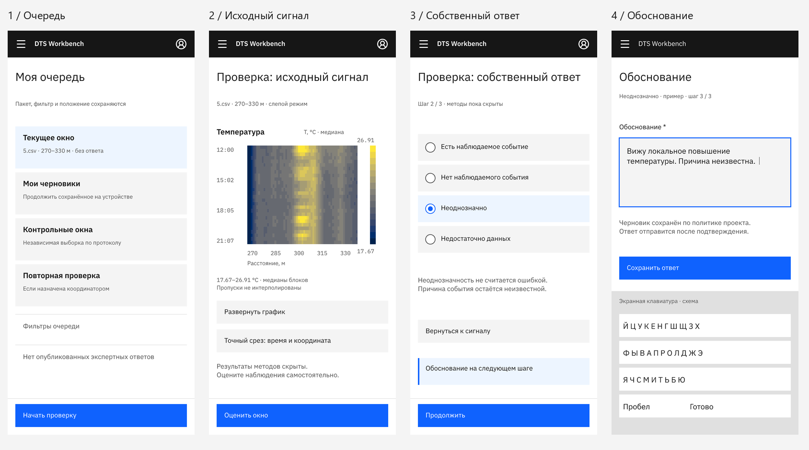
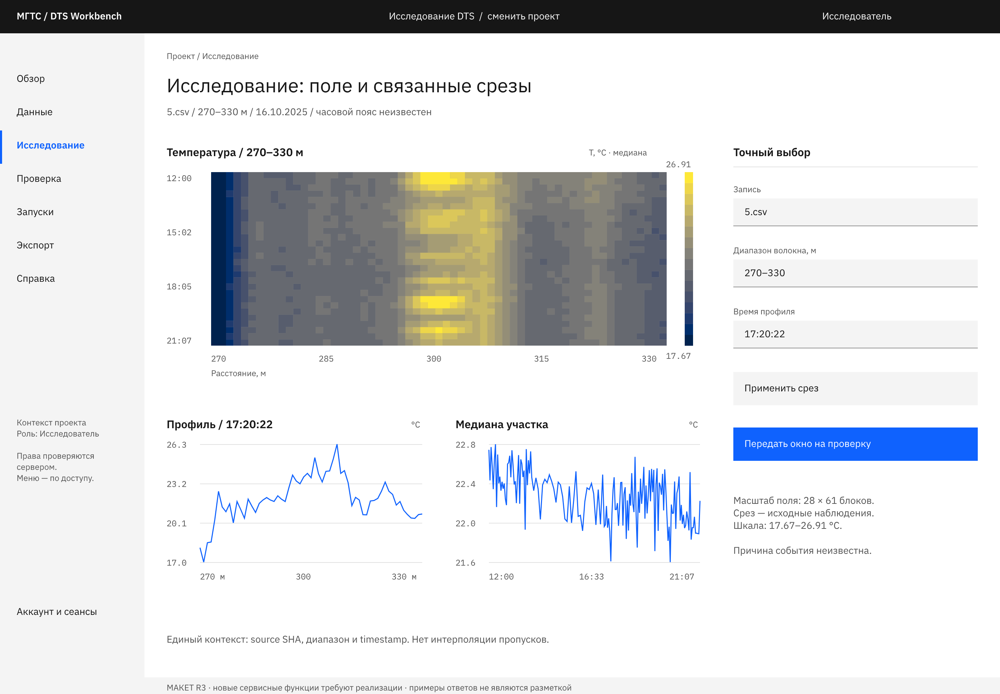
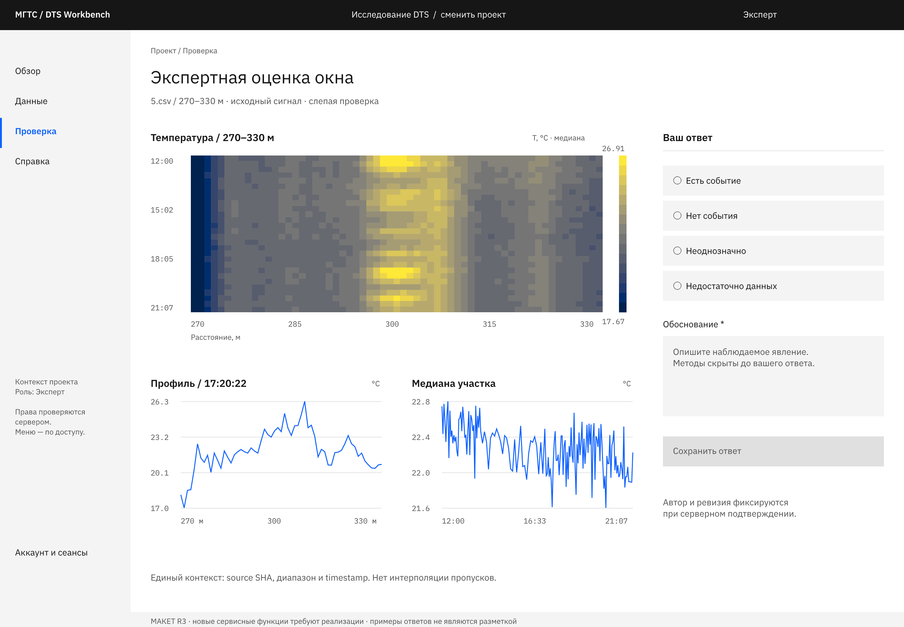
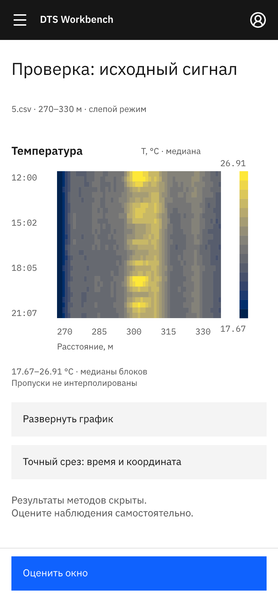
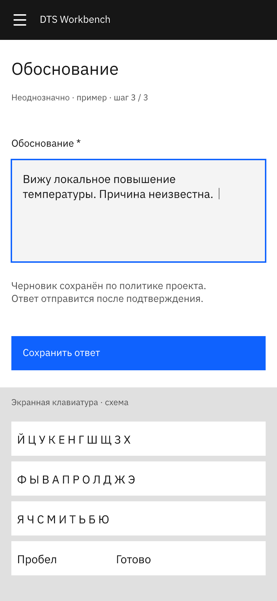

> **ИСТОРИЧЕСКИЙ АРХИВ.** Не источник актуального веб-дизайна и не часть обычной frontend-задачи. Читать/менять только по прямому поручению пользователя про архив. Текущая точка входа: [design/README](../../README.md). Слова «актуальный» и старые инструкции ниже относятся к прежнему этапу.

# DTS Workbench / Carbon R3

9 октября 2026. Расширение дизайна до командного продукта: вход, проекты, пять ролей, полный путь экспертной проверки, управление доступом и мобильная работа.

**53 новых редактируемых макета:** 32 настольных, 19 телефонных, альбомный график и планшет. Общий Pen также содержит 19 научных экранов R2 и 4 исходных корня Захара. R3 определяет новую оболочку и командные сценарии; R2 сохраняет подробные научные представления. Это дизайн и контракт будущей реализации, а не уже развёрнутый многопользовательский сервис.

## Быстро посмотреть и начать работу

| Что нужно | Где находится |
|---|---|
| Все новые PNG и отдельные Pen | [SCREEN_INDEX.md](SCREEN_INDEX.md) |
| Весь редактируемый проект | [pen/dts-workbench.pen](pen/dts-workbench.pen) |
| Галерея для локального открытия в браузере | [gallery.html](gallery.html) |
| Права, переходы и связь с существующим кодом | [PRODUCT_SPEC.md](PRODUCT_SPEC.md) |
| Мобильные решения и критерии приёмки | [MOBILE_UX.md](MOBILE_UX.md) |
| Проверка макетов и ограничения проверки | [QA.md](QA.md) |
| Установка Pen, MCP и работа участников | [PEN_GUIDE.md](PEN_GUIDE.md) |
| Стиль Carbon и переменные | [STYLE.md](STYLE.md), [tokens.json](tokens.json) |
| Машинный индекс и SHA PNG | [manifest.json](manifest.json) |
| Научные представления предыдущей версии | [Carbon R2](../carbon-r2/README.md) |

Скачайте репозиторий целиком, выберите ветку `web`, установите Pen по инструкции и откройте `design/carbon-r3/pen/dts-workbench.pen`. Основной проект редактируется совместно через Git: отдельные `pen/screens/` — независимые снимки, а PNG — экспорт. Ни PNG, ни отдельный Pen автоматически не обновляют общий проект.

## Для Захара

Исследование и оценка окна теперь нарисованы в той же оболочке, что доступ и назначения. Эксперт сначала видит исходный сигнал, затем выбирает `present / absent / ambiguous / unknown` и объясняет наблюдение. В слепом режиме результаты методов скрыты. Пример обоснования на макете не записан в реальную разметку.

Отдельно спроектированы контракт разметки, распределение окон, повторная проверка расхождений, сравнение ревизий и выпуск набора ответов. Администратор управляет доступом; координатор организует проверку; исследователь готовит данные и методы. Ни одна из этих ролей автоматически не публикует человеческий экспертный ответ.

Паспорт качества использует реальные характеристики `5.csv`. Графики получены из реальных измерений, а названия участников, назначения, статусы будущих запусков и примеры ответов обозначены как сценарии. Измеряем температуру DTS; физическая причина остаётся неизвестной. Не создавались новые training labels или оценки точности детектора.

## Примеры

## Что отличается на телефоне

Очередь и записи представлены читаемыми списками. Проверка разделена на сигнал, ответ и обоснование. Есть точный выбор среза без обязательного перетаскивания, разворачивание графика, работа с черновиком, конфликтом и потерей связи. Меню открывается явной кнопкой; управление доступом и экспорт имеют мобильные формы.

Новые макеты не меняют сервер и не доказывают работу на физических телефонах. В [спецификации](PRODUCT_SPEC.md) перечислены необходимые сервисы, а в [мобильном документе](MOBILE_UX.md) — проверки после реализации.

Видео в эту поставку не входит.
