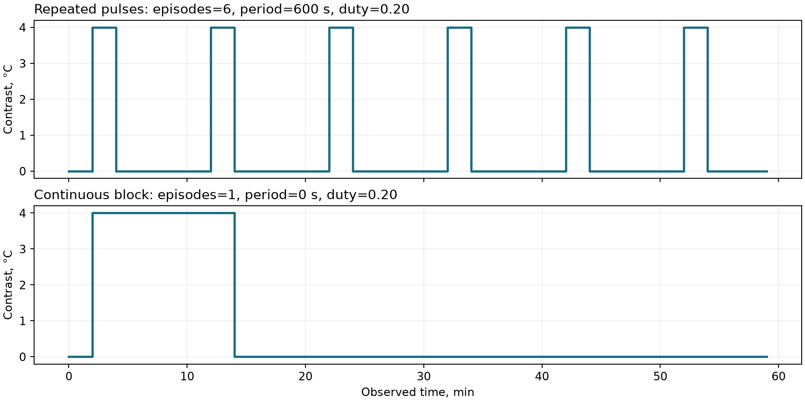
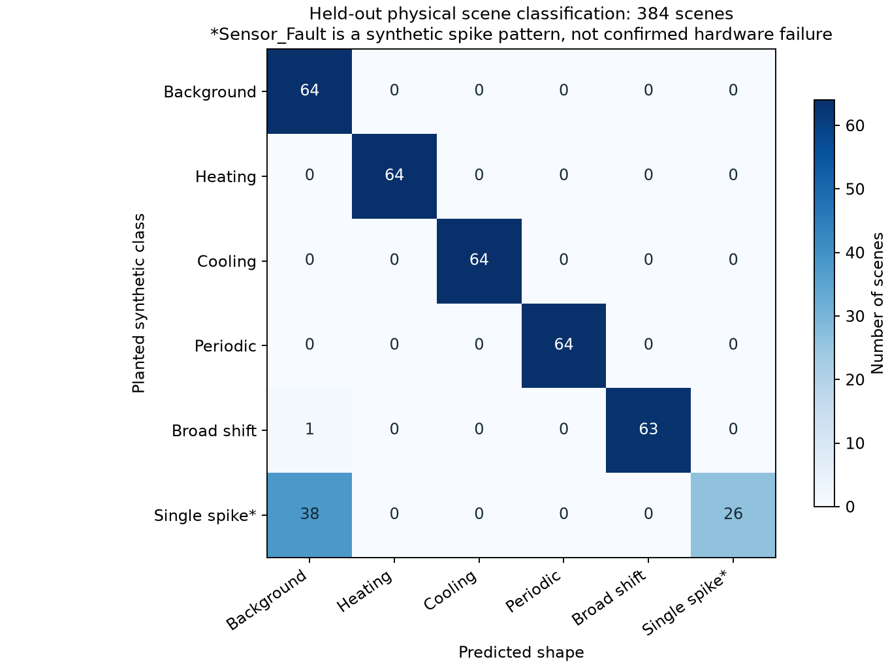

# Захару: что проверили, изменили и почему

Доработка начата от `ml` = `9e64b8b2c463e51ff277ed10fd4bd04558a34513`.
Повторные baseline-результаты взяты из замороженного снимка `f931256` —
последнего найденного push PiorlZ в предыдущем аудите. Рабочая ветка
`sol-ml-hardening` сохраняет историю и все предыдущие исследования.

## Главное

Вектор решения сохранён: **температура → маски → median_x3 → spatial_z_halo
→ зоны → гипотезы формы**. Здесь исправлен смысл отсутствующих данных,
времени, событий и оценки. Порог Z=3.5, halo 8–40 м, bin=2 м,
floor=0.30 °C не подгонялись по свидетелям. На всех шести CSV исходные
температуры, валидность, координаты, временная числовая ось, clean и Z
совпали с baseline. DSP по-прежнему проходит 8/8 development-свидетелей.

Новый обученный классификатор физической формы — **отдельный исследовательский
артефакт**. Он устраняет потерю порядка времени в признаках, но пока плохо
распознаёт одиночный выброс. Он не заменяет рабочий детектор и не включён
в HTTP-контур как источник операционных тревог.

## Исправления рабочего пути

| Было | Теперь | Почему это имеет значение |
|---|---|---|
| Пропуск координаты мог заполниться температурой следующей точки | Только точное сопоставление измеренных координат; пропуск остаётся NaN/quality=4 | Не создаём измерений, которых нет |
| `points_size` игнорировался | Несовпадение с числом пар отклоняется | Повреждённый контракт не проходит молча |
| Неизвестная зона времени получала `+00:00` | Наивное время сохраняется без зоны; metadata содержит `wall_clock_timezone_unknown` | Не приписываем измерению известный UTC |
| Не сохранялись отдельные причины невалидности | `quality_codes.npy`: valid / nonfinite / sentinel / missing coordinate | Для обучения и контроля доступны причины отсутствия температуры |
| Зоны могли объединяться через большие временные разрывы | Компоненты строятся отдельно внутри сегментов ≤300 с между профилями | Пропуск наблюдения не выдаётся за непрерывность события |
| Замыкание проходило через невалидные барьеры и съедало края | Невалидные клетки исключены после замыкания, края обрабатываются с padding | Отсутствие поддержки не становится мостом |
| Только elapsed duration | Также `observed_duration_s`, `time_segment`, numeric time bounds | Можно отличить протяжённость по часам от наблюдаемой поддержки |
| Отсутствие halo могло выглядеть как норма | `score_available.npy`, coverage и `Unknown` | Не смогли оценить ≠ подтвердили отсутствие зон |
| Event scoring удалял события первой строки | Первая строка имеет ненулевую поддержку; временные разрывы разделяют события | Пропущенное раннее событие учитывается |
| median k=5 мог использовать значения через невалидную точку | Фильтрация независимых валидных островов | Большой kernel не соединяет разные участки |
| Границы свидетелей были неоднозначны | Строки `[start, stop)`, метры включительно, схема явно в JSON | Сопоставимые counts между ветками |
| В API был только денойз | `/detect/field` использует общий `fiber/pipeline.py` | Потребителю доступны зоны, качество оценки и provenance |

`Record.save` также перестал deep-copy всех массивов через `asdict` только
ради записи небольших метаданных. Это снижает пиковую память на длинных трассах.
Halo-медиана вычисляется блоками независимых строк: временный массив окна
ограничен примерно двумя миллионами чисел вместо полного массива >1 ГБ
на `5.csv`. Это не меняет сам фон или Z; полная сверка проверяет равенство.

Текущая опорная обработка **offline batch**. Пространственный Z одной строки
не требует будущих строк, однако сборка полных зон и анализ повторений по
переданной истории не являются доказанным потоковым алертом без задержки.

### Повторная проверка реальных данных

| CSV | Зон baseline | Зон после доработки | Зон через разрыв >300 с | Доступность Z на валидных температурах |
|---|---:|---:|---:|---:|
| 1 | 23 | 23 | 0 | 100% |
| 2 | 13 | 19 | 0 | 100% |
| 3 | 5 | 5 | 0 | 100% |
| 4 | 7 | 8 | 0 | 100% |
| 5 | 132 | 134 | 0 | 100% |
| 6 | 24 | 43 | 0 | 100% |

Количество зон изменилось из-за разделения временных разрывов, запрета
невалидных мостов и сохранения событий на краях. Увеличение числа зон
само по себе не повышение точности: экспертной истины по всем событиям нет.
Ранее 16 зон охватывали разрывы >300 с. Теперь таких зон нет.

Длительность наблюдаемой поддержки использует midpoint cells: каждому
отсчёту соответствует интервал до середин соседних отсчётов; на концах
экстраполируется половина локального шага. Большие пропуски заменяются
обычным локальным шагом и не увеличивают поддержку. Для одиночного
отсчёта в метрике принимается единичная поддержка; это конвенция оценки,
а не измеренная физическая длительность. `duration_s` остаётся разностью
крайних временных координат для совместимости.

`Normal` означает отсутствие зон данного метода при доступной оценке всех
валидных температур. Это не сертификат отсутствия любой физической опасности:
ширины <3 м и эпизоды короче ворот шести профилей могут не попасть в зоны.
При отсутствии температуры/фона статус `Unknown`. Если событие найдено при
неполной оценке, статус `Anomaly`, а assessment остаётся `partial`.

## Почему появилась отдельная версия признаков

Пять старых context-признаков инвариантны к перестановке строк температуры
и маски внутри окна. В них нет информации о последовательности повторений.
Логистика и LightGBM не могут восстановить информацию, которую им не передали.
Кроме того, 28×40 отсчётов на данных кейса означает 4–39 м и 4.5–54 минуты.

`fiber/classify/physical.py` определяет версию `physical_shape_v1`: пики в °C,
RMS, пространственную ширину в метрах, доли горячей/холодной поддержки,
число эпизодов, максимальную наблюдаемую длительность, период в секундах,
CV интервалов, пространственную ступень и покрытие. Разрывы времени и
невалидные строки не создают доказательств периода. Пространственный
общий фон вычитается отдельно для каждой строки.



На рисунке одинаковая амплитуда и доля активного времени, но 6 импульсов
отличаются от одного блока: число эпизодов 6/1, оценённый период 600/0 с.
Та же проверка проходит при cadence 10/30/60/120 с и spacing 0.1/0.25/1 м
для этой полностью наблюдаемой конструкции. Это узкая проверка контракта
признаков, а не гарантия переноса на любой тепловой процесс.

### Что действительно обучено и измерено

`scripts/benchmark_physical.py` обучает softmax-логистику на 384 синтетических
сценах: 64 seed × 6 классов. Validation — 192 сцены из seeds 10000–10031.
Test — 384 сцены из seeds 20000–20063. Сцены имеют реальные оси метров и секунд;
стресс-набор меняет cadence и spacing. Генератор добавляет шум, уклон трассы,
общий температурный дрейф, разные амплитуды, позиции и ширины событий.

Выбор threshold делается только по validation, при заранее заданном
эмпирическом бюджете ложных фоновых сцен ≤5%. Test создаётся после выбора.
Выбран threshold=0, то есть дополнительная отсечка уверенности здесь не
улучшила validation-критерий. `selection_under_budget` доступен отдельно
для явного выбора исследовательских моделей по recall/FAR; старая политика
`choose_better` сохранена для воспроизводимости исторических экспериментов.

| Метрика | Validation | Test |
|---|---:|---:|
| Правильный класс сцены | 89.58% | 89.84% |
| Recall правильного класса среди 5 foreground-классов | 87.50% | 87.81% |
| Фон ошибочно назван событием | 0/32 | 0/64 |
| Local_Heating / Local_Cooling / Periodic_Thermal recall | 100% / 100% / 100% | 100% / 100% / 100% |
| Broad_Shift recall | 100% | 98.44% |
| Sensor_Fault recall | 37.50% | 40.63% |



Одиночный спайк часто проигрывает обычному шуму при выборе колонки по
средней энергии за длинную историю. Это объяснение по устройству признаков,
не отдельный доказанный причинный эксперимент. Текущий артефакт оставлен
как исследовательский результат; после просмотра test он не дообучался
для исправления этой ошибки. Следующая версия должна иметь новый удержанный
набор и признаки локального выброса без усреднения всей истории.

**Нельзя сравнивать эти 89.84% с 20/20 старого сканера как единую метрику.**
Здесь задача — имя полной синтетической сцены. Это не sliding-window поиск,
не event IoU и не реальная точность на кабеле. Ноль ошибок на 64 фоновых
сценах не означает нулевую вероятность ложной тревоги на новых данных.
Softmax scores не калиброваны как вероятность физического события.

Веса созданы локально в `artifacts/hardening/physical/physical_model.json`.
Согласно `TEAM_GUIDE.md` веса и датасеты не добавляются в Git; в репозитории
есть код воспроизведения, результаты и SHA весов. Загрузчик проверяет
версию признаков, порядок классов, форму матриц и research provenance.
Старые context-веса не совместимы с новым представлением и не подменены.
Исходные GPU-checkpoints прошлых экспериментов отсутствуют; их сравнительные
скоры здесь не заявлены как независимо перепроверенные.

## Что подготовлено для человеческой разметки

`scripts/prepare_annotation_queue.py` готовит **268 записей**: все 232 зоны
и 36 случайных окон. У каждого есть source SHA, координаты и полуоткрытые
интервалы строк. Нет ни одной придуманной экспертной метки.

- `proposals.jsonl` содержит происхождение и предложенную форму.
- `blind_review.jsonl` скрывает предложение, источник выбора и исходный ID;
  записи перемешаны, ID анонимизированы, связь для последующего сравнения сохранена.
- `manifest.json` фиксирует seed и отсутствие экспертной истины.

Порядок разметки и требования к независимой оценке:
[ANNOTATION_PROTOCOL.md](ANNOTATION_PROTOCOL.md). Существующие CSV уже
просматривались; для настоящей проверки переноса нужны новые измерения.

## Где находится реализация

| Файл | Назначение |
|---|---|
| `fiber/io.py`, `fiber/quality.py` | Загрузка, исходная сетка и причины качества |
| `fiber/grid.py` | Временные сегменты и физическая поддержка отсчётов |
| `fiber/anomaly/detect.py`, `zones.py` | Пространственный Z, доступность и зоны |
| `fiber/pipeline.py` | Общий offline CPU-путь и manifest конфигурации |
| `fiber/api.py` | HTTP денойз и анализ ограниченного поля |
| `fiber/classify/physical.py` | Версионные признаки, research inference и бюджет выбора |
| `scripts/benchmark_physical.py` | Воспроизводимое обучение и отделённая оценка |
| `scripts/verify_hardening.py` | Полная сверка before/after шести файлов |
| `scripts/prepare_annotation_queue.py` | Материал для разметчика |
| `docs/evidence/` | Небольшие переносимые результаты и manifest весов |
| `artifacts/hardening/` | Локальные логи, подробные отчёты и очередь разметки |

### Как повторить

Python ≥3.11, из корня репозитория:

```bash
python -m venv .venv
# Windows: .venv\Scripts\activate ; Linux: source .venv/bin/activate
python -m pip install -e ".[api,dev]"
python scripts/transform_csv.py --raw-root /path/to/six_csv --out-root artifacts/records
python scripts/denoise_records.py --methods median_x3
python scripts/detect_anomalies.py
python scripts/benchmark_models.py
python scripts/benchmark_physical.py
python scripts/prepare_annotation_queue.py
python -m pytest tests -ra
python -m uvicorn fiber.api:app --host 127.0.0.1 --port 8082
```

Для сравнения с прошлой версией нужен её воспроизведённый архив, где есть
`artifacts/records`, `artifacts/denoise` и `artifacts/anomaly`:

```bash
python scripts/verify_hardening.py --before /path/to/reproduced_f931256
python scripts/plot_hardening.py
```

API `/detect/field` принимает `raw[T][X]` (null = нет температуры),
`distances[X]` и строго возрастающий `time_s[T]`. Числовая ось времени
не объявляется UTC. Ответ содержит зоны, гипотезы формы, coverage и manifest;
плотные поля не возвращаются. Лимит — 1 000 000 клеток; большие файлы
обрабатываются офлайн. Ошибочные оси/формы дают HTTP 422, превышение лимита 413.
Также ограничена внутренняя halo-сетка: API ≤4 млн time×bins и ≤200 км
пространственного span; это вычислительный бюджет, не описание объектов кейса.
Офлайн-функция ограничивает сетку 100 тысячами bins и 25 млн time×bins;
при превышении требуется обработка ограниченных временных сегментов.
Это вычислительный API для интеграции, не завершённый интерфейс продукта.

## Что ещё должен решить ML-специалист

1. Независимая разметка и финальный протокол с ценой ложной тревоги/пропуска.
2. Реальный бюджет ложных событий на кабель-сутки; 5% фоновых synthetic-сцен
   здесь — исследовательский gate, а не согласованный продуктовый SLA.
3. Разделение одиночного измерительного выброса и настоящего узкого нагрева.
4. Стабильность фоновой модели при широких очагах, границах помещений и
   систематических температурных профилях. Halo baseline не универсален.
5. Проверка переноса на новых объектах/периодах и причинная/потоковая версия,
   если продукт должен выдавать алерты в реальном времени.
6. Калибровка вероятностей и модель с правом abstain на неизвестных режимах.

Теория Noise2Self требует структуры независимости шума между скрываемыми
наблюдениями; без проверки этой предпосылки на DTS название метода не
доказывает качество очистки. См. [Batson & Royer, ICML 2019](https://proceedings.mlr.press/v97/batson19a.html).
Отдельный validation для выбора порога соответствует
[документации scikit-learn](https://scikit-learn.org/stable/modules/classification_threshold.html).

Эти ограничения сохранены явно, чтобы новые наработки были полезны Захару
и не создавали видимость промышленной точности без соответствующих данных.
