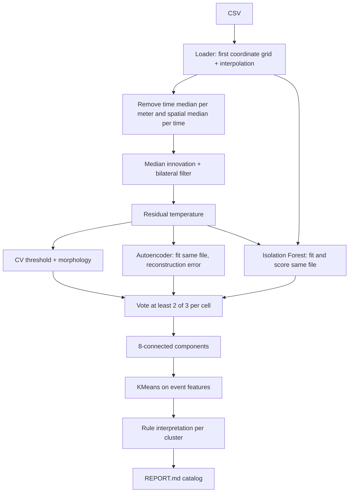
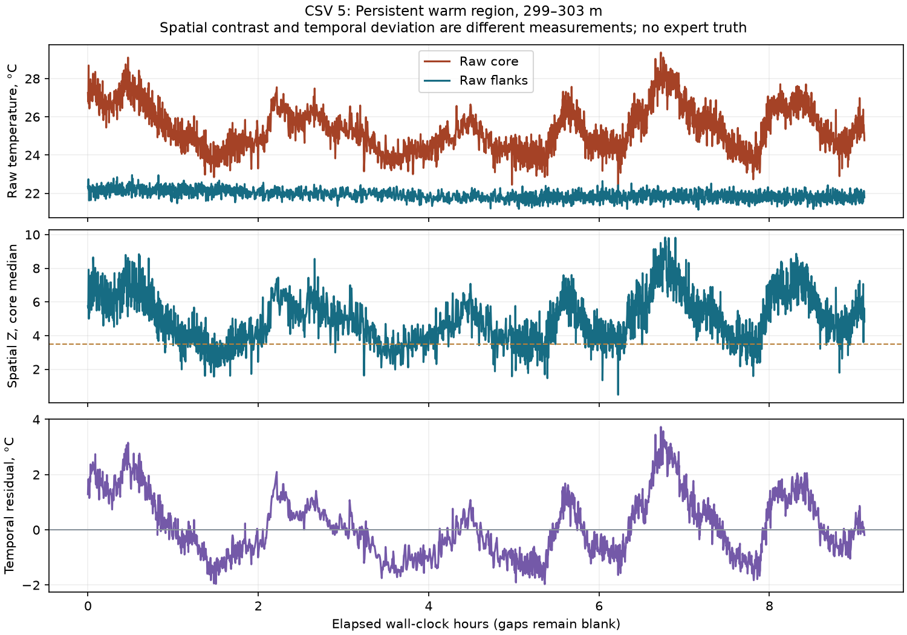
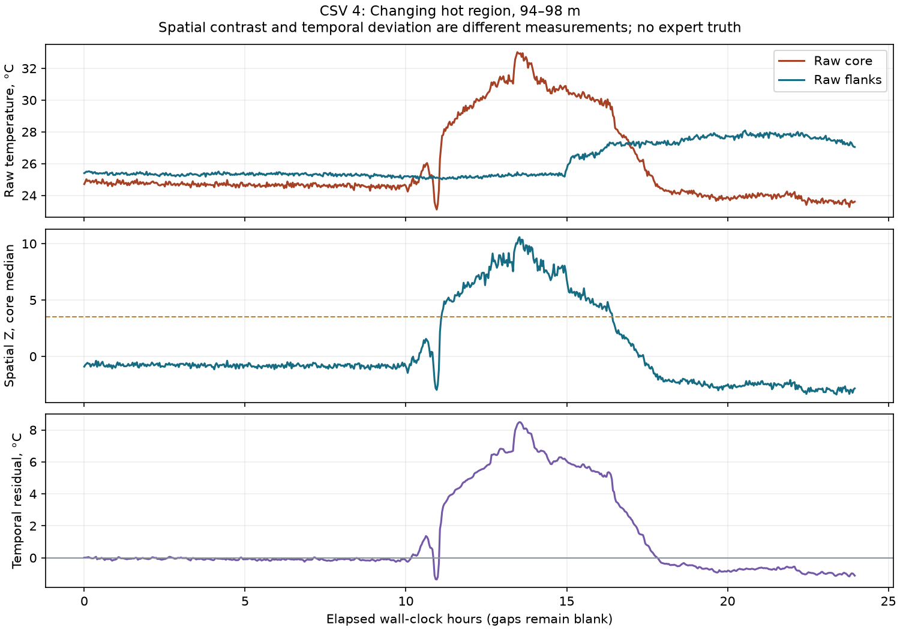
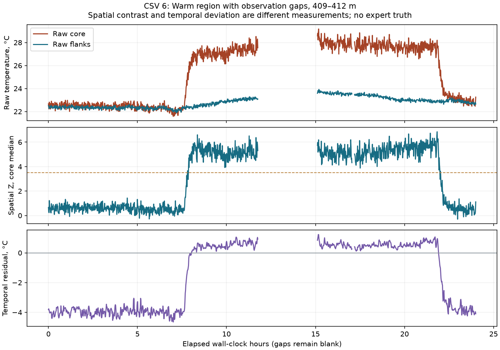

# Захару: независимый аудит PiorlZ/ml-test

Проверяется [репозиторий](https://github.com/PiorlZ/ml-test), ветка `ml-test`,
замороженный commit `33e12ac19b7b6318dc48b5f3e8c1239aaaf9244e`.
Это отдельный репозиторий, не ветка внутри `werd0y45/haklolarp`.
Исходники и REPORT не исправлялись при проверке.

## Решение

**Идея пригодна для второго исследовательского пути: искать изменения
относительно истории конкретного участка. Текущую реализацию нельзя
сразу назначать источником производственных типов происшествий.**
Различия с нашим DSP существенны по смыслу задачи, качеству данных, времени
и интерпретации результатов. Прямое голосование двух пайплайнов пока не обосновано.

Здесь обучение действительно происходит на реальных CSV без ручных меток.
Это полезное направление. Но модель, обучившаяся на реальных температурах,
не получает автоматически знания о неисправностях или истинных событиях.
Код решает ретроспективное обнаружение необычных паттернов; независимая
реальная точность не измерена ни здесь, ни у нашей новой исследовательской модели.

## Что именно реализовано



CatBoost в штатном `run_ensemble` не обучается: аргумент `pseudo_labels`
не передаётся. Он есть как опциональная ветка и проверяется тестами.
Названия типов после ансамбля выдаёт KMeans + правила, а не обученный
на экспертных событиях CatBoost-классификатор.

Ключевые места в замороженных исходниках:

| Что проверять | Исходник |
|---|---|
| Loader и порядок ансамбля | [main.py](https://github.com/PiorlZ/ml-test/blob/33e12ac19b7b6318dc48b5f3e8c1239aaaf9244e/main.py) |
| Удаление исторического профиля и порог CV | [detector_cv.py](https://github.com/PiorlZ/ml-test/blob/33e12ac19b7b6318dc48b5f3e8c1239aaaf9244e/src/detector_cv.py) |
| Постоянный декодер, обучение, threshold | [detector_cnn.py](https://github.com/PiorlZ/ml-test/blob/33e12ac19b7b6318dc48b5f3e8c1239aaaf9244e/src/detector_cnn.py) |
| Признаки и Isolation Forest | [detector_ml.py](https://github.com/PiorlZ/ml-test/blob/33e12ac19b7b6318dc48b5f3e8c1239aaaf9244e/src/detector_ml.py) |
| Связность, повторения, назначение типа кластеру | [stage2_clustering.py](https://github.com/PiorlZ/ml-test/blob/33e12ac19b7b6318dc48b5f3e8c1239aaaf9244e/src/stage2_clustering.py) |

## Сравнение смысла двух путей

| Вопрос | Рабочий haklolarp: median_x3 + spatial_z_halo | PiorlZ/ml-test |
|---|---|---|
| Что считается необычным | Контраст участка с пространственным окружением в текущем профиле | Отклонение от временного профиля каждой координаты и общего пространственного фона |
| Постоянно тёплый локальный участок | Может сохраняться как контраст | Постоянная составляющая вычитается |
| Общий температурный дрейф | Пространственный фон подавляет часть дрейфа | Перестановка medians вычитает общий дрейф и стационарный профиль |
| Исходные пропуски | Маска качества, отдельные причины, неизвестность | Интерполяция/краевое продолжение до первой сетки; числовой sentinel не исключён |
| Время событий | Физическая ось, сегменты, отдельное observed duration | Компоненты и фильтры работают на соседних индексах; elapsed duration через разрывы |
| Тип результата | Зона и явно неподтверждённая гипотеза формы | Физически звучащий incident_type для всего кластера |
| Обучение при анализе файла | Рабочий DSP без обучения | CNN и Isolation Forest учатся заново на анализируемом файле |
| Потоковая применимость | Пространственный score одной строки не требует будущего; зоны offline | Временная медиана всей истории, центрированные окна и обучение всей истории |
| Независимая real precision/recall | Пока отсутствует | В REPORT отсутствует |

Первый путь может видеть постоянный локальный нагрев, второй — новое
отклонение от исторического состояния. Это потенциальное дополнение.
Если требовать согласия обоих, можно потерять именно постоянно тёплый участок.
Если просто объединить все тревоги, можно увеличить ложные срабатывания.
Нужно проверять цену обоих решений на независимых событиях.

Ансамбль не является чистым temporal-only detector: два признака Isolation
Forest — градиенты исходной температуры. Они сохраняют некоторые границы
постоянного профиля. Поэтому обнуление постоянного участка в CV residual
не доказывает, что все три ветки и итоговая маска будут пустыми. Здесь
сравнивается прежде всего точка отсчёта основного residual; окончательное
поведение ансамбля проверяется отдельно по branch masks.

На реальном CSV 5 участок 299–303 м почти всю запись теплее флангов.
Пространственный Z сохраняет это свидетельство. Temporal residual меняет
знак вокруг собственного исторического уровня участка: отрицательное
отклонение здесь не означает, что участок стал холоднее окружения.



Для изменяющегося нагрева в CSV 4 оба представления дают сильный сигнал:



Графики сохраняют реальные интервалы времени и разрывы; это пояснение
различий представлений, а не экспертная разметка физической причины.

В CSV 6 на 409–412 м длительное тёплое состояние занимает большую часть
записи. Историческая медиана сближается с ним: раннее состояние получает
сильное отрицательное отклонение, а тёплый участок — небольшое положительное.
Так работает выбранная точка отсчёта. Нельзя автоматически переводить знак
этого residual в физическую причину «охлаждение помещения» или «нагрев кабеля».



## Проверка 17-МБ Markdown

Git-версия файла занимает 17 099 729 байт; Windows checkout с CRLF —
17 181 811 байт. Оба SHA сохранены в evidence. Прочитаны и разобраны **все 81 970 строк
каталога**, а не несколько начальных страниц. Он содержит описание голосования,
размеры полей, число активных клеток, SHA масок, ссылки на картинки и таблицы.
В нём нет отдельного текстового научного ревью, экспертных меток, внешнего
test, цены ложных тревог или сравнения с baseline.

| CSV | Строк каталога | Активные клетки consensus | Строк с duration=0 | Строк с width=0 | Bbox события через gap >300 с |
|---|---:|---:|---:|---:|---:|
| 1 | 5 598 | 384 521 | 3 228 | 3 129 | 0 |
| 2 | 2 139 | 64 866 | 1 005 | 1 116 | 14 |
| 3 | 2 617 | 139 458 | 1 387 | 1 492 | 30 |
| 4 | 674 | 57 783 | 395 | 415 | 0 |
| 5 | 56 652 | 207 229 | 29 940 | 29 322 | 0 |
| 6 | 14 290 | 124 980 | 8 102 | 8 350 | 45 |

**Все 81 970 строк имеют один тип: «Кратковременная/периодическая аномалия».**
При наличии четырёх типов и четырёх KMeans-групп это схлопывание смысловой
интерпретации, а не доказательство реальной классификации. Не утверждаю,
что 100% строк физически ошибочны: экспертной истины нет. Но REPORT не
доказывает способность различать нагрев/охлаждение/шум/периодику.

44 057 строк имеют нулевую elapsed duration; 43 824 — нулевую width.
Одно измерение действительно имеет нулевое расстояние между крайними
координатами. Это не само по себе вычислительная ошибка. Но массовая
фрагментация требует агрегации и observed support, иначе пользователь
получает десятки тысяч мелких фрагментов вместо полезных инцидентов.
Нельзя считать число строк числом независимых настоящих происшествий.

89 bbox объединяют отсчёты через >300 с отсутствия измерений. В третьем
файле один из интервалов проходит через gap 77 073 с (больше 21 часа).
Все текстовые границы времени сопоставились с реальными timestamp источника:
это реальный численный каталог, но непрерывность события не доказана.

Оценка предыдущего агента: **он собрал работающий интеграционный прототип
и сохранил детальный выход, но не проверил научную достоверность интерпретации
на этих шести CSV.** Размер отчёта и успешные синтетические тесты не заменяют
такую проверку. Отдельного диалога с оценкой модели в этом репозитории нет;
вердикт относится к коду и опубликованному артефакту.

## Существенные проблемы, подтверждённые отдельно

### 1. Потеря качества исходных данных

`load_mgts_csv` интерполирует последующие строки на сетку первой строки.
Если край ряда отсутствует, `np.interp` продолжает крайнее значение.
В реальных файлах так заполнены 852 отсутствующие клетки в CSV 2,
645 в CSV 4 и 108 в CSV 6: **1 605 отсутствующих измерений представлены
как числовые температуры**, без сохранённой маски восстановления.
Наблюдаемые температуры после приведения к native float32 и координаты
совпали с нашим ingestion на всех шести файлах. Ошибка относится именно
к отсутствующим измерениям, а не к другим исходным CSV.

В CSV 5 числовыми входами остаются 1 829 925 sentinel-клеток `−300` —
около 28.6% матрицы этого файла. Постоянная область с sentinel может
затем вычесться временной медианой; это не
эквивалент корректной маске отсутствия наблюдений. Она влияет на фон,
границы, локальные статистики и распределение признаков.

В полном повторном ансамбле CSV 4 **233 несуществующие клетки попали
в consensus**. Это уже наблюдённый дефект маски, а не только опасение по коду.
Во всех шести повторных запусках таких клеток **599**: 353 в CSV 2,
233 в CSV 4 и 13 в CSV 6. В CSV 5 Isolation Forest отметил 18 554
sentinel-клетки, но CV/CNN их не поддержали и consensus их исключил.
Голосование иногда подавляет этот дефект, однако общей гарантии качества
оно не даёт.
CV отдельно включил 19 отсутствующих клеток CSV 2 и 4 клетки CSV 4.
Контрпример также подтвердил, что loader принимает разные устройства/каналы
в одном массиве. Его нельзя использовать как общий ingestion production API.

### 2. Реальная модель CNN ограничена постоянным декодером

После `AdaptiveAvgPool2d((1,1))` код растягивает четыре числа по всему окну
через nearest interpolation. Дальше идут свёртки с replicate padding.
Пространственно постоянный вход остаётся постоянным: **в каждом патче
реконструкция одна и та же во всех клетках**.

Это проверено с ненулевыми произвольными весами, а не только с нулевой
инициализацией последнего слоя: размах выхода трёх разных окон = 0/0/0.
Никакая длительность обучения не даст этому декодеру восстановление
разных температур внутри одного окна. Это свойство архитектуры.

Как обучаемый локальный фон такой механизм возможен; утверждение о
восстановлении сложной геометрии было бы неверным. Для оправдания обучения
его надо сравнить с простым постоянным фоном каждого окна.

На реальном CSV 4 сравнение с **необученной медианой каждого того же патча**:
корреляция error-score 0.962; Jaccard бинарных масок 0.867; Jaccard итогового
consensus при замене CNN-ветки 0.944. Средняя ошибка реконструкции 0.159°C
у patch median против 0.163°C у CNN. Это не precision событий, но польза
дорогого обучения пока не доказана относительно простого baseline.
Медиана по определению минимизирует L1-ошибку постоянной реконструкции
патча; CNN обучается с Huber loss. Поэтому меньшая средняя абсолютная
ошибка baseline не доказывает лучший поиск событий. Нужна проверка
обнаружения нужных случаев и ложных тревог, а не соревнование train loss.
[Семантика pooling в PyTorch](https://docs.pytorch.org/docs/stable/generated/torch.nn.AdaptiveAvgPool2d.html).

При полностью нулевой карте ошибки threshold=0 и сравнение `score >= 0`
даёт 100% активную CNN-маску. Consensus на ровном поле может остаться пустым,
но одна ветка уже голосует за аномалию везде. Этот крайний случай надо исправить.

### 3. Показатель повторений не доказывает период

`_column_periodicity` считает число отдельных runs, умноженное на долю
пропусков между ними. Два случайных раздельных выброса дают положительное
значение. Регулярность интервалов, секунды и gap наблюдения не используются.

Кроме того, `_component_record` берёт показатель **по всей истории каждой
затронутой колонки**, не только по рассматриваемому событию. В контрпримере
одно и то же раннее 27-минутное событие изменило тип «нагрев» на «периодическое»
после добавления поздних отдельных runs. Исходное раннее событие не изменилось.
Три нерегулярных bursts также получили положительную «periodicity».

Далее положительная медиана этого признака у кластера имеет приоритет
над знаком температуры и длительностью. Таким образом повторяющиеся
мелкие включения координаты распространяют periodic-тип на весь кластер.
Механизм соответствует однообразию опубликованного REPORT.
Дополнительно пересчитаны median periodicity для **всех 24 кластеров**
из таблиц REPORT: у каждого она положительна (примерно от 4.83 до 138.11).
Следовательно, первый `if periodicity > 0` действительно назначает всем
этим кластерам один тип ещё до проверки знака и длительности.

### 4. Физическое время и пространственный масштаб

Связность событий, morphology, фильтры и CNN задаются индексами. Окно
32×32 означает по данным этих файлов около 3.15–31 м по пространству
и 5.2–62 минут типичного elapsed time. Через большие gaps смысл ещё меняется.
Поля `dT_dt`/`dT_dx` вычислены через `np.gradient` без осей: это °C на индекс,
а не °C/с или °C/м. Per-file fitting не делает геометрию сопоставимой.

Контрпример с соседними индексами, разделёнными 20 часами, дал одну компоненту
с duration=1200 минут. Relative numeric axis `[0, 60]`, если считать её секундами,
дала 60 минут вместо одной: `_parse_timestamps` угадывает единицы по величине.
Текущие шесть файлов имеют строки времени и этим последним дефектом напрямую
не затронуты; наша сохранённая абсолютная ось `time_s` тоже не имеет величин
`[0, 60]`. Дефект важен при переходе адаптера к относительным секундам:
единицу времени следует передавать явно, а не угадывать.

### 5. Глобальный порог зависит от самого сильного события

CV использует `floor = max(3 * robust_MAD, 0.2 * peak)` отдельно по знаку
на всём поле. Контрпример: локальный блок 2°C имел 32 активные клетки;
после добавления далёкого блока 30°C те же клетки перестали обнаруживаться.
Локальное измерение не изменилось, но порог вырос до 6°C.
Для поиска слабого события рядом с сильным нужен локальный или независимо
калиброванный порог; текущее правило не задаёт стабильную чувствительность.

### 6. Голосование и обучение на анализируемом файле

CV и CNN используют один residual, большая часть признаков Isolation Forest
также построена из него. Два голоса не являются двумя независимыми
подтверждениями физического события. И ошибки общего preprocessing голосование
не исправляет: пример 233 отсутствующих клеток CSV 4 это показывает.

Isolation Forest на самом анализируемом файле — допустимый *outlier detection*
для ретроспективного исследования. Это не автоматически «утечка, делающая всё
бессмысленным». Но это также не независимая проверка *novelty detection*
на будущем файле и не frozen-модель, пригодность которой уже доказана.
[Различие задач в scikit-learn](https://scikit-learn.org/stable/modules/outlier_detection.html).

В текущем пути нет held-out real truth, независимой калибровки бюджета тревог,
сохранения исходных моделей и runtime-манифеста. В нашем аудите веса и версии
сохранены отдельно; это веса нового повторного CPU-прогона, не исходные веса Захара.

## Что проверили запуском

Штатные тесты репозитория: **21 passed**. Это проверка механики и подобранных
искусственных сцен. Она не оценивает real precision и не выявила описанные
ошибки качества данных/классификации. Для временных pytest-файлов использован
каталог аудита; source checkout остался чистым.

Loader и CV повторно выполнены на **всех шести исходных CSV**. Таблицы
наблюдаемых температур, координат и времени сверены с native artifacts.
Полный ансамбль повторно выполнен на **всех шести CSV** с записью масок всех веток,
версий, SHA, CNN-весов и сравнения с восемью development-свидетелями.
Результаты полного прогона находятся в [машинном отчёте](evidence/ml_test_reproduction.json).
Это не новая экспертная разметка и не оценка переноса на новый объект.
Повторный каталог содержит **82 306 компонент**, все с тем же объединённым
типом. Каждые из шести сохранённых CNN-весов повторно загружены через
`weights_only=True`; вся соответствующая карта error-score воспроизведена
побитово точно, без повторного обучения.

<!-- BEGIN VERIFIED REPRODUCTION -->

Полный ансамбль выполнен на **6/6 CSV**.

| CSV | Consensus в REPORT | Consensus повторно | Компонент повторно | На отсутствующих измерениях | Время CPU, с | Jaccard consensus при замене CNN медианой |
|---|---:|---:|---:|---:|---:|---:|
| 1 | 384 521 | 383 908 | 5 526 | 0 | 1627.4 | 0.921 |
| 2 | 64 866 | 64 961 | 2 119 | 353 | 277.0 | 0.931 |
| 3 | 139 458 | 138 411 | 2 617 | 0 | 202.2 | 0.912 |
| 4 | 57 783 | 57 087 | 669 | 233 | 163.0 | 0.944 |
| 5 | 207 229 | 209 488 | 57 256 | 0 | 2655.5 | 0.949 |
| 6 | 124 980 | 119 642 | 14 119 | 13 | 1498.6 | 0.914 |

Jaccard — число клеток, включённых в обе маски, делённое на число клеток, включённых хотя бы в одну. Он показывает сходство, не правильность событий. Время включает fit каждой модели заново на файле; это CPU с четырьмя Torch threads в нашем окружении. Прогоны CSV 1 и 5 выполнялись параллельно; времена служат ориентиром затрат, а не нормированным performance benchmark.

| Development core | Spatial Z ≥3.5, доля valid | Consensus, доля всех клеток | Consensus с положительным residual, доля valid | Consensus с отрицательным residual, доля valid |
|---|---:|---:|---:|---:|
| 4-first-heating-core | 1.000 | 1.000 | 1.000 | 0.000 |
| 4-second-heating-core | 1.000 | 1.000 | 1.000 | 0.000 |
| 4-early-quiet-control | 0.000 | 0.000 | 0.000 | 0.000 |
| 5-early-warm-core | 0.999 | 0.824 | 0.824 | 0.000 |
| 5-late-warm-core | 1.000 | 0.775 | 0.775 | 0.000 |
| 5-dead-tail | — | 0.000 | — | — |
| 6-heating-core-1 | 0.574 | 0.179 | 0.174 | 0.005 |
| 6-heating-core-2 | 1.000 | 0.618 | 0.618 | 0.000 |

Это частичные области, выбранные агентом ранее, без подтверждения экспертом. Различаются точка отсчёта и знак score; таблица объясняет различия, а не объявляет победителя по precision/recall.

<!-- END VERIFIED REPRODUCTION -->

Исходный REPORT не содержит версий библиотек/устройства/source SHA,
поэтому расхождение повторного SHA не доказывает подделку отчёта.
На CSV 4 повторный CPU-run дал 57 087 активных клеток против 57 783
в REPORT и 669 компонент против 674. Указанную исходную маску побитово
в этом окружении не воспроизвели. Условия исходного прогона нужны для
строгой проверки воспроизводимости.

Ни одна из шести повторных consensus-масок не совпала побитово с SHA
из исходного REPORT. Семантическое схлопывание классов при этом полностью
повторилось. Контроль с необученной patch median дал Jaccard итоговых
масок **0.912–0.949** на всех шести CSV; это сходство результатов, не
доказательство равной точности происшествий. На CSV 5 сборка каталога и
голосование заняли около 15 минут сверх детекторов в нашем прогоне.

## Как использовать вторым пайплайном

Предлагаемый первый рабочий вариант — отдельный **research score изменений
относительно истории**, который отображается рядом с пространственным DSP.
Он не заменяет текущий detector и не переименовывает неподтверждённые формы
в неисправность кабеля/кондиционера.

Последовательность интеграции:

1. Подать общий `Record` с raw/valid/quality/x/time. Не выдумывать пропуски.
   Маски отсутствия сохранить до итоговых зон; при нехватке поддержки — Unknown.
   Одного `final_mask &= valid` недостаточно: обучение, статистики окна,
   нормализация и производные соседних клеток уже могли использовать
   невалидные значения. Проверять долю наблюдаемой поддержки окна, считать
   производные по валидным парам и исключать неподдержанные признаки/патчи.
   Если плотному алгоритму нужно временное числовое заполнение рабочего
   тензора, сохранить его отдельным вычислительным представлением, не
   измерением; маскировать loss и итоговый score и проверять влияние на соседей.
2. Разбить по физическому времени, не фильтровать и не кластеризовать через gaps.
   Окна и производные задавать в метрах и секундах, а не индексах.
3. Сначала сравнить temporal-median innovation + robust score, patch median,
   CV и Isolation Forest по отдельности. CNN включать только при доказанной
   дополнительной пользе на нужных реальных случаях.
4. Отделить устойчивую пространственную структуру от нового изменения.
   Историческую оценку явно назвать offline. Для streaming использовать
   только доступное прошлое и фиксировать задержку.
5. Не распространять тип кластера на каждое событие. Сохранить форму,
   неизвестную причину, наблюдаемую поддержку и отказ классификации.
   Период подтверждать несколькими повторениями и интервалами времени.
6. Сохранить все branch scores и источники согласий/конфликтов. Выбирать
   способ объединения только после оценки бюджета ложных тревог/пропусков.
7. Проверять на текущих partial cores, случайных контролях и спорных
   реальных фрагментах; затем на независимо удержанных новых измерениях.
   Совпадение с teacher не является precision. Все шесть CSV уже изучались.
8. Для передачи сохранять маленькие веса + preprocessing/feature schema,
   параметры fit/threshold, source SHA и версии. Самостоятельный `state_dict`
   без нормализации/контракта не является полноценным воспроизводимым артефактом.
9. После фиксации корректного результата профилировать исполнение.
   `_component_record` заново сканирует всю label-матрицу для каждой
   компоненты: стоимость O(число компонент × число клеток). Статистику
   компонент можно собирать одним проходом, а историю повторений координат
   вычислять один раз. В ML локальные окна сейчас считаются Python-циклом
   для каждой клетки. Оптимизацию проверять на неизменность результата,
   отдельно от изменения смысла детектора.

Ограничения нашего пути тоже сохраняются: он может пропускать узкие очаги
ниже минимальной ширины и короткие эпизоды, spatial halo может пересекать
границу помещений, а наблюдённый пространственный контраст сам по себе
не доказывает опасность. Восемь выбранных агентом partial cores — regression,
не независимый промышленный benchmark. Общий verdict не «наше уже точное»;
нужны качественные входы, подходящий смысл score и отдельная проверка обоих путей.

## Что передать Захару для следующего шага

Большой каталог из REPORT не следует превращать в очередь ручной разметки.
Уже подготовленные [реальные материалы](REAL_DATA_WORK.md) содержат 340
фрагментов с исходными измерениями и качеством, в том числе 72 окна,
выбранных независимо от текущего детектора, и короткую очередь из 24 вопросов.
Это черновой материал; слабые/агентские метки не становятся экспертными.

После исправления входов второй detector полезно запускать на этих же
координатах и показывать **расхождения**: spatial-only, temporal-only,
оба сигнала, отсутствие наблюдения. Захару тогда нужно оценивать несколько
содержательных ситуаций с контекстом, а не десятки тысяч строк. Обучение
фона на реальных данных можно продолжать без ручных типов. Подтверждение
качества событий всё равно должно опираться на отдельные реальные случаи;
неизвестную причину можно и нужно оставить неизвестной.

Для передачи создаётся `artifacts/zakhar-ml-test-audit.zip`: этот обзор,
графики, небольшие JSON, скрипты, receipts и шесть CNN `state_dict` повторного
обучения (около 25 КБ каждый). Исходные CSV и большие карты в архив не входят.
В evidence для каждого веса указаны входной residual, центр/масштаб, patch/stride,
порог, source SHA и версии. Это не исходные веса Захара и не production-модель.
Штатный Isolation Forest возвращает fitted estimator, но его веса этот аудит
не экспортировал; CatBoost в основном прогоне отсутствует.

Оба готовых архива опубликованы в [релизе для Захара](https://github.com/werd0y45/haklolarp/releases/tag/zakhar-real-data-2026-10-06).
Шесть CNN-весов доступны и [прямо в Git](../research/ml-test-review/README.md)
с отдельным манифестом нормализации, SHA, версий и области применимости.

## Где лежат доказательства и как повторить

В основной рабочей копии `artifacts/ml-test-audit/`:

- `report_audit.json`: статистика всех строк большого MD и SHA source-файлов;
- `report_gap_audit.json`: все timestamp bounds и пересечения gaps;
- `native_cv_audit.json`: сравнение шести исходных loader/CV;
- `cnn_architecture_probe.json`: свойство декодера и zero-score threshold;
- `contract_probes.json`: конкретные контрпримеры без обучения моделей;
- `external-tests.xml`: штатные 21 тест;
- `reproduced/N/`: branch masks/scores, catalog CSV, CNN state_dict и receipt;
- `reproduced/N/cnn_ablation.json`: сравнение CNN с patch median.

В Git сохраняются небольшие копии JSON в `docs/evidence/ml_test_*` и
скрипты аудита. Чужие исходники, большой REPORT, большие массивы и пакеты
зависимостей в Git не дублируются.

```bash
git clone --branch ml-test https://github.com/PiorlZ/ml-test.git ../ml-test-review
git -C ../ml-test-review checkout 33e12ac19b7b6318dc48b5f3e8c1239aaaf9244e
# Отдельное окружение аудита: numpy scipy pandas matplotlib torch
# scikit-learn catboost opencv-python-headless streamlit pytest.
python scripts/audit_ml_test_report.py
python scripts/audit_ml_test_gaps.py
python scripts/audit_ml_test_cnn.py
python scripts/audit_ml_test_contracts.py
python scripts/audit_ml_test_native.py
python scripts/reproduce_ml_test_ensemble.py --records 4 3 2 6 5 1
python scripts/ablate_ml_test_cnn.py --records 4 3 2 6 5 1
python scripts/verify_ml_test_weights.py
python scripts/summarize_ml_test_audit.py
python scripts/package_ml_test_audit.py
```

Для воспроизведения исходные шесть CSV должны находиться в родительском
каталоге; native records — в `artifacts/records`. Изолированные зависимости
аудита подключаются через PYTHONPATH. Исходный репозиторий не содержит
requirements/lockfile; версии нашего повторного прогона сохранены в receipts.

Аудит и подготовка реальных материалов включены в `haklolarp`, ветку `ml`;
историю сохраняют `sol-ml-test-review` и `sol-real-data`.
Чужой репозиторий не изменён. Внедрение второго пути остаётся отдельной
реализацией; документ даёт проверяемое основание для выбора Захаром.
