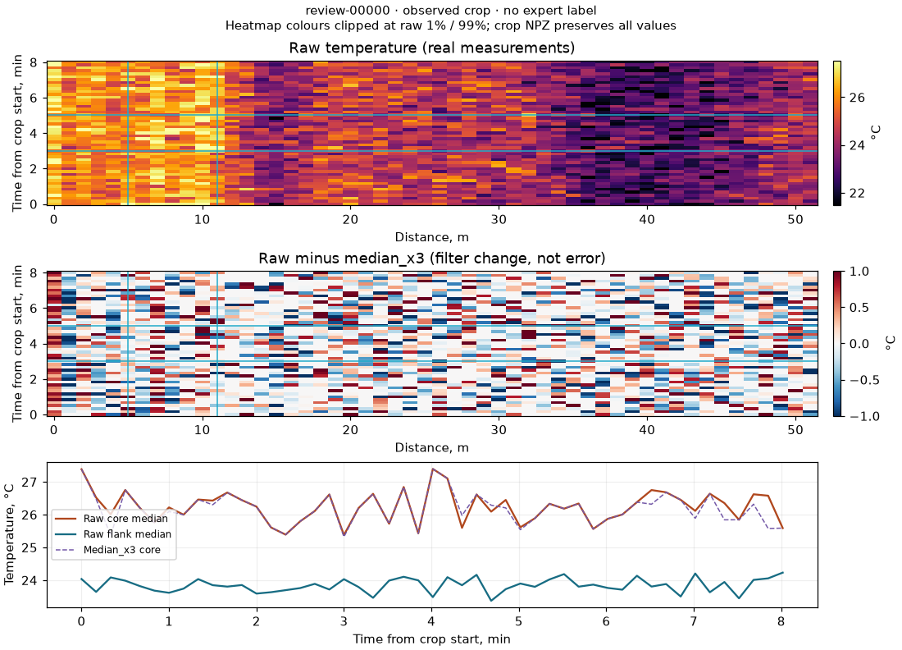
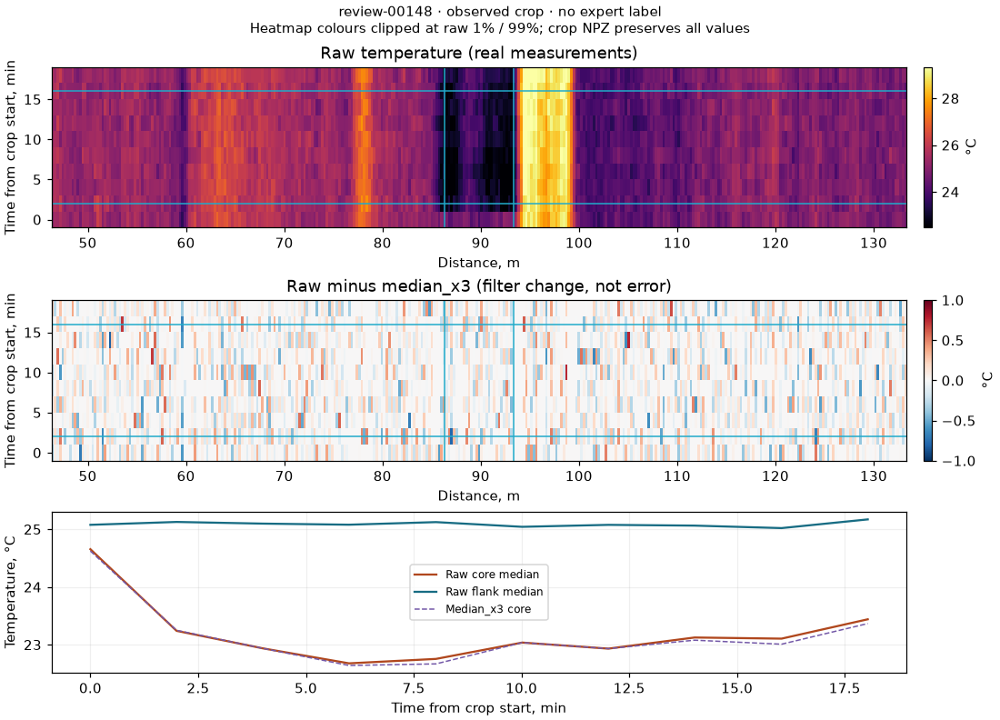

# Захару: работа на реальных измерениях, 6 октября 2026

Материалы включены в ветку `ml`; история подготовки — `sol-real-data`,
основанная на `sol-ml-hardening` после PR #22.
Рабочая DSP-обработка не заменена. Этот этап не использует синтетические
сцены для обучения или разметки. Небольшой эксперимент восстановления
обучен только на исходных измерениях и оставлен исследовательским.

## Что можно забрать и открыть

Готовый архив доступен в [релизе для Захара](https://github.com/werd0y45/haklolarp/releases/tag/zakhar-real-data-2026-10-06).
Распакуйте `zakhar-real-data-v2.zip` и откройте `real-data-v2/shortlist.html`.
Небольшие [веса ridge](../research/real-data-v2/real_masked_ridge.json) также
сохранены в Git. Результат эксперимента не одобрен для рабочего detector.

Пакет `artifacts/real-data-v2/` — переносимый каталог, где относительные ссылки
работают без сервера. Начать с **`shortlist.html`**: 24 вопроса разработки,
до четырёх на файл. Полный каталог — `index.html`, 340 карточек.
В архиве `artifacts/zakhar-real-data-v2.zip` также находятся отчёт и веса
эксперимента восстановления. Большие массивы остаются локальными артефактами;
код воспроизведения и небольшие агрегированные результаты находятся в Git.

| Материал | Где | Для чего |
|---|---|---|
| 24 примера с окружением | `shortlist.html`, `shortlist.json` | Быстро посмотреть наиболее полезные вопросы разработки |
| Все 340 карточек | `index.html`, `cards/*.png` | Исходная температура, изменение median_x3, графики core/reference/clean |
| Исходные фрагменты без потери значений | `patches/*.npz` | Обучение, проверка, собственные графики |
| Предварительные ответы правил | `weak_labels.jsonl` | Согласия, отказы и различия raw/clean; это не экспертные метки |
| Пустой шаблон ответов | `review_template.jsonl` | Записать независимый ответ, автора и объяснение |
| Вопросы о покрытии детектора | `coverage_questions.json` | 31 окно с локальным контрастом вне bbox предложенных зон |
| Аудит изменчивости и корреляций | `noise_audit.json` | Проверить предпосылки очистки, отличия файлов |
| Временное разделение | `splits/*.npy`, `splits/*.json` | Коды train/development/internal holdout/guard |
| Происхождение и сверка | `manifest.json`, `verification.json` | SHA источников, параметров, фрагментов; проверка всех массивов |

В NPZ есть `raw_c`, `median_x3_c`, `valid`, `quality_codes`, `x_m`, `time_s`,
исходные номера строк и колонок, границы ядра и split-коды. Исходные
невалидные значения не заменены выдуманными температурами: рядом находятся
маска и причины. Графики скрывают невалидные клетки; фоновые участки
не объявлены нормой заранее. `numpy.load(path, allow_pickle=False)`.

Пример карточки с устойчивым пространственным контрастом:



Пример сравнения исходной и очищенной медианы ядра:



## Как выбраны реальные примеры

232 предложения рабочего детектора + 36 прежних случайных окон +
72 независимых от детектора стратифицированных окна (две временные позиции
на шесть пространственных полос каждого файла). Последние покрывают разные
места, но не являются равномерной вероятностной выборкой всех событий.
Это не исчерпывающая разметка трасс и не выборка для точной оценки precision.

Ядро каждого примера окружено пространственным контекстом до 40 м и
временным контекстом до 180 с. Padding не пересекает внешний временной разрыв.
Внутренние разрывы сохраняются. Тепловая карта рисует отдельные временные
сегменты и не растягивает измеренную температуру через отсутствие наблюдения.
Цвет raw ограничен 1-м/99-м процентилем; численные экстремумы доступны в NPZ.

Короткая подборка сбалансирована по файлам, включает случайные контроли,
отказы правил и разные формы/масштабы. Используются фиксированные физические
группы, а не обученный кластеризатор. Это не доказанная дедупликация и не
обязательство Захара обработать все 340 примеров. Holdout туда не входит.

## Что означают предварительные метки

Правила работают по **raw**, не по Z детектора. Для каждой строки считается
медиана внутри ядра и медиана флангов на расстоянии 8–40 м от его границ.
Требуются 80% валидности ядра и хотя бы три измеренных точки флангов.
Контраст оценивается только при наличии обеих сторон сравнения.

Принятые предположения разработки: порог 1°C; устойчивое изменение минимум
три профиля и 180 с наблюдаемой поддержки; повторения минимум три раза,
CV интервалов ≤0.3 внутри непрерывно наблюдаемого сегмента. Короткий пик —
отдельная гипотеза формы. Пропуски разрывают эпизоды и доказательство периодики.
Эти пороги не калиброваны как продуктовые тревоги.

| Ответ | Количество | Смысл |
|---|---:|---|
| 1 | 211 | Правило нашло различимый локальный контраст заданного масштаба |
| 0 | 59 | Нет контраста ≥1°C с выбранными флангами при достаточном покрытии |
| Отказ (`null`) | 70 | Не выполнены условия уверенного ответа правил |
| Экспертная метка в релизе 2026-10-06 | 0 | Ни одному примеру в том архиве не приписан ответ Захара |

10 октября 2026 Захар подтвердил четыре карточки `1.csv` из короткой подборки.
Снимок релиза остаётся с пустым шаблоном. Ответы лежат в
[zakhar_shortlist_2026-10-10.jsonl](evidence/zakhar_shortlist_2026-10-10.jsonl):
`review-00034` и `review-00098` — один `Local_Heating`, `review-00187` —
несколько `Local_Heating`, `review-00223` — `Local_Cooling`. Остальные
карточки по-прежнему без ответа.

**0 не означает отсутствие любой аномалии.** Широкий нагрев, затрагивающий
ядро и фланги одновременно, может иметь нулевой локальный контраст.
**1 не означает начало неисправности.** Постоянно тёплый участок, конструкция
объекта или граница помещений могут объяснять такой ответ. `local_heating`
и `local_cooling` здесь названия гипотез формы; причина неизвестна.
Несколько форм могут сосуществовать. Вероятности достоверности не выдуманы.

31 независимо выбранное положительное окно не пересекает bbox предложения
детектора. Это **вопросы о покрытии**, а не 31 подтверждённый пропуск: методы
ищут разные масштабы и формы. В семи карточках ответ правила raw/clean
различается; это вопросы сохранения сигнала, а не семь доказанных ошибок.
Оба направления требуют просмотра исходных измерений и контекста.

## Что узнали о шуме

| Файл | Прокси изменчивости приращений, °C | Корреляция соседних пространственных residual | Корреляция соседних временных residual |
|---|---:|---:|---:|
| 1 | 0.482 | −0.488 | 0.010 |
| 2 | 0.281 | −0.452 | 0.240 |
| 3 | 0.303 | −0.437 | 0.046 |
| 4 | 0.257 | −0.421 | 0.083 |
| 5 | 0.881 | −0.530 | 0.009 |
| 6 | 0.556 | −0.502 | 0.016 |

Прокси = `median(abs(diff_time(raw) - median_space(diff_time(raw)))) /
0.67448975 / sqrt(2)`. Приращения через разрывы >300 с исключены.
Температурные изменения входят в эти числа вместе с шумом: **это не sigma
прибора**. `residual = raw - median_x3`: сам фильтр может создавать
пространственную антикорреляцию. Таблица не доказывает независимость
исходного шума и не доказывает, что вся residual-компонента вредна.

Дополнительно сохранены распределения температуры, cadence, шагов сетки,
приращений, изменённой фильтром температуры и доля изменённых валидных
измерений. По карточкам измеряются изменения контраста и пороговых runs
на одних и тех же наблюдаемых строках raw/clean. Это диагностика искажения
признаков; настоящие границы и амплитуды чистого события ещё неизвестны.

## Реальное обучение: выполненный эксперимент и отрицательный результат

`scripts/benchmark_real_reconstruction.py` обучает ridge-регрессию только
на реальных измерениях. Значение целевой точки скрыто. Предикторы —
исходные температуры примерно в −8/−4/−2/+2/+4/+8 м той же строки.
Округление идёт наружу: внутрь двухметровой слепой зоны предиктор не попадает.
Окна через невалидный пространственный участок исключаются. Будущих профилей
нет. Якоря по пространству разнесены минимум на 17 м, строки берутся через пять.

52 180 train-якорей, 13 106 development-якорей. Нормализация и веса учатся
только на train. На development выбирается alpha из заранее заданных
0.1/1/10/100. Internal holdout не используется для этого эксперимента.

| Метод | Development MSE по шумной цели, °C² | MAE по шумной цели, °C |
|---|---:|---:|
| Медиана шести внешних соседей | **1.343** | **0.802** |
| Обученный ridge, alpha=100 | 1.392 | 0.829 |
| Среднее шести соседей | 1.437 | 0.827 |
| Среднее ближайшей симметричной пары | 1.614 | 0.915 |

Ridge уступил медиане в общей оценке, а также в среднем MSE по шести файлам:
1.872 против 1.834. По отдельным файлам 3/4 он лучше медианы, по 1/2/5/6 — хуже.
**Оснований включать его в рабочую очистку нет.** Сравнивается masked
reconstruction, а не текущий median_x3, который видит центральное значение.
Эти baseline не следует путать.

Самосупервизия на реальных данных убирает зависимость от генератора сцен,
но не даёт чистую истину автоматически. Пространственно коррелированный
шум может вознаграждать восстановление шума. Маска 2 м может сглаживать
узкий реальный очаг. Сохранение событий и независимость шума не подтверждены.
Поэтому у весов `operational_approved=false` и `serve=research_offline`.
Структурная предпосылка Noise2Self описана в
[Batson & Royer, ICML 2019](https://proceedings.mlr.press/v97/batson19a.html).

## Защита от утечки и пределы оценки

Внутри каждого файла границы находятся на 60%/80% профилей. По обе стороны
границы оставлено суммарно 1800 с guard. Коды: 0 train, 1 development,
2 internal holdout, −1 guard или пересечение split внутри карточки.
Карточка получает split только если **весь контекст** принадлежит ему.
202 карточки train, 42 development, 25 internal holdout, 71 исключены.
Границы и guard остаются явными артефактами; overlap-окна не смешиваются.

Это внутренний протокол разработки. Все шесть исходных CSV уже изучались
в предыдущих исследованиях; поздний split не делает их новыми объектами.
Нужны новые измерения для внешней проверки переноса. После просмотра и
настройки по internal holdout его нельзя продолжать называть тестом.
Если следующая модель использует историю длиннее 1800 с, guard надо пересмотреть.
См. [временное разделение scikit-learn](https://scikit-learn.org/stable/modules/generated/sklearn.model_selection.TimeSeriesSplit.html).

## Воспроизведение и проверка

Из корня, Python ≥3.11, зависимости `pip install -e ".[api,dev]"`.
Нужны исходные шесть CSV и предыдущие native records/median_x3/зоны:

```bash
python scripts/transform_csv.py --raw-root /path/to/six_csv --out-root artifacts/records
python scripts/denoise_records.py --methods median_x3
python scripts/detect_anomalies.py
python scripts/prepare_annotation_queue.py
python scripts/prepare_real_data.py
python scripts/benchmark_real_reconstruction.py --out artifacts/real-reconstruction-v2
python scripts/verify_real_data.py
python scripts/summarize_real_data.py
python -m pytest tests -ra
```

Завершённые пакеты и эксперименты не перезаписываются: для новой версии
использовать новый `--out`. Верификатор поддерживает `--pack`/`--experiment`;
агрегатор этой версии намеренно фиксирует имена v2.
Все 340 фрагментов сверены с native raw/clean/valid/quality/осями/индексами;
проверены SHA и отсутствие придуманных экспертных ответов.
Тесты отдельно проверяют отказ при отсутствии флангов, временные разрывы,
guard, физическую длительность и отсутствие целевого значения в предикторах.
Полный локальный прогон: **160 passed, 1 skipped**; пропущен необязательный
LightGBM-тест из-за отсутствия пакета. Проверки текущего реального пути прошли.

## Следующий этап

1. Дать Захару готовые вопросы и показать отдельно устойчивые пространственные
   контрасты, настоящие изменения во времени и широкие общие смещения.
2. Проверить пространственный масштаб корреляции **исходных** повторных
   измерений с учётом изменения сигнала; residual одного фильтра недостаточно.
3. Разрабатывать очистку на реальных данных с явной проверкой сохранения
   коротких/узких очагов. Более сложная модель должна выигрывать нужную задачу,
   а не только делать график гладким.
4. Подготовить устойчивое обучение по слабым меткам, сохраняя отказ и их
   ограниченную семантику. Оценивать на отдельной разметке, не на учителе.
   [Подход weak supervision](https://snorkelproject.org/get-started/).
5. Перенести карточки и ответы в существующий продукт с журналом исправлений;
   независимые ответы хранить отдельно от автоматических предложений.
6. Запросить новые объекты/периоды и журнал известных воздействий. Согласовать
   цену пропуска, ложные тревоги на кабель-сутки и допустимую задержку.

Промпт для продолжительного режима Goal: [REAL_DATA_GOAL.md](REAL_DATA_GOAL.md).
Готовность исследовательского пакета не равна готовности промышленной модели.
