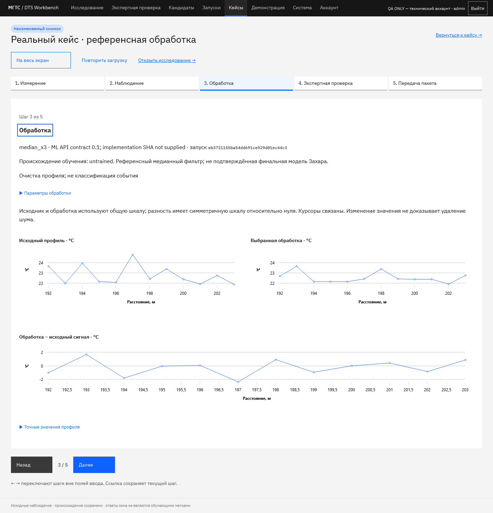

# Защита по сохранённому кейсу

Режим `/cases/{id}?present=1&step=0` показывает неизменяемый снимок рабочего кейса. Войдите своим участником, откройте «Кейсы» и нажмите «Показать на защите». Текущий шаг находится в ссылке и восстанавливается после обновления. Права те же, что у самого кейса; этот адрес не делает данные публичными.

`/demo` остаётся отдельной интерактивной репетицией. В показе кейса нет форм ответа, импорта или запуска обработки. Разрешено чтение снимка, скачивание ZIP и штатное продление сессии. Переход «Открыть исследование» возвращает в обычный рабочий интерфейс; он доступен лишь при совместимых источнике и выбранном запуске.

## Сценарий на 4–6 минут

| Время | Шаг | Что показать и сказать |
|---|---|---|
| 0:00–0:45 | Измерение | «Это реальное распределённое измерение температуры вдоль волокна». Покажите источник, SHA, время, границы и физические оси. Пропуски и неизвестный часовой пояс сохраняются. |
| 0:45–1:30 | Наблюдение | Покажите поле, точный профиль и заметку автора. «Изменение сигнала видно; его физическая причина пока не установлена». При необходимости раскройте числовое представление. |
| 1:30–2:45 | Обработка | Покажите явно выбранный запуск. Исходник и обработка имеют общую шкалу, курсоры связаны; разность симметрична относительно нуля. Назовите метод, происхождение обучения и ограничения. Референсная медиана не является финальной моделью Захара. |
| 2:45–3:30 | Экспертная проверка | Покажите сохранённого автора и ревизию либо «Эксперт ещё не проверил». Это рабочий снимок, а не ответ из репетиции. Не называйте его обучающей меткой или подтверждением аварии. |
| 3:30–4:30 | Передача пакета | Скачайте ZIP. «Другой специалист может открыть разбор без сайта и проверить числовые данные с доверенным исходником». Покажите состав пакета и команду проверки. SHA не доказывают авторство или качество модели. |
| 4:30–6:00 | Вопросы и резерв | Откройте уже скачанный HTML; при вопросах вернитесь к метаданным или точным значениям. Не меняйте реальный ответ ради сценического эффекта. |

Навигация: «Назад»/«Далее», кнопки пяти шагов и ←/→ вне полей ввода. Заголовок шага получает фокус. «На весь экран» использует возможности браузера; при отказе показ продолжается в обычном окне. На телефоне блоки расположены последовательно, страницы прокручиваются обычным способом.

## Подготовка и запасной путь

1. Выберите основной кейс с проверенным результатом и резервный без обработки. Если результата команды пока нет, сохраните явное обозначение reference-фильтра. Не переносите технические QA-ответы в реальный кейс.
2. Войдите, откройте каждый из пяти шагов, проверьте чтение графиков, числовые значения и происхождение. Сохраните ссылки на основной и резервный кейсы.
3. Заранее скачайте оба ZIP и откройте `evidence.html` без сервера. Для независимой числовой сверки нужны подготовленный исходник и [проверяющая утилита](CASES.md#независимая-сверка-zip).
4. После загрузки временная ошибка чтения оставляет снимок доступным. Ошибка скачивания не считается успехом: повторите после восстановления связи либо используйте ранее сохранённый HTML. Обновление страницы без сети не обеспечивает полноценный офлайн-вход; резервом служит файл.
5. Проведите репетицию другим участником с собственным аккаунтом. Проверьте доступ к экспертному ответу: чужой ответ раскрывается по существующим правилам независимости, а не по ссылке режима показа.

В текущем локальном стенде основной контекст — `5.csv`, профиль 536, окно `[359,539) × [192,204)` с `median_x3`; резерв — `1.csv`, профиль 146, окно `[146,205) × [591,710)` без обработки. В обоих реальных кейсах экспертный ответ отсутствует. ID зависят от базы; другая установка создаёт собственные кейсы либо открывает переданный автономный пакет.

## Приёмка

Расширенный `qa-cases.js` проходит технический кейс в изолированной PostgreSQL-схеме: новое вычисление/новый ответ не меняют выбранный запуск и ревизию; точные таблицы совпадают со снимком; курсоры синхронизированы; URL и обновление восстанавливают шаг; все пять шагов проверяются на 320/390/430/1440 px; ошибки чтения/скачивания, повтор и отказ fullscreen обработаны. Режим не выполняет продуктовых POST; heartbeat авторизации разрешён. Для исходного кейса отсутствуют выдуманная обработка и разность. Существующий `/demo` проверяется прежним отдельным сценарием.

Реальный основной и резервный кейсы дополнительно сверяются в браузерах с данными сохранённых снимков. Эмуляция ширины не заменяет репетицию на физическом телефоне. Финальный расчёт Захара и самостоятельное выступление участником остаются неподтверждёнными до их фактического выполнения.

[PNG на телефоне, 390 px](screenshots/case-presentation-primary-390.png).

Резерв без обработки: [PNG на компьютере](screenshots/case-presentation-backup-1440.png), [PNG на телефоне](screenshots/case-presentation-backup-390.png).
