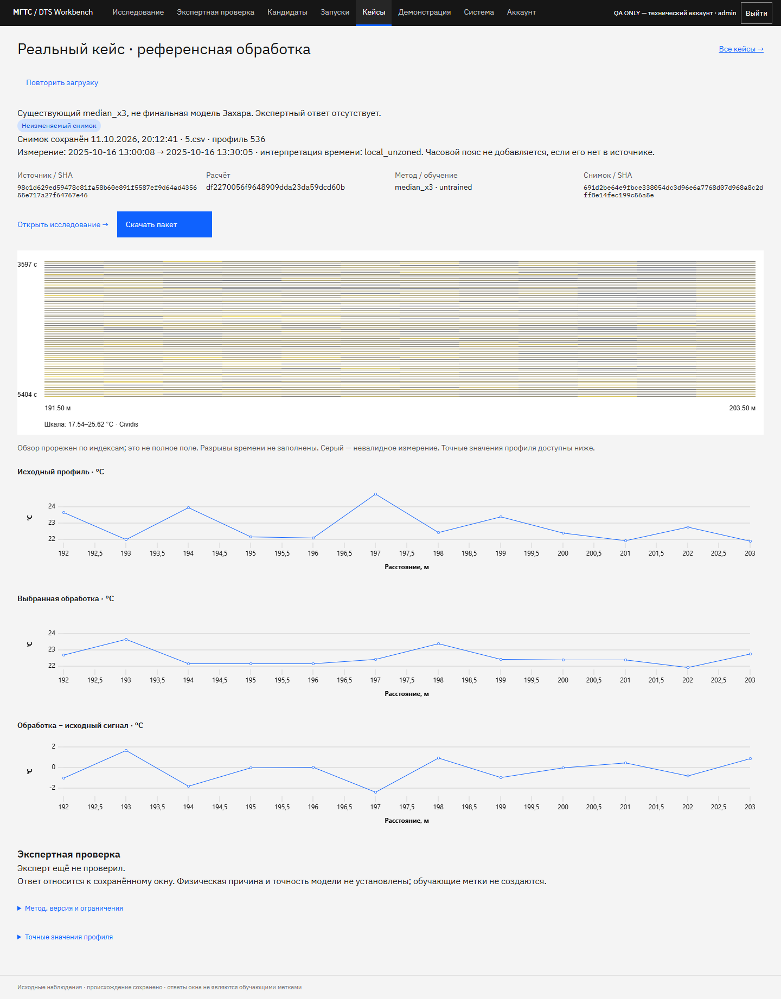

# Проверяемый кейс: сохранить и передать

11 октября 2026. Кейс — неизменяемый снимок окна, выбранного расчёта и выбранной экспертной ревизии. Он не создаёт обучающих меток и не объявляет физическую причину установленной.

## Участнику

1. Завершите репетицию, если синяя полоса сообщает, что она активна. В обычном исследовании откройте участок, выберите точный профиль и подключите сохранённый расчёт. Проверьте видимый ID, метод, версию и ограничения.
2. Задайте название и наблюдения в существующей форме участка. В блоке «Зафиксировать кейс» проверьте SHA, границы и профиль. Нажмите «Проверить состав кейса».
3. Эксперт/admin может включить **свой** сохранённый ответ на точно такое окно и SHA очереди. Предпросмотр показывает автора, текст и ревизию. Если ответ изменится до фиксации, сервер вернёт 409: обновите предпросмотр и ознакомьтесь с новым ответом. При отсутствии ответа кейс честно показывает «Эксперт ещё не проверил». Репетиционные ответы сюда не переносятся.
4. Нажмите «Зафиксировать кейс», откройте сохранённую страницу. Новый расчёт, правка журнала и перезапуск API не изменяют этот снимок. Для новой версии создайте новый кейс; редактирования старого нет.
5. Нажмите «Скачать пакет». ZIP содержит `evidence.html`, `evidence.json`, выбранный `run.json` при наличии обработки, `manifest.json` с SHA и `README.txt`. Название и наблюдения также входят в снимок. HTML открывается без сервера и показывает те же сохранённые значения.

При временной ошибке чтения уже загруженный снимок остаётся на странице. После сетевой ошибки или 503 сервер мог уже сохранить кейс: используйте «Повторить сохранение». Вкладка удерживает первоначальные параметры и ключ попытки; повтор возвращает тот же кейс. Автоматических повторов нет. После подтверждения повторное создание из этой формы блокируется.

Конфликт данных или экспертной ревизии требует нового предпросмотра. Незавершённая попытка хранится только в памяти вкладки. После смены участка или обновления страницы сначала проверьте список кейсов; автоматического сохранения чувствительного содержимого в браузерное хранилище нет.

Кнопка «Открыть исследование» доступна, пока источник и выбранный расчёт соответствуют снимку. При смене SHA, исчезновении или изменении запуска остаются снимок и ZIP; другой результат не подставляется. Не заменяйте ZIP картинкой графика.

## Права и независимость

Для выступления нажмите «Показать на защите»: [пять шагов сохранённого кейса](CASE-PRESENTATION.md). Показ читает тот же снимок, сохраняет шаг в URL и не создаёт ответов или расчётов.

Кейсы принадлежат проекту. Кейс без экспертного ответа могут читать его участники. Ответ внутри кейса доступен автору, администратору проекта и другому эксперту **после его самостоятельного ответа** на то же окно и SHA очереди. Наблюдатели и аналитики не получают чужой экспертный текст; недоступные кейсы не появляются в их списке. Знание ID не даёт доступа. Полученный автономный ZIP содержит ответ: передавайте его специалисту после независимой проверки либо используйте кейс без ответа.

Архив в текущем этапе принадлежит проекту `local`; из другого проекта нельзя создать кейс по этим данным. Без PostgreSQL закрытый контур не переключается на неподтверждённое имя. Case API использует существующие cookie-сессии, CSRF и репетиционную защиту.

## Независимая сверка ZIP

В клоне `web` с зависимостями веб-API:

```text
python scripts/verify-evidence.py --record /path/to/prepared-record --bundle dts-case-ID.zip
```

Укажите каталог одной подготовленной записи с `manifest.json`, координатами и native-массивами. Проверка не распаковывает произвольные пути и не обращается к сети. Она сверяет файлы с manifest, связь HTML/JSON, ID и ревизию, затем точные значения и маски относительно исходника. Предел: 16 MiB на пакет/распакованное содержимое, 8 MiB на файл; архивы с лишними/повторными именами, шифрованием и неподдерживаемым сжатием отклоняются.

`verified=true` и код возврата 0 означают согласованность с переданными файлами. SHA не являются цифровой подписью; качество модели и авторство экспертного ответа остаются непроверенными. Полного CSV в ZIP нет. Для числовой сверки нужен доверенный подготовленный исходник. Отдельные экспорты по-прежнему проверяются через `--report` и `--run`.

## Импорт результата

В «Запусках» выбор JSON только открывает предпросмотр. Проверьте источник/SHA, исходную строку, область, метод, версию, параметры, происхождение обучения и ограничения. Лишь «Подтвердить импорт» отправляет файл серверу. После успеха доступна прямая ссылка на этот результат. Сводка без `denoised` не превращается в температурный профиль. Контракт и упаковка: [RESULT-HANDOFF](RESULT-HANDOFF.md).

## Контракты и хранение

- `POST /api/v2/cases/preview` проверяет состав и текущую ревизию, ничего не сохраняет.
- `POST /api/v2/cases` создаёт снимок; `GET /api/v2/cases` возвращает доступные сводки с `limit/offset`; `GET /api/v2/cases/{id}` возвращает снимок и доступность исследования; `GET /api/v2/cases/{id}/bundle` выдаёт ZIP. Обновления/удаления кейса через API нет. Максимальный снимок — 4 MiB.
- Метаданные находятся в PostgreSQL `documents`, kind `evidence_case`; снимок — в существующем content-addressed blob-хранилище. Проверка экспертной ревизии и вставка документа происходят в одной транзакции под блокировкой журнала. Существующий backup включает документы и связанные blobs.
- Создание снимка принимает необязательный `Idempotency-Key`: 1–128 печатных ASCII-символов без пробелов; клиент использует UUID. Область ключа — проект и аккаунт. Одинаковые ключ и нормализованное тело возвращают исходный ID/снимок с HTTP 201; другое тело возвращает 409. Без ключа прежнее поведение сохраняется. Регистрация `evidence_case_request` и сам кейс вставляются одной транзакцией под блокировкой; сырой ключ не хранится. Существующий backup документов включает регистрацию. При повторе проверка записи выполняется раньше проверки текущего запуска и ревизии; авторизация и доступ к кейсу обязательны.
- Назначения экспертов выделены в `/api/v2/case-assignments`. Старые `GET /api/v2/cases?package=...` и POST с `CaseUpdate` сохранены как совместимые варианты. Без `package` GET теперь возвращает сводки снимков. Клиент «Системы» использует отдельный маршрут назначений.

## Текущая приёмка и границы

12 октября: 63 серверных и 14 клиентских теста прошли; три серверных проверки пропущены по условиям окружения. Chromium/Firefox/WebKit прошли сохранение с потерей ответа **после commit**, повтор с тем же ключом, второй разрыв связи и получение прежнего ID; сводка изменений сверена со снимком. Сервер проверяет три параллельных повтора, разные аккаунты/проекты, конфликт содержимого, изменённую ревизию, удалённый запуск, перезапуск и отключённый аккаунт. SHA ZIP двух ранее созданных реальных кейсов до и после обновления совпали.

## Что изменила обработка

Страница кейса и шаг «Обработка» в режиме защиты показывают число сопоставимых точек, число изменений **строго больше 0,01 °C**, максимальное и среднее абсолютное изменение. Порог — правило отображения, не характеристика датчика. Сравнение выполняется по сохранённым числам без предварительного округления.

В расчёт входят только пары валидных исходных/обработанных значений выбранного окна. Пропуски исходника считаются отдельно; пропуски обработки считаются среди валидных исходных точек. Нет обработки — нет показателей; нет сопоставимых пар — явное сообщение вместо среднего или максимума 0. До пяти наибольших изменений содержат расстояние, исходную/обработанную температуру и знаковую разность; равенства разрешаются исходным порядком точек.

Новые кейсы хранят `processing_changes`, формат `dts-profile-changes-v1`, внутри снимка. HTML и JSON используют эти же показатели; офлайн-проверка пересчитывает их из профиля. Для старого кейса интерфейс вычисляет сводку отдельно, но не добавляет её в старый снимок или ZIP. Это описание изменения сигнала, **не оценка качества очистки или обнаружения аварий**. Python и TypeScript проверяются общими техническими примерами порога, пропусков, равенств, неизменённого профиля и отсутствующей обработки; эти примеры не являются данными для обучения.

На телефоне наибольшие изменения представлены карточками: расстояние, исходник, обработка и разность видны последовательно без прокрутки таблицы по горизонтали. [PNG компьютера](screenshots/case-changes-primary-1440.png), [PNG телефона](screenshots/case-changes-primary-390.png).

Серверные сценарии проверяют двух экспертов, слепое раскрытие, viewer, чужой проект, конфликт ревизии, исчезнувший/изменённый запуск, смену SHA, перезапуск, побайтную неизменность ZIP, исходные маски, `null`, обнаружение изменённого файла и запрет произвольных путей. Chromium/Firefox/WebKit прошли импорт с подтверждением, сохранение после 503, скачивание, прямую ссылку/обновление, reduced motion и ширины 320/390/430/1024/1440 px. CI проверяет фактический JSON результата браузерного сценария: ошибка Playwright не считается успехом по одному коду выхода CLI.

На локальном 8081 подготовлены основной кейс `5.csv`, строка 536, окно `[359,539) × [192,204)` с существующим `median_x3`, и резервный `1.csv`, строка 146, окно `[146,205) × [591,710)` без обработки. Пакеты сверены с настоящими массивами. Оба отмечены как операторская подготовка без экспертного ответа; референс не заменяет финальную модель Захара. ID локальны и не переносимы в другую БД — переносится ZIP либо создаётся новый кейс на совместимых данных.

Проверки нескольких аккаунтов автоматизированы; самостоятельная репетиция живым участником команды, подключение подтверждённого результата Захара и внешний deployment остаются отдельными шагами.



[PNG мобильного кейса, 390 px](screenshots/case-390.png).
