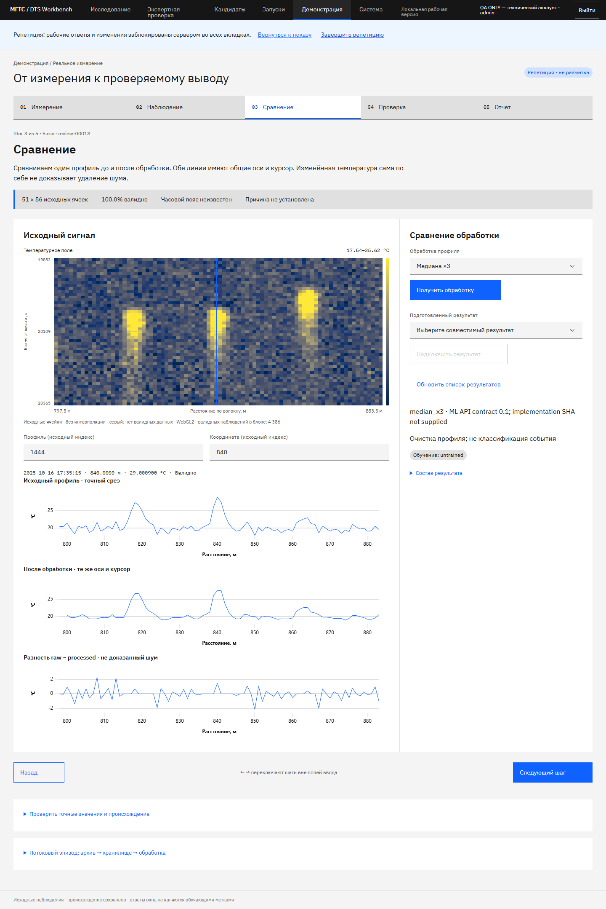

# Приёмка демонстрационного пути — 10 октября 2026

Проверяется пользовательская Goal-цель: реальное измерение → наблюдение → обработка → самостоятельная проверка → автономный отчёт. Это локальная версия для показа и передачи команде. Она не заявляет подтверждённую точность модели, подключённое оборудование или готовность публичного стенда.

Машиночитаемые результаты: [demo-goal-20261010.json](measurements/demo-goal-20261010.json). Инструкция участнику и докладчику: [PRESENTATION-GUIDE.md](PRESENTATION-GUIDE.md). Контракт Захару: [RESULT-HANDOFF.md](RESULT-HANDOFF.md).

## Что проверено

| Требование | Реализация и прямое доказательство |
|---|---|
| Управляемые пять шагов | `/demo`, `presentation.tsx`; браузерный проход Chromium/Firefox/WebKit на реальном `5.csv`, `review-00018`. Шаг/строка/координата сохраняются в URL; обновление и вторая вкладка восстановили контекст. Границы, шкала и SHA фиксируются сервером. |
| Исходное основание | Поле, точные профиль/ряд, инспектор, таблица значений и причин невалидности, ссылка на соседний контекст с SHA. `test_demo_exact_evidence_for_every_real_record` сравнил полный профиль, координаты, время и маски со всеми шестью mmap-записями. `test_all_real_records` проверил обзоры всех шести; тесты физических блоков/разрывов проверяют нерегулярные оси. |
| Реальная обработка | Живой существующий ML API вернул `median_x3`. Метод явно untrained, не классификатор аварий. Исходная/обработанная линии имеют одинаковые оси и курсор; разность подписана как остаток, а не доказанный шум. |
| Подготовленный результат | CLI упаковал существующий результат этой обработки без изменения значений. Импорт через `/runs`, подключение в репетиции, SHA, все 2364 значения и исходные пропуски сверены. Это доказательство адаптера; нового результата Захара оно не имитирует. 404 при недоступном результате оставил исходный график доступным. |
| Безопасная репетиция | Отдельные серверные документы `demo_session`, `demo_answer`, `demo_processing`. HttpOnly-контекст блокирует рабочие мутации даже с правильным CSRF. Браузер сверил неизменность рабочего журнала и списка обычных запусков. Тесты проверили восстановление после нового экземпляра приложения, владельца, viewer/analyst/admin и изменившийся SHA. |
| Исторический поток | Отдельная техническая сессия `4.csv`. Отмена после 11 принятых профилей, возобновление того же job. Завершение: 708 принятых, сохранённых и обработанных профилей; 1 197 228 исходных ячеек сверены с ClickHouse. Источники не менялись, сервисы ради теста не останавливались. |
| Preflight и предзагрузка | Проверки источника/очереди, доступа, ML, подготовленных результатов и сервисов. Предзагрузка одного бинарного блока с AbortController и SHA; браузерный LRU 64/32 MiB. Реальные массивы не помещаются в React state. |
| Отчёт | HTML открыт в браузере через `file:`: inline SVG и стили, нет скриптов и внешних запросов. JSON содержит профиль, SHA и признак репетиции. В обоих форматах репетиционный ответ явно не является рабочей экспертной меткой. |
| Телефон, клавиатура, восстановление | Все пять шагов на 320/390/430/1024/1440 px без горизонтального переполнения. Стрелки переключают шаги вне полей, но не внутри текста; reduced motion проверяется через media query и вычисленную CSS-длительность. Разрыв запроса evidence и повторное подключение проверены во всех трёх движках. Это эмуляция размеров, не испытание физического телефона. |

Архивный пакет при загрузке дополнительно сверяет 13 956 989 ячеек 340 окон с исходными массивами. Существующие слабые предложения не импортируются как человеческие ответы.

## Измерения и их границы

Windows, Node 24.0.2, Chromium 153.0.8010.12, RAM 68 002 148 352 байт; CIM сообщает CPU как `Genuine Intel(R) 0000`, точная коммерческая модель недоступна. Loopback без ограничения сети, подготовленные серверные данные. Перед первым полем HTTP-кэш очищен и выключен; для повторных переходов включён. Контекст страницы приложения новый.

| Измерение | 1440 px | 390 px на том же компьютере |
|---|---:|---:|
| Навигация до готового первого поля | 918 мс | 940 мс |
| Переход шага + два animation frame, медиана | 11,5 мс | 11,5 мс |
| Максимум такого перехода, 50 переключений | 12,7 мс | 12,1 мс |
| Бинарный кэш в этом сценарии | 46 478 байт / 64 MiB | 46 478 байт / 32 MiB |

Измерение двух кадров не является FPS сложного перемещения или полной задержкой нового запроса. CDP heap после принудительного GC остаётся в диапазоне нескольких MiB, снимки опубликованы без утверждения о долгосрочном плато: 10 циклов не заменяют 30-минутный soak. После перехода через Исследование в Систему — ноль активных chart workers, WebGL-контекстов, выделенных buffers/textures и canvas surfaces. Оценка графических байт не включает память драйвера, compositor, двойную буферизацию и RSS процесса.

При полной потоковой проверке найден настоящий отказ ClickHouse по памяти. Исправление: ранний отбор только по неизменяемому sorting key `replay_id,row_idx`, `max_threads=1`, блоки до 64 строк. `FINAL` сохранён; неключевые фильтры температуры и качества не перенесены в PREWHERE. Полный replay после исправления прошёл. Правила и ограничения: [ClickHouse PREWHERE](https://clickhouse.com/docs/reference/statements/select/prewhere), [настройки чтения](https://clickhouse.com/docs/reference/settings/session-settings). Предыдущие неудачные технические задачи остаются в истории.

## Воспроизвести проверки

```text
npm --prefix apps/web run lint
npm --prefix apps/web test
npm --prefix apps/web run build
pytest services/web-api/tests --tb=short -q
PYTHONPATH=services/web-api python scripts/export-openapi.py --check
```

Последний полный запуск: **32 серверных и 6 клиентских тестов**, ESLint, TypeScript/Vite, Ruff и проверка дрейфа OpenAPI прошли. Для настоящих массивов задайте `DTS_REAL_RECORDS` и `DTS_REAL_QUEUE`; для PostgreSQL — `DTS_TEST_PG_URL` с технической БД. Без этих переменных соответствующие тесты могут пропускаться — такой запуск не повторяет всю эту приёмку.

Браузерный сценарий `scripts/qa-presentation.js` запускается Playwright CLI только на изолированном QA API 8091 с `qa_mode=true`; подготовка через `scripts/platform-qa.py`. Он добавлен в CI после проверки аккаунтов. На CI-контрактных данных при недоступном ML допускается только честный 503 с доступным исходником; локальная приёмка выше проверила действующий ML. Не запускайте технические ответы против командного журнала. `qa-presentation-performance.js` измеряет уже созданную репетицию; `qa-result-handoff.js` требует частную копию с настоящим контекстом и настоящим пакетом вместо двух обозначенных placeholders.

Локальный Compose обновлён с `--build --wait`; `/api/v1/health` на 8081 вернул шесть записей, `auth_enabled=true`, `qa_mode=false`, `/demo` — HTTP 200. Внешний деплой и видео не выполнялись.

Реализация сохранена локально в ветке `web`: `3c96bf1 feat(web): add isolated real-data presentation and result handoff`. Следующий коммит содержит эту приёмку, инструкции, JSON и PNG. Повторная проверка 8081 после сборки подтвердила PostgreSQL и свежий heartbeat worker. Временный QA сервер 8091 и его отдельная схема очищаются после проверки; рабочие данные и сервисы 8081 сохраняются.

## Зависимости от команды

Захар должен предоставить фактический результат/версию/параметры и происхождение обучения; его новая модель и веса здесь не создавались. Поле результатов большого объёма и runtime его модели потребуют отдельного бинарного/server adapter. Качество классификации требует настоящей экспертной разметки и независимой оценки. Публичному стенду нужны проверенный TLS/доступ, а подключению оборудования — реальный транспорт и идентификация источника. Физический телефон и длительные нагрузочные испытания остаются отдельными испытаниями эксплуатации.

## Актуальные экраны



[PNG мобильного пути, 390 px](screenshots/demo-goal-390.png). Это снимки реализации, Pen-макеты Carbon R3 остаются дизайн-ориентиром.
