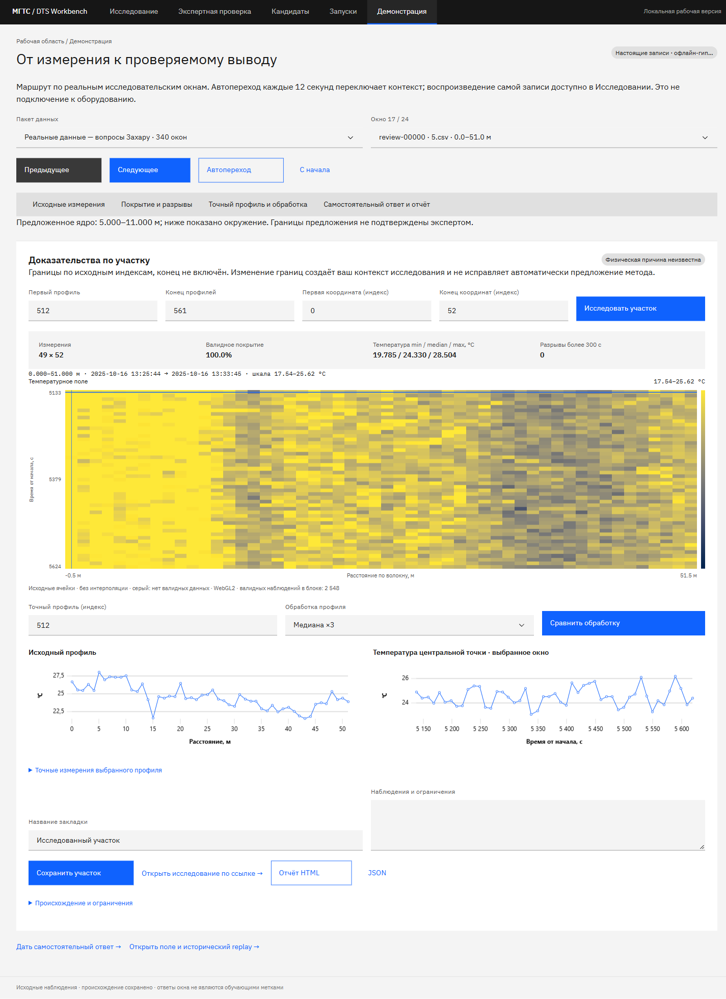
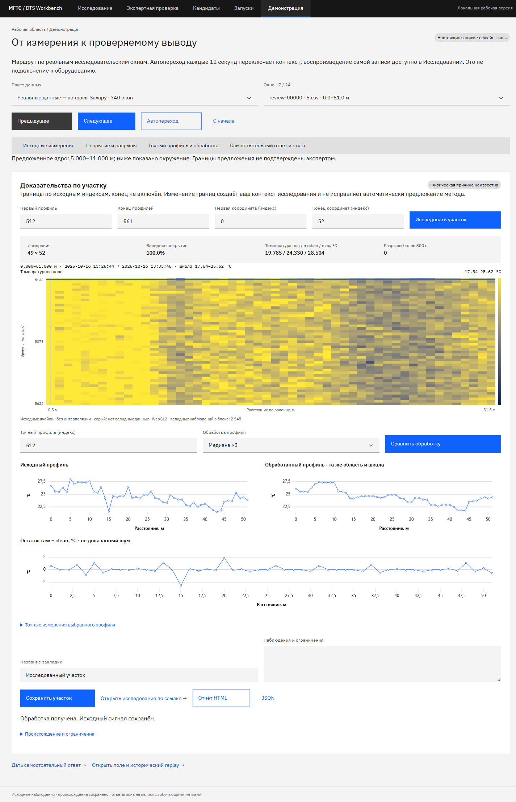

# Демонстрация и подключение результатов Захара

Обновлено 10 октября 2026. Ветка `web`; это развитие локальной платформы, а не завершение всех командных экранов Pen. Актуальный показ: [PRESENTATION-GUIDE.md](PRESENTATION-GUIDE.md). Подключение результатов: [RESULT-HANDOFF.md](RESULT-HANDOFF.md). Основная готовность нужна 14 октября, сдача для отбора — 16 октября, финал — 22 октября.

## Что открыть

| Раздел | Назначение |
|---|---|
| `/demo` | Пять управляемых шагов одного реального окна; отдельная серверная репетиция, preflight и технический поток |
| `/candidates` | Исследовательские окна, короткая подборка и полный пакет, сохранённые закладки |
| `/research` | Поле, точные срезы и исторический replay; произвольный участок и ссылка с его границами |
| `/review` | Собственный ответ, отдельный журнал локального участника и восстановление черновика |
| `/runs` | Постоянная история расчётов, отмена и подключение подготовленного результата |

Для показа откройте `/demo` и создайте репетицию реального участка. По умолчанию предпочтительно окно `review-00018` записи `5.csv`, если оно есть в проверенной подборке: это исследовательский вопрос о локальном изменении и влиянии обработки, не экспертный положительный пример. Другой участок можно выбрать явно. На шаге «Сравнение» нажмите «Получить обработку» или подключите подготовленный результат. Исходный и обработанный профили имеют одинаковую шкалу °C и связанный курсор. Остаток `raw − processed` не объявляется доказанным шумом. Точные числа и маски доступны таблицей/JSON.

Далее сохраните участок, откройте ссылку исследования и запустите исторический replay. Завершите скачиванием HTML или JSON. HTML автономен: SVG с Cividis, физические границы показанных ячеек, исходный профиль, доступная обработка и происхождение. Разреженный обзор отчёта явно подписан; отсутствующие промежутки не заполнены температурой. JSON содержит числовые значения. Ответ участника включается только для выбранного имени и точно совпадающего окна; изменённый участок не наследует чужую разметку.

Маршрут переключает шаги фиксированного окна; границы/SHA/профиль сохраняются. Replay отдельно воспроизводит историю измерений. Ни один из них не является подключением к оборудованию. Репетиционные ответы сохраняются отдельно, рабочие мутации блокируются серверной cookie во всех вкладках до явного выхода. Для рабочей экспертизы используйте `/review` после завершения репетиции.

## Подключить исследовательский пакет

Сначала установите зависимости по основному README. Пакет `real-data-v2` можно взять из существующего релиза для Захара: https://github.com/werd0y45/haklolarp/releases/tag/zakhar-real-data-2026-10-06. Распакованный каталог должен содержать `manifest.json`, `weak_labels.jsonl`, `shortlist.json` и `patches/*.npz`.

Для локального запуска:

```powershell
./scripts/start-web.ps1 -Records C:/data/records -Queue C:/data/queue -ResearchPack C:/data/real-data-v2
```

Для Compose:

```powershell
$env:DTS_RECORDS='C:/data/records'
$env:DTS_QUEUE='C:/data/queue'
$env:DTS_RESEARCH_PACK='C:/data/real-data-v2'
docker compose -p haklolarp-web -f compose.web.yaml up --build -d --wait
```

Переменная необязательна: без неё работает прежняя очередь. При наличии пакета адаптер проверяет SHA источников и каждого NPZ, все значения с учётом исходной Float32-точности пакета, координаты, временные приращения, валидность и соответствие кодов качества. Коды sentinel/nonfinite в Sol и general различаются: адаптер сопоставляет их явно. В производном пакете остаются исходные Float64 температуры и маски general; часовой пояс берётся из источника, а не придумывается из числовой оси пакета.

Сверено 340 фрагментов, 13 956 989 ячеек; короткая подборка содержит 24 окна. Это пересекающиеся фрагменты, а не столько уникальных наблюдений. Предложенное ядро и его окружение различаются. Слабые ответы правил не импортируются как экспертные. Очереди 147 и 340 имеют отдельные SHA и журналы; исходные пакеты не изменяются. Производные данные лежат в runtime, не в Git.

## Контракт результата ML

В `/runs` можно подключить JSON до 240 KiB (запрос `/results` до 256 KiB). Браузер передаёт его веб-API, который сверяет источник, границы и формат. Большие массивы этим способом не передаются: для них нужен серверный адаптер/бинарный контракт. В этом этапе фронтенд не обучает модели и не меняет веса Захара.

```json
{
  "schema_version": "dts-method-result-v1",
  "region": {
    "record_id": "5",
    "row_start": 512,
    "row_end": 561,
    "column_start": 600,
    "column_end": 652
  },
  "source_sha256": "ЗАМЕНИТЬ_НА_64_СИМВОЛА_SHA_ИЗ_ПАСПОРТА",
  "method": "zakhar-model",
  "method_version": "commit-or-artifact-sha",
  "parameters": {"threshold": 0.5},
  "calculated_at": "2026-10-09T15:00:00+03:00",
  "training_origin": "real",
  "limitations": "Независимая точность ещё не установлена",
  "result": {
    "zones": []
  }
}
```

Это пример структуры, не рассчитанный результат; указанные границы надо заменить на область собственного расчёта. Индексы нативные, конец не включён. `training_origin`: `real`, `synthetic`, `mixed`, `untrained`, `unknown`. Метаданные импортированного результата заявлены автором; приложение не подтверждает их само по себе.

Для понятной таблицы зон поддерживаются поля `start_m`, `end_m`, `duration_s`, `polarity`, `median_contrast_c` внутри `result.zones`. Список показывает первые 100 зон, полный JSON открывается по действию. Отсутствие поля или зоны не означает подтверждённую норму. Вероятности не калибруются приложением и не выводятся вместо температур.

Существующий ML API остаётся на `DTS_ML_URL`: `/denoise/profile` и ограниченный `/detect/field`. Его фактический implementation SHA пока не сообщается API; интерфейс честно показывает версию контракта и это ограничение. Результаты профиля проверяются по длине и конечности значений; исходные пропуски сохраняются. Все успешные обработки и фоновые расчёты появляются в истории.

## Сохранение и телефон

В локальном режиме имя участника заявлено, без персональной авторизации. Имя подтверждается при выходе из поля ввода. Для каждого имени и SHA очереди отдельный журнал; ответ одного имени не раскрывает методы для другого. Старый общий журнал сохранён отдельно для совместимости и аудита. Это организационное разделение локальной работы, не механизм доступа для публичного стенда.

Черновики остаются в памяти. Если включить «Это доверенное устройство», IndexedDB сохраняет текст, выбор и ревизию после обновления. Токены и матрицы там не хранятся. Отключение не удаляет ранее сохранённый текст; для удаления есть отдельная кнопка. Черновик не отправляется автоматически. При изменившейся серверной ревизии остаётся сравнение и явная повторная отправка.

На телефоне меню раскрывается кнопкой, очередь и шаги «Сигнал → Ответ → Сохранено» показываются последовательно. После сохранения доступны исправление новой ревизией и следующее окно. Цвет не заменяет числовое представление.

Запуски и закладки сохраняются в `workspace.sqlite3`. Прерванный перезапуском расчёт получает статус `interrupted`; повтор создаёт новый ID. Отмена running-вызова не убивает внешний ML-процесс: сервер ждёт завершения/ошибки вызова, отбрасывает результат и лишь затем подтверждает `cancelled`. Список истории показывает последние 500 записей; большие результаты загружаются отдельно. При превышении 32 MiB бюджета workspace старые payload результатов удаляются с отметкой, метаданные истории сохраняются.

## Границы готовности

Персональные аккаунты, четыре серверные роли, назначения и PostgreSQL доступны в platform-конфигурации. Приглашения, полноценные другие проекты, импорт CSV через браузер, SSO, публичный HTTPS и оборудование остаются следующими этапами. Новых меток обучения и обещания точности нет. Локальная версия доступна через loopback; общий стенд требует отдельной приёмки доступа и деплоя.

Проверки и измерения новой версии — в QA.md; старый 30-минутный replay относится к предыдущей сборке и не подменяет проверку новых экранов.

## PNG рабочей версии

Ниже исторические снимки версии 9 октября до пятишаговой репетиции, а не актуальное состояние `/demo`. Это настоящие графики `5.csv`, не Pen-макеты. Предложения не обозначены как подтверждённые события. Видео не включено.





Мобильный путь: [сигнал](screens/review-mobile-signal.png) → [самостоятельный ответ](screens/review-mobile-answer.png).

[Автономный отчёт участка](screens/evidence-report.png): физические оси, покрытие, исходный SHA и раскрываемое происхождение. В примере ответ эксперта не выбран.

Для повторного экспорта откройте рабочий стенд 8081 в Playwright CLI и выполните `run-code --filename=scripts/qa-delivery-screens.js`. Скрипт не отправляет экспертных ответов; сравнение профиля создаёт обычный вычислительный запуск в истории.
