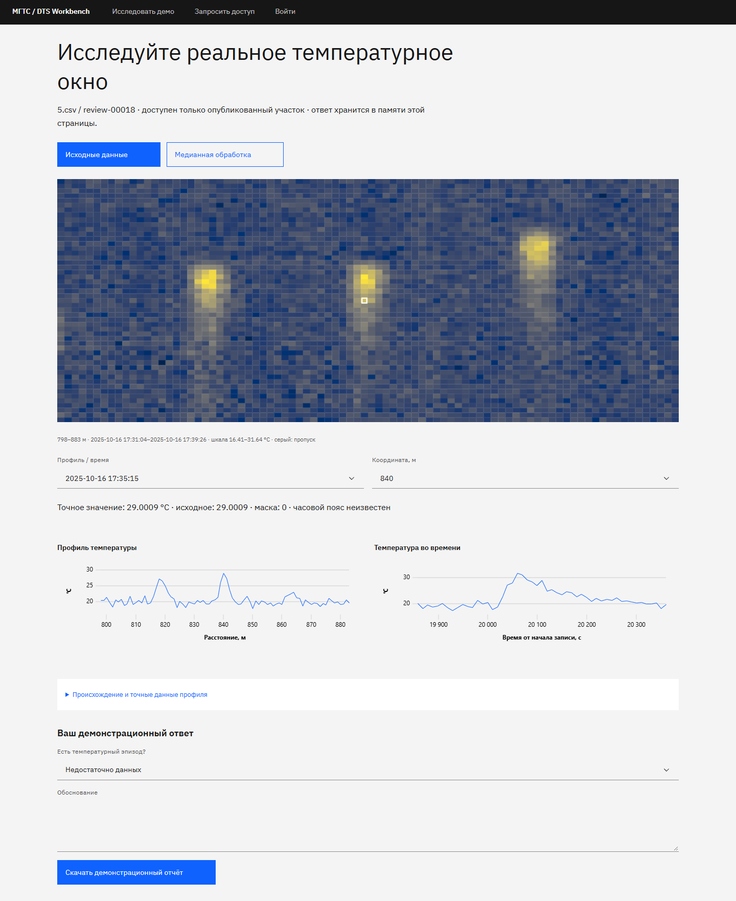

# Приёмка публичного демо и командного доступа

Проверки проведены 10–11 октября 2026 года. Рабочий локальный стенд обновлён
на `http://127.0.0.1:8081`; публичный путь — `/try`, презентационный — `/demo`.
Внешней публикации пока нет. Это отчёт о локальной приёмке, а не утверждение
о готовности к любой нагрузке или независимом аудите безопасности.

## Исправление CI 11 октября

Первый [GitHub-прогон](https://github.com/werd0y45/haklolarp/actions/runs/38122317802)
упал в `qa-platform.js`, хотя серверные тесты и сборка прошли. Сбой
воспроизведён в Linux с Chromium и Playwright CLI 0.1.22: на ширине 1024 px
блок `.account-actions` выходил за правую границу, ширина страницы достигала
1039 px. Восстановление закладки прошло, запросы данных вернули успешные статусы.

Шапка переключается на меню при ширине до 1280 px включительно; блок
аккаунта переносится отдельной строкой. На промежуточных desktop-размерах
скрывается дополнительная подпись и уменьшаются отступы навигации. Переполнение
не скрывается CSS, проверка остаётся строгой; таймаут не увеличен.

Сценарий проверяет закрытое и открытое меню на 320, 390, 430, 1024, 1280,
1281 и 1440 px. Добавлены именованные этапы и безопасная диагностика:
маршрут без query/fragment, статусы API, размеры выходящих элементов и
техническое название закладки. Только диагностическая строка загружается
артефактом CI; cookie, файлы авторизации, приватные логи и приглашения не загружаются.
Очистка временной схемы PostgreSQL остаётся обязательной при любом исходе.

Два последовательных Linux-прогона на свежих схемах прошли полностью:
закладка, размеры/меню, сохранение, повтор после потери связи, конфликт двух
вкладок, назначение эксперта, приглашения и пятишаговая презентация.
Сборка/ESLint и 6 клиентских тестов прошли также в Linux. Дополнительно
повторно прошли 44 серверных теста на всех шести реальных записях и
проверка отсутствия расхождений OpenAPI.

GitHub Actions подтвердил исправление на коммите
`17c6f82414a209d14bdffedee391b6c137f1c993`:
[успешный полный запуск №38127835618](https://github.com/werd0y45/haklolarp/actions/runs/38127835618).
Job `checks / contracts-and-build` завершился успешно, включая авторизованный
браузерный путь. Деплой пропущен по конфигурации и не выполнялся.
В CI прошёл 41 серверный тест; три проверки реальных исходных записей
пропущены, поскольку приватный архив в runner не передаётся. Все 44 проверки
с реальным архивом прошли локально. Эти два вида доказательств не смешиваются.

## Проверенные результаты

| Проверка | Фактический результат |
|---|---|
| Серверные контракты | 44 теста прошли, без пропусков; реальные PostgreSQL/Redis и все шесть подготовленных записей |
| Клиент | ESLint, TypeScript/Vite build; 6 тестов в 3 файлах прошли |
| Контракт OpenAPI | Проверка отсутствия расхождения прошла; клиентские типы обновлены |
| Научная точность | Опубликованные исходные значения, маски, координаты и время совпали с окном `5.csv` |
| Доступ | Приглашения, конкурирующее принятие, истечение/отзыв/повтор, подмена роли, занятый логин, восстановление, idle, CSRF и отключение аккаунта проверены |
| Отказы инфраструктуры | При недоступной БД закрытый контур отказывает; публичный пакет остаётся доступным. Ограничитель Redis отказывает контролируемым 503 |
| Квоты задач | Один активный запуск на пользователя, два выполняемых и десять ожидающих на проект; идемпотентность и lease сохранены |
| Nginx/HTTPS | Конфигурация и Compose проверены локально; реальный результат размером 95 001 байт принят с 201, 70 KiB на другом маршруте и >256 KiB на маршруте результата отклонены с 413 |
| Браузеры | Chromium, Firefox, WebKit: публичный путь, отчёт, потеря связи, прямые ссылки; приглашение/активация, мобильный вход, отзыв сессии при отключении и повтор загрузки |
| Мобильная ширина | Проверены 320, 390, 430 px; без горизонтального переполнения. Это эмуляция размера, не испытания физических телефонов |
| Анонимная изоляция | Четыре проверяемых закрытых API вернули 401; публичный ответ после reload исчезает, в рабочий журнал не попадает |
| Резервные копии | Реальное шифрование `age`, работа ежедневного сервиса, две ежедневные копии; в отдельном временном каталоге ротация оставила ровно семь файлов |
| Восстановление | Снимок восстановлен в новой пустой БД; ID/роли/ревизии сохранены, сессий и активных ссылок нет. Отдельный тест проверил SHA артефакта и отзыв приглашения/восстановления |

В браузерных тестах нет необработанных ошибок финального успешного прогона.
Для намеренно оборванного запроса WebKit допускается только явно учтённое
сообщение сетевого инспектора; другие ошибки не подавляются.
Серверный прогон выдаёт предупреждение upstream Starlette/httpx; Carbon Sass
выдаёт предупреждения устаревающего API. Они не помешали проверкам и сборке.

## Нагрузка: десять пользователей, тридцать минут

Изолированный проект Docker `dts-production-qa`, собственные БД/тома,
HTTPS Nginx, шесть прогретых реальных записей. Пять публичных посетителей
и пять разных участников, `httpx`, десять потоков, пауза между действиями
2 секунды. Локальная сеть Docker Desktop на Windows, 63,3 GiB RAM;
система сообщила CPU как `Genuine Intel(R) 0000`, поэтому точную модель
процессора не заявляем. Внешняя сеть и физический телефон не моделировались.

- Продолжительность: **1800 секунд**.
- Чтений: **8240**, сохранённых ответов: **140**.
- Ошибок: **0**; итоговая ревизия каждого из пяти тестовых ответов: **28**.
- p95 прогретого чтения: **114,61 мс**, медиана: **95,26 мс**.
- После завершения в PostgreSQL повторно подтверждены **140** сохранённых строк.
- API: 183,9 → 195,4 MiB; Nginx: 29,92 → 39,69 MiB;
  worker: 80,24 → 80,17 MiB. Последние измерения API: 195 → 195,4 MiB.
  Рост за этот интервал невелик; более длительный тест нужен для вывода
  об отсутствии утечки на многочасовой работе.

Тестовые ответы имели техническое происхождение и были записаны только
в отдельную QA-базу. Они не являются экспертной разметкой или обучающей выборкой.
Машиночитаемые измерения: [public-team-20261010.json](measurements/public-team-20261010.json).
Нагрузочный сценарий: `scripts/soak-public-team.py`.

## Связность с реальным решением

Публичный пакет: `services/web-api/public/demo-v1/`. Это 51 × 86 исходных ячеек
из `5.csv / review-00018`, собственный SHA, исходные оси и маски.
Медиана рассчитана заранее существующим ML-сервисом по опубликованным
профилям; вне окна контекст не подмешивается. Это обработка сигнала,
а не доказательство обученной классификации или её качества.

Рабочий контур продолжает читать подготовленные записи через memory mapping,
выдавать ограниченные бинарные блоки и точные срезы. Ответы сохраняются
в PostgreSQL с авторством, ревизией и идемпотентностью; вычисления проходят
через фоновые задания и существующий ML API. Принятый результат проверяется
по привязке к источнику/окну и сохраняется как артефакт. Наличие подготовленного
публичного результата не означает доступность ML worker в конкретном развёртывании.

## Перед общим стендом

Нужны реальные домен/сертификаты, закрытые секреты, выдача приглашений,
ключ расшифрования вне сервера и копирование архивов за его пределы.
Это остаётся отдельной операцией публикации. В текущей конфигурации
HTTPS привязан к loopback. OAuth, произвольная загрузка CSV и
изоляция нескольких пользовательских проектов не реализуются в этом этапе.

Метрики API относятся к одному процессу; для нескольких экземпляров
понадобится агрегация. Измеренные 115 мс нельзя переносить на внешнюю сеть
или утверждать как SLA. Сценарий replay на 30 минут отдельно этим нагрузочным
прогоном не проверялся.

Инструкции: [участнику](TEAM-ACCESS.md), [оператору](PRODUCTION-OPERATOR.md),
[быстрая передача Захару](ZAHAR-HANDOFF.md).

Мобильный PNG: [390 px](screenshots/public-team-mobile.png).
