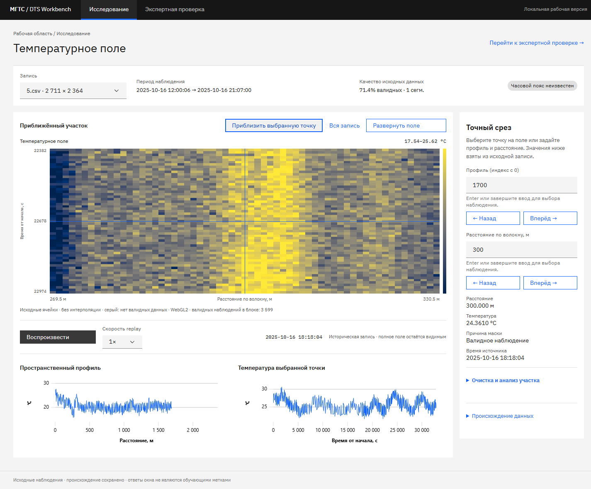
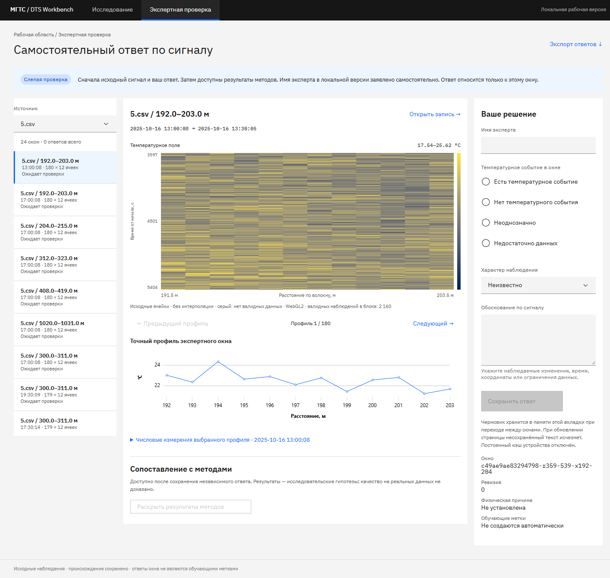

# DTS Workbench — рабочая веб-версия

**Текущий UI зафиксирован:** [правила заморозки](UI-FREEZE.md),
[готовый промпт для Grok](GROK-WEB-GUARDRAILS.md). Лендинг, все разделы и
переключения меняются только по конкретному явному поручению пользователя.
Исторические планы ниже не разрешают перестраивать текущий интерфейс.

**Актуально для продолжения 15 октября:** [контекст рабочего дерева](CHAT-HANDOFF-2026-10-15.md), [стиль и айдентика для участников и моделей](STYLE-AND-IDENTITY.md), [аудит авторизации и передачи](PRE-HANDOFF-AUDIT-2026-10-15.md). Ниже сохранена история этапов: публичное `/try`, локальный пилот и multi-model схема не описывают нынешнюю политику закрытого командного продукта. Новый лендинг и последние исправления собраны в отдельную ветку `sol-web-design-handoff`; не считать их развёрнутыми по старому адресу Docker или на сервере.

Единое рабочее место, лаборатория, мониторинг и права: [WORKSPACE](WORKSPACE.md). Статус общей приёмки: [PRODUCT-GOAL](PRODUCT-GOAL.md).

Интерактивная репетиция реального измерения: [пять шагов демонстрации](DEMONSTRATION-GUIDE.md). Доработка 15 октября разделяет паспорт источника, наблюдение, численное сравнение, репетиционный ответ и передачу отчёта; статус локальных проверок не означает публикацию в `web`.

Подготовка защиты, выбранный результат и статус интеграции команды: [DEFENSE-READINESS](DEFENSE-READINESS.md). Внешняя публикация и включение автоматического deployment пока отложены.

**Обновление 11 октября:** публичное демо `/try`, приглашения и управление
сессиями готовы на локальном стенде. [Передача Захару](ZAHAR-HANDOFF.md),
[приёмка с измерениями](PRODUCTION-ACCEPTANCE.md),
[вход участников](TEAM-ACCESS.md), [production-конфигурация](PRODUCTION-OPERATOR.md).

Ветка `web` содержит React-приложение и отдельный FastAPI gateway. Реализован путь **реальная запись → поле и точные срезы → самостоятельный экспертный ответ → сохранение и экспорт**, а также replay, очистка профиля и фоновый анализ через ML API. Это локальный пилот. В конфигурации `compose.platform.yaml` доступны персональный вход, роли, PostgreSQL и отдельные workers. Командная публикация остаётся отдельным этапом.

Продолжение: **кандидаты, сравнение обработки, закладки, постоянные запуски, автономные отчёты и пятишаговая репетиция**. Пакет `real-data-v2` подключается отдельно от прежних 147 окон. Актуальная инструкция докладчика: [PRESENTATION-GUIDE.md](PRESENTATION-GUIDE.md), адаптер Захара: [RESULT-HANDOFF.md](RESULT-HANDOFF.md).

Историческая приёмка пятишагового пути, PNG проверенного тогда SHA и измерения: [DEMO-ACCEPTANCE.md](DEMO-ACCEPTANCE.md).

Неизменяемые кейсы и ZIP одним действием: [инструкция участнику и API](CASES.md). Обычное исследование фиксирует конкретный расчёт и ревизию ответа; репетиция остаётся отдельным контуром.

Новый контур данных и командной работы: [PLATFORM.md](PLATFORM.md). Измерения на шести реальных записях: [platform/measurements.json](platform/measurements.json).

Работа несколькими моделями: [Sol → Muse → Grok: установка и команды](MULTI-MODEL-WORKFLOW.md), [результаты проверенного пилота](MULTI-MODEL-PILOT.md).

## Запустить на Windows

Нужны Node 24 LTS, npm и Python 3.12. Команды выполняются из корня репозитория.

```powershell
py -3.12 -m venv .venv
.venv/Scripts/python.exe -m pip install -r services/web-api/requirements.lock.txt
npm --prefix apps/web ci --no-audit --no-fund
```

Если npm 11.3 падает с внутренней ошибкой `edgesOut`, используйте `npx --yes npm@11.6.2 --prefix apps/web ci`, без `--force` и `--legacy-peer-deps`.

### Если уже есть подготовленные данные general

Укажите каталог хешированных записей и **одну** неизменяемую очередь: в ней `queue.json`, `manifest.json` и все указанные `.npz`. Папка записей содержит подпапки с `manifest.json`, `raw_c.npy`, `invalid_reason.npy`, координатами и временем. Формат Sol `meta.json/quality_codes.npy` сюда напрямую не подходит.

```powershell
./scripts/start-web.ps1 -Records C:/path/to/general/artifacts/general/records -Queue C:/path/to/general/artifacts/general/review-queues/<queue-hash>
```

Откройте **http://127.0.0.1:5173/research**. Остановка команды через Ctrl+C завершает запущенный ею API. Его порт — 8091; ML API — 8082. Скрипт не устанавливает зависимости автоматически.

### Если есть только шесть CSV

Raw-файлы, подготовленные массивы и журналы в Git не включены. Их предоставляет участник команды. Файлы должны называться `1.csv` … `6.csv`.

```powershell
$env:PYTHONPATH='services/web-api'
.venv/Scripts/python.exe -m workbench.prepare --csv-root C:/path/to/csv --records .runtime/records --queue .runtime/queue
./scripts/start-web.ps1
```

Подготовка проверяет координаты, время, структуру CSV и SHA; данные не интерполируются. На первом запуске выполняются два потоковых прохода по CSV. В исходной записи сохраняется float64; передача поля использует float32, точные числовые срезы — исходную точность.

Новая очередь содержит 54 окна покрытия: 3 временных положения × 3 пространственных положения × 6 записей. Это **материал для проверки**, не найденные события и не разметка. Гипотез методов в такой очереди нет. Для имеющихся 147 окон с 11 подготовленными методами используйте проверенную очередь `general`, описанную выше.

Каталог очереди нельзя перезаписывать. Для другого набора создайте новую папку. SQLite-журнал автоматически разделён по SHA очереди, существующий журнал никогда не привязывается к другому набору.

## Что делать в приложении

1. Выберите запись. Поле показывает медианы валидных наблюдений по физическим бинам. Серый цвет обозначает отсутствие валидных данных; временные разрывы не соединяются.
2. Щёлкните поле или задайте профиль и расстояние. Число подтверждается по Enter или завершению ввода; доступны кнопки перехода. Инспектор показывает ближайшее **реальное** наблюдение и время источника. Приближение загружает новый участок: если исходная сетка помещается в блок, показывает нативные ячейки, иначе — физическую агрегацию. Числовые значения не читаются из цвета.
3. Replay двигает курсор по исторической записи со скоростью 1×, 10× или 60×. Сессия создаётся только при воспроизведении. Всё поле остаётся видимым для контекста. При потере сессии есть восстановление. Это не прямое подключение к оборудованию.
4. Откройте экспертную проверку. Выберите окно, рассмотрите исходные ячейки, при необходимости откройте точный профиль и таблицу чисел.
5. Укажите собственный ответ, характер наблюдения, имя и обоснование. «Сохранено» появляется только после подтверждения сервера. Изменения записываются новой ревизией; HTTP 409 открывает сравнение с серверным ответом.
6. После ответа можно раскрыть методы. Их гипотезы используют отдельную шкалу −1/0/+1; это не температура и не вероятность класса. Исторические `tree_v2/cnn_v2` явно отмечены как обученные на синтетике.
7. Экспорт скачивает совместимый `general-review-packet-v1`. Никаких автоматических cell labels или training targets не создаётся.

На телефоне проверка идёт по шагам «Очередь → Сигнал → Ответ → Сохранено», меню раскрывается кнопкой. Черновики сохраняются в памяти; по явному выбору доверенного устройства восстанавливаются через IndexedDB после обновления. Для каждого заявленного имени есть отдельный журнал и собственное раскрытие методов. Подробности и ограничения — в инструкции демонстрации.

## ML API

Для очистки и нового анализа нужен отдельно запущенный сервис ветки `ml`, проверенный на коммите `160539d7be4d58acb55c4bdad4bf7de518a2c605`. Gateway обращается к `DTS_ML_URL` (по умолчанию `http://127.0.0.1:8082`). Если сервис недоступен, исходные данные и проверка продолжают работать; ошибка обработки показана явно.

Пример в отдельном checkout ветки `ml` с установленными её зависимостями:

```powershell
python -m uvicorn fiber.api:app --host 127.0.0.1 --port 8082
```

В этом веб-проекте нет нового обучения или новых весов. Для первого сквозного теста достаточно CPU DSP; PyTorch не нужен. Подробности интеграции и различия масок — [INTEGRATION.md](INTEGRATION.md).

В интерфейсе обработка находится в раскрываемом разделе **«Очистка и анализ участка»**. По умолчанию отображаются исходные данные. Для нового анализа доступны подтверждённые состояния задачи; процент отсутствует, если ML API его не сообщает.

## Собранная версия без Vite

```powershell
npm --prefix apps/web run build
$env:PYTHONPATH='services/web-api'
$env:DTS_RECORDS='C:/path/to/records'
$env:DTS_QUEUE='C:/path/to/queue'
$env:DTS_WEB_DIST=(Resolve-Path apps/web/dist).Path
.venv/Scripts/python.exe -m uvicorn workbench.api:app --host 127.0.0.1 --port 8091
```

Откройте **http://127.0.0.1:8091/research**. Фронт и API имеют один origin. В API middleware проверяются Host, Origin, mutation token и размер тела. Токен защищает локальные изменения, но не является персональной аутентификацией.

Docker Compose подготовлен для порта 8081, опубликованного только на loopback:

```powershell
$env:DTS_RECORDS='C:/path/to/records'
$env:DTS_QUEUE='C:/path/to/queue'
docker compose -p haklolarp-web -f compose.web.yaml up --build -d --wait
```

Журнал и кэш сохраняются в именованном volume. `docker compose down -v` удаляет их — эту команду для обычной остановки не используйте. На Linux входные массивы должны быть доступны для чтения UID 10001. ML URL внутри контейнера задаётся отдельно.

## Проверки и развитие

```powershell
npm --prefix apps/web run lint
npm --prefix apps/web test
npm --prefix apps/web run build
.venv/Scripts/python.exe -m pytest services/web-api/tests -q --basetemp=.runtime/test-temp
$env:PYTHONPATH='services/web-api'
.venv/Scripts/python.exe scripts/export-openapi.py --check
docker compose -p haklolarp-web -f compose.web.yaml config -q
```

Для проверки всех настоящих массивов задайте `DTS_REAL_RECORDS`. Тестовые маленькие CSV служат проверке контрактов; они не используются для ML-обучения.

При изменении API: `python scripts/export-openapi.py`, затем `npm --prefix apps/web run generate:api`. Каталог, срезы, очередь и ответы типизированы по OpenAPI; двоичный протокол описан отдельно в [DATA_CONTRACT.md](DATA_CONTRACT.md).

CI запускает клиентские проверки и серверные тесты до возможного деплоя. Автоматический деплой по push отключён. Ручной `deploy_local_pilot` разворачивает только loopback-стенд. Персональный вход, приглашения и роли уже реализованы; внешняя публикация требует конфигурации HTTPS, сервера и проверки deployment. Имена workflow, staging-каталог и чужие порты сохранены.

Проверки, измерения и ограничения: [QA.md](QA.md). Актуальный дизайн: [источник и правила](../../design/README.md) и [Design Guide](STYLE-AND-IDENTITY.md); архивные макеты не входят в обычную задачу. Командные аккаунты, роли и назначения описаны в PLATFORM.md. Браузерный импорт исходных CSV, управление несколькими проектами и прямой поток оборудования остаются отдельными этапами.

## Где менять код

| Задача | Файлы |
|---|---|
| Навигация и новые разделы | `apps/web/src/main.tsx`; новые разделы подключаются через `lazy` |
| Исследование, связанный выбор, replay и вызов ML | `apps/web/src/explorer.tsx`, `coordinate-input.tsx` |
| Очередь, черновики, конфликты, самостоятельный ответ | `apps/web/src/reviews.tsx` |
| Поле, WebGL/Canvas и линии | `apps/web/src/charts.tsx`, `palette.ts`, `numeric.ts`, `data.worker.ts` |
| Кэш, запросы и контрактные типы | `apps/web/src/cache.ts`, `api.ts`, генерируемый `api-schema.d.ts` |
| Carbon, адаптивность и локальные шрифты | `apps/web/src/styles.scss` |
| API, replay, ML задачи и проверка локальных изменений | `services/web-api/workbench/api.py` |
| Массивы, агрегация, исходные ячейки и SHA очереди | `services/web-api/workbench/store.py` |
| CSV и журнал general | `services/web-api/workbench/vendor`; происхождение и изменения в `INTEGRATION.md` |
| Локальный запуск, OpenAPI, воспроизводимый QA | `scripts/`; входные данные и журналы остаются в `.runtime` |

Состояние выбранной записи/окна отражается в URL. Формы, графики и числовые массивы разделены; новые разделы не должны складывать полную матрицу в React state. При изменении состава исходных записей перезапустите API и обновите страницу: текущий пилот работает с неизменяемым каталогом CSV.

## Скриншоты рабочей версии

Это изображения исполняемого приложения на реальном `5.csv`, а не макеты или фиктивная температура.





Мобильная форма: [PNG 390 px](screens/review-mobile.png). На скриншотах проверки ответ ещё не сохранён; имена и выводы эксперта не подставляются автоматически.

## Числовые ML-пакеты

Контракт и операторские команды: [ANALYSIS-CONTRACT](ANALYSIS-CONTRACT.md). Массивы хранятся в runtime/artifacts/arrays; существующий backup включает зарегистрированные бинарные артефакты и проверяет SHA при восстановлении. Сохраняйте весь runtime-том. Каталог `/analysis` требует действующую сессию проекта.
