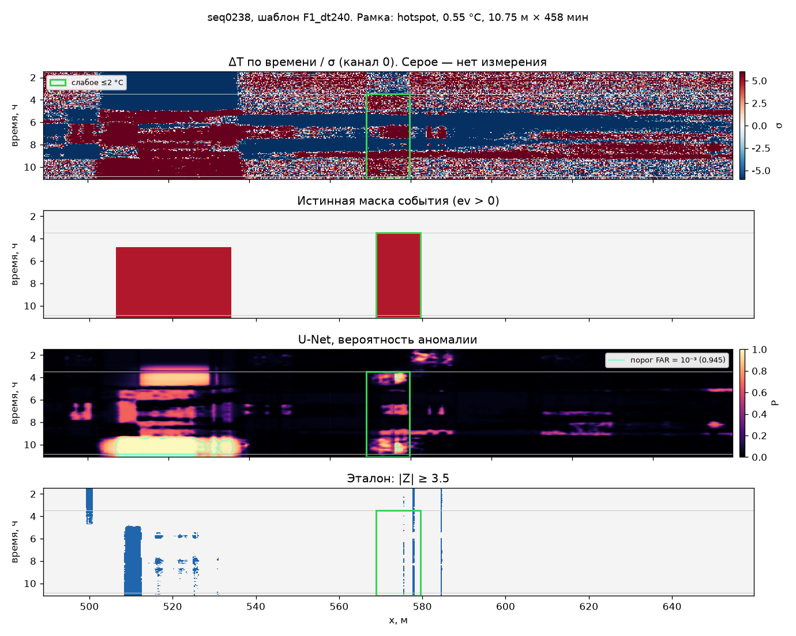
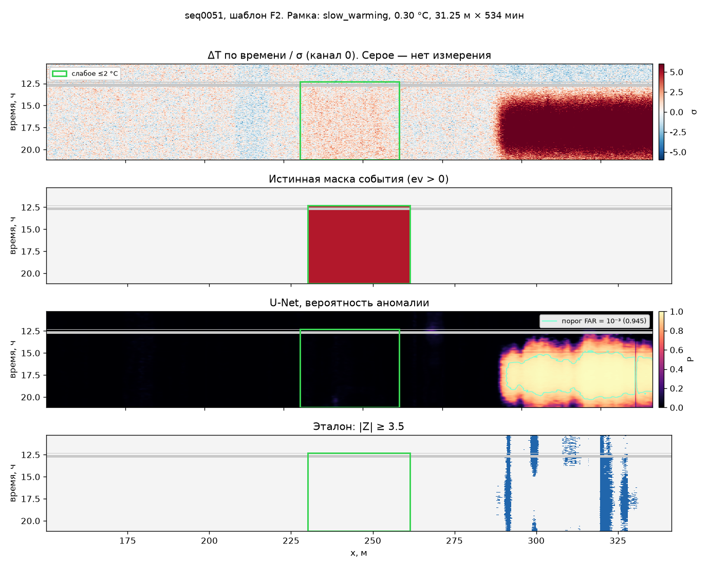
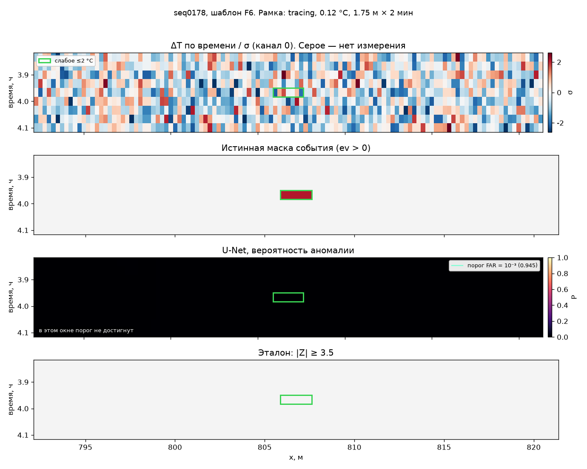
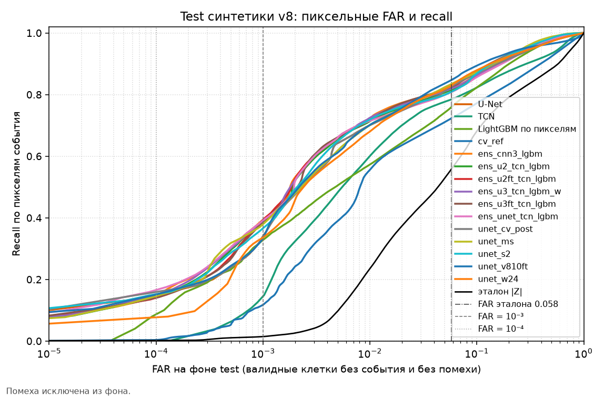
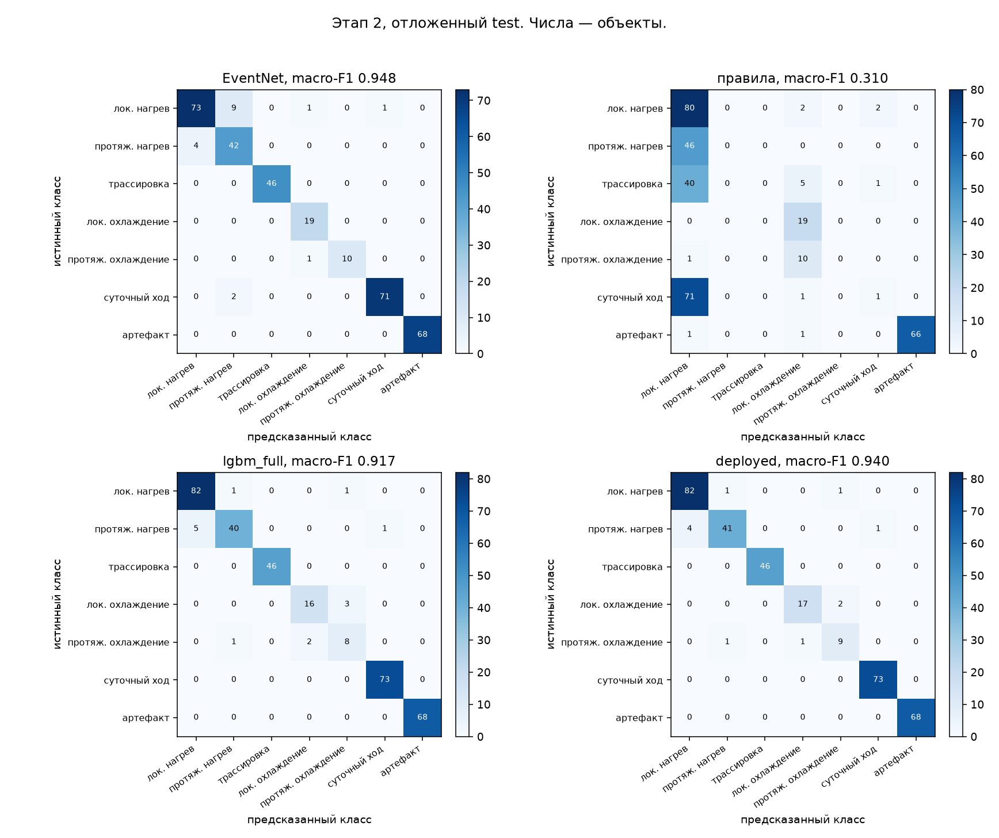

# Пояснительная записка: аномалии на Raman-DTS, кейс МГТС

Документ можно читать без авторов кода. Полные таблицы собирает `scripts/make_report.py` в `docs/RESULTS.md`. Числа в этой записке стоят между служебными HTML-комментариями и при просмотре видны как обычный текст. Текст вокруг комментариев можно править; сами числа скрипт перезаписывает. Десятичная точка — как в таблицах результатов. «н/д» значит, что файл оценки ещё не собран или в нём нет такого ключа.

Состояние файлов на момент сборки: этап 1 — <!-- AUTO:s1_status -->есть<!-- /AUTO:s1_status -->, этап 2 — <!-- AUTO:s2_status -->есть<!-- /AUTO:s2_status -->, реальные записи — <!-- AUTO:real_status -->есть<!-- /AUTO:real_status -->.

## 1. Постановка

Оптоволокно лежит в помещении (офис, производство, общепит, лифтовый холл) и измеряет температуру вокруг себя. На выходе поле T(t, x): время профиля, метры вдоль кабеля, градусы Цельсия. Виброакустики в выданных файлах нет, классы «машина / копка / шаги» к этим данным не относятся.

Кейсодержатель разделил работу на два этапа.

1. Бинарная детекция. В каждой клетке поля нужно ответить, есть ли аномалия. На уровне записи это различение «норма / аномалия».
2. Типизация. Если аномалия есть, нужно назвать её тип по форме, а не по предполагаемой причине.

Упор поставлен на компьютерное зрение и свёрточные сети: поле T(t, x) рассматривается как изображение «время × расстояние», и сеть ищет на нём объекты. На вход идут сырые зашумлённые измерения. Отдельный обязательный денойзер перед детектором не ставится. Классические детекторы и правила считаются на том же протоколе, чтобы отличие сети от простой статистики было видно в цифрах, а не в выборе порога.

Что в этой постановке считается событием, а что фоном. Естественный фон — люди пришли, включился кондиционер, и широкий участок волокна плавно остыл. Событие — локальный нагрев или охлаждение, достаточно долгое, иногда периодическое, иногда в один момент на разных координатах. Пример кейсодержателя: волокно лежит вдоль силового кабеля насоса, и нагрев кабеля виден на коротком отрезке. Имя причины («насос», «протечка») из одной температуры не выводится. Классификатор называет форму.

Значение −300 в файлах — нет измерения, а не «очень холодно».

## Почему два этапа и что считается тревогой

Этап 1 и этап 2 отвечают на разные вопросы.

Этап 1 ищет на поле всё необычное. В карту входят и очаги, по которым потом поедет человек, и то, что тревогой не является: суточный цикл помещения (HVAC) и артефакт прибора. Карта этапа 1 — вероятность аномалии, единица минус вероятность фона. По ней нарезаются зоны.

Этап 2 даёт зоне имя класса и отдельно решает, тревога ли это. Тревога — флаг оператору, не название класса. Классы HVAC_Diurnal и Sensor_Artifact тревогу не поднимают: зона остаётся в протоколе, выезд по ней не ставится. В коде это одна строка `dts/infer.py`: `alarm` ложен именно для этих двух классов. Локальный и протяжённый нагрев, трассировка, локальное и протяжённое охлаждение тревогу ставят.

Так разделены «найти странное» и «звать человека». Если этап 1 промолчит на суточном ходе, этапа 2 не будет: зоны нет, подписать её и явно оставить без тревоги некому. Если этап 1 отдаёт всё необычное, этап 2 ставит тревогу только там, где класс её заслуживает.

Синтетическая помеха устроена так же. `diurnal_section` переходит в HVAC_Diurnal, `common_mode_jump` и `connector_step` — в Sensor_Artifact. Их надо увидеть и не отправить как тревогу. В пиксельной оценке этапа 1 помеха событием не считается. Как она входит в FAR и в IoU, написано в оговорках к метрикам.

## 2. Что измеряет прибор

Распределённый датчик температуры (DTS) на комбинационном, рамановском, рассеянии работает так. В волокно посылают короткий лазерный импульс. Небольшая часть света рассеивается назад. У рассеянного света две полосы: стоксова и антистоксова. Антистоксова сильнее растёт с температурой, и по отношению полос восстанавливают температуру. По задержке прихода импульса понимают, на каком метре волокна произошло рассеяние. Один профиль — это вся трасса сразу. Следующий профиль снимают через секунды или минуты. Получается картинка: по горизонтали расстояние, по вертикали время, цвет — температура.

Что на этой картинке мешает увидеть событие.

- Шум прибора. К дальнему концу волокна вернувшихся фотонов меньше, разброс температуры больше. Шум оценивается отдельно в каждой точке кабеля и обозначен σ(x).
- Постоянный пейзаж трассы. Кабель проходит мимо тёплых и холодных мест, и эта картина почти не меняется от профиля к профилю. Это фон маршрута, а не событие.
- Синфазный сдвиг. Весь профиль разом прыгает на доли градуса или на градус: дрейф прибора или общая температура комнаты. Сдвиг одинаковый на всех метрах.
- Пропуски. −300, обрыв записи, хвост после конца волокна. Интерполировать их как температуру нельзя.
- Разная дискретизация. У шести реальных файлов шаг по расстоянию от 0,1 м до 1 м, шаг по времени от 10 с до 4 мин. Пиксель «один отсчёт» в разных файлах означает разный метр и разную минуту.

Пространственное разрешение прибора грубее шага отсчётов: пятно чувствительности порядка 1 м. Короткий очаг уже этого пятна размазывается по соседним метрам. Событие, которое длится меньше шага по времени, усредняется внутри одного профиля и становится слабее.

Отсюда рабочая картинка для сети. Сначала общий сдвиг и постоянный пейзаж вычитаются. Остаток делится на местный шум. То, что осталось, — «на сколько своих сигм эта клетка теплее или холоднее, чем ей положено быть». Сеть видит безразмерное изображение, а не сырые 20–30 °C.

## 3. Данные

Две разные совокупности. Путать их нельзя.

Реальные записи — шесть файлов `1.csv` … `6.csv`. На них модель не обучается и порог не подбирается. Они нужны для итогового прогона и для сверки с эталоном. По разбору выгрузки у файлов такой вид (шаг и размер — свойства измерения, не результат модели):

| Файл | Профилей × точек | Шаг по x | На что смотреть |
|---|---:|---:|---|
| 1 | 615 × 11707 | 0,10 м | два режима времени: редкие профили и частые, около 12 ч |
| 2 | 696 × 2315 | 0,25 м | сутки, разрывы записи, мёртвый хвост |
| 3 | 788 × 1689 | 0,25 м | запись длиннее суток |
| 4 | 708 × 1691 | 0,25 м | сутки, мёртвый хвост |
| 5 | 2711 × 2364 | 1 м | шаг 10 с, много клеток −300, пояс в метке времени не задан |
| 6 | 1231 × 4534 | 0,25 м | сутки, часть профилей короче остальных |

Файлы 2, 3 и 4 сняты одним прибором. Это не повод учить модель на одном из них и проверять на другом: реальные файлы целиком выведены из обучения.

Синтетика v8 — 300 размеченных записей, калибровка шума, фона и расписания снята с тех же шести файлов. Запись целиком попадает в один сплит: train 210, val 45, test 45. Порог детектора ставится по val, отчётные цифры — по test. Внутри записи пиксели между обучением и тестом не перемешиваются.

Шаблон синтетики повторяет геометрию одного реального файла. F1 соответствует файлу 1 и из-за двух режимов времени разрезан на `F1_dt30` и `F1_dt240`. F2 … F6 соответствуют файлам 2 … 6. Число записей v8 (train / val / test):

| Шаблон | Файл-прообраз | Номинальные dx, dt | train | val | test |
|---|---|---|---:|---:|---:|
| F1_dt240 | 1.csv, режим ~4 мин | 0,10 м, 240 с | 15 | 4 | 8 |
| F1_dt30 | 1.csv, режим ~30 с | 0,10 м, 30 с | 16 | 1 | 2 |
| F2 | 2.csv | 0,25 м, 120 с | 30 | 8 | 10 |
| F3 | 3.csv | 0,25 м, 120 с | 32 | 8 | 6 |
| F4 | 4.csv | 0,25 м, 120 с | 33 | 3 | 8 |
| F5 | 5.csv | 1 м, 10 с | 22 | 4 | 4 |
| F6 | 6.csv | 0,25 м, 60 с | 62 | 17 | 7 |

Номинальный шаг — не закон для каждой записи: у части последовательностей шаг по времени заменён на другой из набора 10–240 с, а шум пересчитан. Шаблон всё равно указывает, на какой реальный файл запись похожа по длине, шуму и фону.

В `labels.csv` v8 — 1290 событий и 837 помех. Событие модель должна найти. Помеху (скачок всей трассы, ступень коннектора, суточный ход участка) модель не должна поднимать как тревогу. Около 15% записей вообще без событий: только фон и помехи. У части событий амплитуда специально занижена до уровня шума — это слабые события.

Синтетика v9 — следующий выпуск генератора. Загрузчик `dts/synth.py` берёт номер версии из идентификатора записи и не привязан к v8. Новый выпуск можно прогнать тем же `scripts/eval_stage1.py`. Чтобы порог не подстроился под новую синтетику, ему передают уже снятые пороги v8 (`--thresholds-from`). Пока в сборку отчёта не подан json v9, перенос на v9 цифрами не заявлен. Эта записка читает только v8.

Версия в файле этапа 1: <!-- AUTO:s1_version -->v8<!-- /AUTO:s1_version -->. Версия в файле этапа 2: <!-- AUTO:s2_version -->v8<!-- /AUTO:s2_version -->.

## 4. Предобработка

Все модели смотрят на одну сетку: 0,25 м по расстоянию и 120 с по времени (`dts/grid.py`). Так пиксель U-Net значит одно и то же на шаблоне F5 (исходный шаг 1 м и 10 с) и на файле 1 (0,1 м и до 4 мин). Температура в ячейке сетки — среднее валидных отсчётов, попавших в ячейку. Метки и зоны переносятся ближайшим отсчётом. Пустая ячейка не заполняется выдуманной температурой. Если между профилями дыра длиннее 300 с, строка сетки помечается невалидной и не интерполируется.

Дальше поле переводится в три канала (`dts/features.py`). Все температурные каналы обрезаны в диапазон от −12 до 12 и умножены на маску валидности.

| Канал | Формула | Зачем |
|---|---|---|
| 0. Изменение во времени | ΔT_time / σ(x) | температура минус синфазная медиана профиля и минус статический профиль вдоль кабеля |
| 1. Отличие от соседей | ΔT_space / σ(x) | то же поле минус медиана по окну 40 м вдоль кабеля |
| 2. valid | 0 или 1 | −300, разрыв и конец волокна равны нулю |

Синфазная медиана по строке снимает скачок, общий для всего кабеля: иначе дрейф прибора выглядит как аномалия на каждом метре. Статический профиль — медиана по времени в каждой точке — снимает постоянный пейзаж маршрута. Окно 40 м по расстоянию оставляет узкий очаг и гасит плавный фон комнаты: очаг в такое окно почти не попадает, а широкий гладкий участок попадает и вычитается.

σ(x) считается по разностям соседних по времени профилей: 1,4826 · MAD(Δt T) / √2, затем медианное сглаживание вдоль кабеля. Пол не опускается ниже 0,03 °C, чтобы деление не раздувало тихую точку. Это робастная оценка: редкий горячий очаг почти не двигает медиану разностей.

Один и тот же блок каналов используется и для синтетики, и для реальных файлов. Отдельной нормализации «под конкретный csv» нет.

## 5. Модели

Этап 1 отвечает на вопрос «где аномалия» и заодно даёт знак: нагрев или охлаждение. Сеть сегментирует изображение на три класса: фон, нагрев, охлаждение. Вероятность аномалии — единица минус вероятность фона. Знак для зоны — разность вероятностей нагрева и охлаждения. Сеть полностью свёрточная и принимает трассу любой длины; длинное поле режется на тайлы с перекрытием.

| Имя в отчёте | Код | Что делает | Обучение |
|---|---|---|---|
| U-Net | `DTSUNet` в `dts/models.py` | компактный U-Net. В энкодере ядра 7×3: по времени шире, чем по метрам, потому что событие DTS обычно тянется по времени и узко по кабелю. В узком месте сети — ворота по времени: строка, усреднённая по расстоянию, модулирует всю строку и помогает заметить одновременное включение | train синтетики, ранняя остановка по val |
| TCN | `TCN` | свёртки с дырками только вдоль времени, узкое ядро по расстоянию. Поле зрения растёт по времени, разрешение не теряется | то же |
| Dilated FCN | `DilatedFCN` | двумерные свёртки с увеличивающейся дыркой. Большой контекст без пулинга | то же |
| согласованный фильтр | `matched_filter` в `dts/classic.py` | гауссово сглаживание двух температурных каналов, без обучения. Оценка — максимум модулей двух сглаженных каналов | нет |
| LightGBM по пикселям | `pixel_features` | в каждой клетке исходные каналы и несколько гауссовых масштабов (от ~3 мин × 0,8 м до ~40 мин × 5 м на канонической сетке). Бустинг учится тем же трём классам | train синтетики |
| эталон | `dts/baseline.py` | чужой пайплайн haklolarp: медианный контраст к кольцу 8–40 м, модуль Z не меньше 3,5, затем фильтры ширины и длительности зоны. В сравнение входит и пиксельный модуль Z, и готовая маска зон | не обучается, только сравнение |
| U-Net с интегрирующим входом | `DTSUNetMS` и `Integrate` в `dts/models.py` | к трём каналам добавлены четыре карты усреднения. Окна фиксированы. Подробнее в следующем подразделе | train синтетики; окна усреднения не обучаются |

### Интегрирующий вход (`unet_ms`)

Слабое долгое событие, десятые доли градуса при σ порядка 0,3 °C, в одной клетке тонет в шуме. Если тот же сигнал держится в N клетках, а шум клеток независим, усреднение поднимает отношение сигнала к шуму как √N. Для пятна известного размера это согласованный фильтр: сложить клетки пятна и поделить на √N.

Класс `Integrate` считает два таких фильтра. Окна заданы в клетках канонической сетки и весов не имеют.

| Окно, клетки (время × расстояние) | На сетке 0,25 м × 120 с |
|---|---|
| 7 × 15 | 14 мин × 3,75 м |
| 21 × 61 | 42 мин × 15,25 м |

В окне усредняются только валидные клетки двух температурных каналов. Число валидных клеток N берётся из канала valid. Среднее умножается на √N: шум снова имеет размах порядка σ, а согласованный сигнал вырастает как √N. Дальше стоит фиксированное деление на 3 — поправка на то, что соседние клетки шума коррелированы, эффективное N меньше геометрического. Ответ обрезается в диапазон от −12 до 12, как и исходные каналы. Размер карты не меняется: окно скользит с шагом в одну клетку.

Два окна и два канала дают четыре дополнительных карты. Вместе с тремя исходными на вход `DTSUNetMS` идут 7 карт. Дальше это тот же U-Net: свёртки учатся, окна усреднения остаются фиксированными. В файле оценки метод называется `unet_ms`. Строка в таблице этапа 1 появляется, когда оценка запишет этот метод.

Этап 2 получает уже вырезанную зону и называет тип. Кроп приводится к размеру 32 строки на 64 столбца, каналы те же три. Рядом со картинкой идёт вектор скаляров: длительность, ширина и доля ширины от длины кабеля, медиана и крайние амплитуды, знак, пространственный пик, доли фронта, плато и спада, число смен знака, период и сила автокорреляции, контраст края кропа к полям, доля валидных клеток, положение окна внутри записи.

| Имя в отчёте | Что делает |
|---|---|
| EventNet | небольшая 2D-свёртка по кропу плюс полносвязный слой по скалярам. На инференсе ответ усредняется с кропом, отражённым по расстоянию: у волокна нет привилегированного направления «лево» |
| CNN только по кропу | та же сеть, скаляры обнулены. Проверка, хватает ли одной картинки. Считается в перекрёстной проверке и отдельной моделью на test не выпускается |
| LightGBM по признакам | бустинг по скалярам и простым статистикам кропа (средние, разброс, максимум, грубые профили по времени и по метрам) |
| ансамбль CNN + LightGBM | среднее вероятностей двух моделей с равным весом. Вес на test не подбирается |
| правила haklolarp | готовые пороги формы из эталонного пакета. Их словарь беднее нашей таксономии, соответствие задано в `RULES_TO_CLASS` и описано ниже |

Обучение этапа 2 идёт с весами классов: редкий класс тянет функцию потерь сильнее. Метки слегка сглажены, кроп с вероятностью 1/2 отражается по расстоянию. Группы перекрёстной проверки — целые записи, не отдельные кропы.

## 6. Протокол оценки

Сравнивать детекторы при разных порогах бессмысленно: один порог ловит всё и шумит, другой молчит и выглядит аккуратным. Поэтому рабочая точка фиксируется долей ложных тревог.

1. На val считается FAR эталона: доля фоновых клеток, где модуль пространственного Z не меньше 3,5. Фон — валидная клетка без события и без помехи. Это число FAR_ref = <!-- AUTO:s1_far_ref -->0.0581<!-- /AUTO:s1_far_ref -->.
2. Для каждого метода на тех же фоновых клетках val находится порог, при котором его FAR равен FAR_ref. Дополнительно ставятся две жёсткие точки, FAR = 10⁻³ и FAR = 10⁻⁴. У эталона есть ещё замороженная точка |Z| = 3,5, без подгонки под квантиль.
3. Порог на test не двигается. Рядом с качеством публикуется фактический FAR на test и отношение к FAR_ref. Отношение может чуть уехать, потому что val и test — разные записи. Метод считается попавшим в равный FAR, если отношение не выше 1,1.
4. На test считаются precision, recall, F1 и IoU по пикселям, отдельно IoU нагрева и IoU охлаждения, событийный recall, recall слабых событий и разбивка по шаблонам и меткам.
5. Событие засчитано найденным, если порог покрыл не меньше 30% пикселей его маски. Бокс из разметки, у которого после переноса на сетку не осталось пикселей маски, в знаменатель не входит: его нельзя было увидеть.
6. Слабое событие — наблюдаемая амплитуда не выше 2 °C. Это событийный recall, не пиксельный. Пиксельный recall слабых публикуется рядом.
7. Доверительный интервал IoU — бутстрэп целых записей test, не отдельных пикселей.

Этап 2 оценивается отдельно, по уже известным боксам разметки, а не по зонам детектора. Так ошибка типа не смешивается с ошибкой поиска.

- Перекрёстная проверка: 5 фолдов, группа — идентификатор записи, только train и val. Каждая запись получает ответ модели, которая её не видела.
- Финальные модели заново учатся на всём dev и один раз применяются к test.
- macro-F1 считается по семи классам. 95% интервал — бутстрэп записей (300 повторов, фиксированное зерно). Интервал на test шире, чем на dev: записей test меньше, и состав классов от записи к записи разный.
- coarse macro-F1 сворачивает семь имён в четыре группы: нагрев, охлаждение, естественный цикл, артефакт прибора. Он отвечает на вопрос, не перепутан ли нагрев с охлаждением или с циклом комнаты, даже если локальный очаг перепутан с протяжённым.
- ECE смотрит калибровку: заявленная вероятность и фактическая доля верных ответов. У правил вероятности нет, ECE для них не считается.
- Матрица ошибок: строка — истинный класс, столбец — предсказанный.

Реальные файлы идут последним шагом и только в инференс. Порог — тот, что снят с синтетического val и записан в выпуск модели (сейчас в прогоне: точка <!-- AUTO:real_op -->far_1e-3<!-- /AUTO:real_op -->, порог <!-- AUTO:real_threshold -->0.8608<!-- /AUTO:real_threshold -->). Ни веса, ни порог, ни список классов по реальным файлам не обновляются. Сверка с эталоном — пересечение масок зон. Сверка с карточкой оператора — попадание заранее указанного окна: сколько зон CNN и эталона попало в окно и какой класс в нём доминирует. Карточка не используется как обучающая метка.

## Оговорки к метрикам

Пиксельный FAR на синтетике v8 во многом создают структуры фона, у которых нет метки.

На шаблоне F1 генератор включает активный фон `bg_temporal_gate`. Окно активности покрывает часть записи с шагом около 30 с, как активный режим реального файла 1.csv: локальные смещения, выключение горячих выбросов фона, масштабирование остатка. В `labels.csv` эти структуры не являются ни событием, ни помехой.

На шаблоне F6 фон взят из реального файла 6.csv. Холодные и тёплые участки и тёмные полосы кабеля событиями не размечены. Так задумано: статический пейзаж трассы событием не считается.

Детектор, который загорается на таком фоне, платит пикселями ложной тревоги. Порог эталона |Z| ≥ 3,5 на val тоже их задевает, поэтому FAR_ref выходит около 5%. Это грубая точка сравнения. Главная рабочая точка — FAR = 10⁻³. Точка FAR = 10⁻⁴ опубликована рядом как более жёсткая. Точное FAR_ref из файла оценки стоит в протоколе выше.

Показатель `nuisance_ignored` считает precision и IoU иначе. Клетка помехи вынута из подсчёта: она не становится ни верной тревогой, ни ложной. Обычные precision и IoU по-прежнему видят тревогу на помехе как ложную, если эта клетка не событие. Рядом остаётся доля помех в тревоге: она показывает, как часто детектор загорается именно на размеченной помехе.

В таблицах этапа 1 есть ещё два числа. Ложные зоны на км·ч — связные зоны, у которых меньше 10% тревожных клеток попадают в маску события; знаменатель — километр·час записи. Средняя точность пикселей (`pixel_average_precision`) порога не имеет. Отдельная таблица подбирает порог уже на test, чтобы FAR совпал с FAR эталона на test. По этой таблице модель не выбирают.

## 7. Таксономия и почему она такая

Жюри ждёт тип события. В материалах кейса типы заданы формой: фон, цикл вентиляции, локальный нагрев, локальное охлаждение, периодический тепловой процесс, сбой датчика. Таксономия в `dts/events.py` сохраняет этот смысл и дробит его там, где у формы разная физика и разный ответ оператору.

| Класс | Откуда в синтетике | Что это на картинке | Что делать оператору |
|---|---|---|---|
| Local_Heating | hotspot | узкая горячая точка, обычно уже 2 м, держится часами | смотреть короткий участок: контакт, муфта, кабель |
| Extended_Heating | section_heating и slow_warming | нагрев секции в десятки метров, ступенькой или с постоянной времени 1–2 ч | смотреть участок, а не точку |
| Contact_Trace | tracing | горячая точка шагает вдоль волокна, на картинке это диагональ, а не вертикальная полоса | след перемещения, не стационарный очаг |
| Local_Cooling | coldspot | узкий холодный очаг | короткий холодный участок |
| Extended_Cooling | cooling | охлаждение секции 20–80 м | выраженный холодный участок |
| HVAC_Diurnal | diurnal_section, это помеха генератора | суточный ход куска кабеля | естественный цикл помещения, тревогу не поднимать |
| Sensor_Artifact | common_mode_jump и connector_step | скачок всей трассы или ступень на коннекторе | прибор, не процесс на объекте, тревогу не поднимать |

Грубые группы для coarse macro-F1: три тёплых класса → heating, два холодных → cooling, HVAC_Diurnal → periodic_natural, Sensor_Artifact → artifact.

Почему не оставить шесть имён правил haklolarp. Те правила смотрят на уже вырезанную зону: ширина, знак, повторяемость, скачок профиля. Отдельных классов «протяжённый нагрев» и «трассировка» у них нет, оба случая попадают в локальный нагрев. Периодика требует трёх повторов в узкой полосе. Сеть смотрит на форму картинки: фронт, плато, диагональ, период. Эти формы она может развести, правила — нет. Это видно по матрице ошибок: правила почти не ставят Extended_Heating, Contact_Trace, Extended_Cooling и HVAC_Diurnal.

Соответствие для честного сравнения задано так: Local_Heating и Local_Cooling сохраняются, Periodic_Thermal переходит в HVAC_Diurnal, Broad_Shift, Sensor_Fault и Background переходят в Sensor_Artifact. Сравнение заведомо жёсткое к правилам: их словарь беднее, и macro-F1 это показывает, а не прячет.

Состав объектов v8 после этого слияния (все сплиты): <!-- AUTO:s2_class_counts -->Local_Heating — 629; Extended_Heating — 283; Contact_Trace — 191; Local_Cooling — 120; Extended_Cooling — 67; HVAC_Diurnal — 457; Sensor_Artifact — 380<!-- /AUTO:s2_class_counts -->. В перекрёстной проверке <!-- AUTO:s2_n_dev -->1780<!-- /AUTO:s2_n_dev --> объектов, на test <!-- AUTO:s2_n_test -->347<!-- /AUTO:s2_n_test -->.

Тревога оператору и имя класса — разные флаги. Зона классов HVAC_Diurnal и Sensor_Artifact показывается, но alarm не ставится. Зачем этап 1 отдаёт и эти зоны, а тревогу снимает этап 2, сказано в разделе «Почему два этапа и что считается тревогой».

Имена описывают форму. На реальном кабеле экспертной метки нет, поэтому класс на файлах 1–6.csv — гипотеза модели, а не установленная причина.

## 8. Цифры этапа 1

Этап 1 в сборке: <!-- AUTO:s1_status -->есть<!-- /AUTO:s1_status -->. Версия <!-- AUTO:s1_version -->v8<!-- /AUTO:s1_version -->, FAR_ref = <!-- AUTO:s1_far_ref -->0.0581<!-- /AUTO:s1_far_ref -->.

Победитель рабочей точки FAR = 10⁻³ выбирается только по IoU на val: <!-- AUTO:s1_winner_name -->ансамбль U-Net w24 + U-Net v8+v10 + TCN + LightGBM<!-- /AUTO:s1_winner_name -->, val IoU <!-- AUTO:s1_winner_val_iou -->0.387<!-- /AUTO:s1_winner_val_iou -->. На test у этой же точки IoU <!-- AUTO:s1_winner_iou -->0.405<!-- /AUTO:s1_winner_iou -->, F1 <!-- AUTO:s1_winner_f1 -->0.577<!-- /AUTO:s1_winner_f1 -->, precision <!-- AUTO:s1_winner_precision -->0.595<!-- /AUTO:s1_winner_precision -->, recall <!-- AUTO:s1_winner_recall -->0.560<!-- /AUTO:s1_winner_recall -->, FAR <!-- AUTO:s1_winner_far -->0.0023<!-- /AUTO:s1_winner_far -->, recall слабых <!-- AUTO:s1_winner_weak_recall -->0.018<!-- /AUTO:s1_winner_weak_recall -->. Столбец IoU на test может поставить другой метод выше. На выбор это не влияет: в критерии только val. Сводная таблица всех методов — в `docs/RESULTS.md`.

Состав победителя: <!-- AUTO:s1_winner_members -->среднее карт U-Net ширины 24, дообученного U-Net ширины 16 (focal+Tversky на v8+v10), TCN и пиксельного LightGBM<!-- /AUTO:s1_winner_members -->. Кандидаты файлов `stage1_v8_round4.json`, `r5_*.json`, `r6_*.json` и `r7_*.json`, у которых val IoU не ниже максимума более чем на 0.005: <!-- AUTO:s1_lead_n -->1<!-- /AUTO:s1_lead_n --> (<!-- AUTO:s1_lead_names -->ансамбль U-Net w24 + U-Net v8+v10 + TCN + LightGBM<!-- /AUTO:s1_lead_names -->), от <!-- AUTO:s1_lead_val_min -->0.387<!-- /AUTO:s1_lead_val_min --> до <!-- AUTO:s1_lead_val_max -->0.387<!-- /AUTO:s1_lead_val_max -->. Второй по val — <!-- AUTO:s1_lead_second -->ансамбль U-Net w16 + U-Net w24 + TCN + LightGBM<!-- /AUTO:s1_lead_second -->, val IoU <!-- AUTO:s1_lead_second_iou -->0.381<!-- /AUTO:s1_lead_second_iou -->, разрыв с первым <!-- AUTO:s1_lead_gap -->0.006<!-- /AUTO:s1_lead_gap -->. 95% интервал IoU победителя на test — <!-- AUTO:s1_winner_iou_ci -->[0.323; 0.491]<!-- /AUTO:s1_winner_iou_ci -->. Этот интервал описывает разброс test по записям и не измеряет разность val. На его фоне отрыв лидеров мал. Отдельного порога «это шум, берём любой» нет: рабочая точка остаётся у максимума val IoU. Эталон median_x3 + spatial Z на test при той же точке: IoU <!-- AUTO:s1_test_iou_base_1e3 -->0.013<!-- /AUTO:s1_test_iou_base_1e3 -->. В файлах кандидатов это число одно и то же: <!-- AUTO:s1_base_stable -->да<!-- /AUTO:s1_base_stable -->. Таблица кандидатов — в `docs/RESULTS.md`.

На test в точке равного FAR U-Net даёт precision <!-- AUTO:s1_unet_precision -->0.083<!-- /AUTO:s1_unet_precision -->, recall <!-- AUTO:s1_unet_recall -->0.868<!-- /AUTO:s1_unet_recall -->, F1 <!-- AUTO:s1_unet_f1 -->0.152<!-- /AUTO:s1_unet_f1 -->, IoU <!-- AUTO:s1_unet_iou -->0.082<!-- /AUTO:s1_unet_iou --> (95% ДИ <!-- AUTO:s1_unet_iou_ci -->[0.061; 0.105]<!-- /AUTO:s1_unet_iou_ci -->). IoU нагрева <!-- AUTO:s1_unet_hot_iou -->0.072<!-- /AUTO:s1_unet_hot_iou -->, IoU охлаждения <!-- AUTO:s1_unet_cold_iou -->0.138<!-- /AUTO:s1_unet_cold_iou -->. Фактический FAR <!-- AUTO:s1_unet_far -->0.0980<!-- /AUTO:s1_unet_far --> (отношение к FAR_ref <!-- AUTO:s1_unet_far_ratio -->1.687<!-- /AUTO:s1_unet_far_ratio -->), порог <!-- AUTO:s1_unet_threshold -->0.01634<!-- /AUTO:s1_unet_threshold -->.

Слабые события, амплитуда ≤2 °C: событийный recall <!-- AUTO:s1_unet_weak_recall -->0.421<!-- /AUTO:s1_unet_weak_recall -->, пиксельный recall <!-- AUTO:s1_unet_weak_pixel_recall -->0.325<!-- /AUTO:s1_unet_weak_pixel_recall -->, событий в знаменателе <!-- AUTO:s1_unet_weak_n -->57<!-- /AUTO:s1_unet_weak_n -->. Recall всех событий <!-- AUTO:s1_unet_event_recall -->0.796<!-- /AUTO:s1_unet_event_recall -->. Доля клеток помехи, взятых в тревогу, <!-- AUTO:s1_unet_nuisance -->0.267<!-- /AUTO:s1_unet_nuisance -->.

Эталонный пиксельный |Z| на той же точке: precision <!-- AUTO:s1_base_precision -->0.132<!-- /AUTO:s1_base_precision -->, recall <!-- AUTO:s1_base_recall -->0.513<!-- /AUTO:s1_base_recall -->, F1 <!-- AUTO:s1_base_f1 -->0.210<!-- /AUTO:s1_base_f1 -->, IoU <!-- AUTO:s1_base_iou -->0.117<!-- /AUTO:s1_base_iou --> (95% ДИ <!-- AUTO:s1_base_iou_ci -->[0.080; 0.158]<!-- /AUTO:s1_base_iou_ci -->). IoU нагрева <!-- AUTO:s1_base_hot_iou -->0.174<!-- /AUTO:s1_base_hot_iou -->, IoU охлаждения <!-- AUTO:s1_base_cold_iou -->0.050<!-- /AUTO:s1_base_cold_iou -->. FAR <!-- AUTO:s1_base_far -->0.0464<!-- /AUTO:s1_base_far --> (отношение <!-- AUTO:s1_base_far_ratio -->0.799<!-- /AUTO:s1_base_far_ratio -->). Recall слабых <!-- AUTO:s1_base_weak_recall -->0.070<!-- /AUTO:s1_base_weak_recall --> при <!-- AUTO:s1_base_weak_n -->57<!-- /AUTO:s1_base_weak_n --> событиях. Recall всех событий <!-- AUTO:s1_base_event_recall -->0.597<!-- /AUTO:s1_base_event_recall -->.

Разность U-Net минус эталон: IoU <!-- AUTO:s1_unet_delta_iou -->−0.035<!-- /AUTO:s1_unet_delta_iou -->, F1 <!-- AUTO:s1_unet_delta_f1 -->−0.058<!-- /AUTO:s1_unet_delta_f1 -->, recall слабых <!-- AUTO:s1_unet_delta_weak -->+0.351<!-- /AUTO:s1_unet_delta_weak -->. Положительный знак — U-Net выше эталона на test при том же протоколе FAR.

Готовая маска зон эталона, уже после фильтров ширины и длительности: FAR <!-- AUTO:s1_zones_far -->0.0429<!-- /AUTO:s1_zones_far -->, precision <!-- AUTO:s1_zones_precision -->0.136<!-- /AUTO:s1_zones_precision -->, recall <!-- AUTO:s1_zones_recall -->0.495<!-- /AUTO:s1_zones_recall -->, F1 <!-- AUTO:s1_zones_f1 -->0.214<!-- /AUTO:s1_zones_f1 -->, IoU <!-- AUTO:s1_zones_iou -->0.120<!-- /AUTO:s1_zones_iou -->. У этой строки нет отдельного порога score: порог |Z| = 3,5 зашит внутри эталона.

Наибольший IoU на test среди методов, у которых FAR не выше 1,1×FAR_ref: <!-- AUTO:s1_best_matched_name -->эталон |Z|, пиксели<!-- /AUTO:s1_best_matched_name --> (IoU <!-- AUTO:s1_best_matched_iou -->0.117<!-- /AUTO:s1_best_matched_iou -->, recall слабых <!-- AUTO:s1_best_matched_weak -->0.070<!-- /AUTO:s1_best_matched_weak -->, отношение FAR <!-- AUTO:s1_best_matched_far_ratio -->0.799<!-- /AUTO:s1_best_matched_far_ratio -->). Это диагностика точки «FAR эталона» на test. Победителя рабочей точки FAR = 10⁻³ она не назначает.

TCN, Dilated FCN, согласованный фильтр и пиксельный LightGBM, точки FAR 10⁻³ и 10⁻⁴, разбивка F1–F6 и разбивка по меткам hotspot / section_heating / slow_warming / tracing / coldspot / cooling стоят в `docs/RESULTS.md`. Здесь они не продублированы, чтобы записка не расходилась с таблицами.

<!-- FIGURES:stage1 -->
### Примеры test и кривая FAR–recall

Четыре записи отложенного test синтетики v8, разные шаблоны. Зелёная рамка — слабое событие с амплитудой не выше 2 °C. Если в записи есть слабое событие протяжённее 4 м или длиннее 5 минут, рамка стоит на самом слабом из таких. Иначе рамка — самое слабое событие, которое есть на маске. Запас вокруг бокса — 80 м по кабелю и 2 часа по времени. Если при этом рамка занимает меньше 6% ширины кадра или меньше 12% его высоты, запас уменьшается. Серое поле — клетка без измерения. Бирюзовый контур на карте U-Net — порог точки FAR = 10⁻³, значение 0.945 из `artifacts/eval/stage1_v8_early.json` (`thresholds.unet`).



seq0238, шаблон F1_dt240: рамка — hotspot, 0.55 °C, 10.75 м × 458.0 мин, 9847 клеток маски. Окно 489.0–659.5 м, 1.50–11.10 ч от начала записи (вся запись 1203 м и 11.1 ч). Слабых событий ≤2 °C в записи: 3.



seq0051, шаблон F2: рамка — slow_warming, 0.30 °C, 31.25 м × 534.0 мин, 33375 клеток маски. Окно 150.2–341.2 м, 10.30–21.17 ч от начала записи (вся запись 570 м и 21.2 ч). Слабых событий ≤2 °C в записи: 1.


seq0277, шаблон F5: рамка — section_heating, 0.57 °C, 22.00 м × 6.0 мин, 264 клеток маски. Окно 114.8–296.5 м, 2.13–2.93 ч от начала записи (вся запись 2388 м и 8.4 ч). Слабых событий ≤2 °C в записи: 19. В записи есть ещё 3 более слабых следов короче 4 м; рамка поставлена на протяжённое событие.



seq0178, шаблон F6: рамка — tracing, 0.12 °C, 1.75 м × 2.0 мин, 7 клеток маски. Окно 792.2–821.2 м, 3.83–4.10 ч от начала записи (вся запись 1172 м и 21.7 ч). Слабых событий ≤2 °C в записи: 18.

Кривые считаются по всему test, не по окнам. По горизонтали — доля фоновых пикселей выше порога (валидная клетка, нет события и нет помехи). По вертикали — доля пикселей события выше того же порога. Линии FAR эталона, 10⁻³ и 10⁻⁴ нанесены для чтения, порог каждой модели на test не подгонялся.


<!-- /FIGURES:stage1 -->

## Что не сработало и почему

Ниже ветки, которые на точке FAR = 10⁻³ не обогнали победителя по IoU на val. Цифры стоят в маркерах: следующий прогон `make_report.py` их заменит.

**U-Net с весом слабых событий (`unet_weak`).** В функции потерь слабый пиксель получает дополнительный множитель `weak_weight` = <!-- AUTO:s1_train_weak_weight -->3<!-- /AUTO:s1_train_weak_weight --> (журнал `artifacts/stage1/train_log_unet_weak.json`). Средняя точность пикселей на test: U-Net <!-- AUTO:s1_ap_unet -->0.515<!-- /AUTO:s1_ap_unet -->, unet_weak <!-- AUTO:s1_ap_unet_weak -->0.442<!-- /AUTO:s1_ap_unet_weak -->. Val IoU при FAR = 10⁻³: unet_weak <!-- AUTO:s1_val_iou_unet_weak -->0.264<!-- /AUTO:s1_val_iou_unet_weak -->, U-Net <!-- AUTO:s1_val_iou_unet -->0.368<!-- /AUTO:s1_val_iou_unet -->. Взвешивание слабых событий среднюю точность снизило.

**Интегрирующий вход (`unet_ms`).** Лучший val loss — минимум кросс-энтропии плюс Dice на val. У U-Net он <!-- AUTO:s1_train_best_unet -->0.382<!-- /AUTO:s1_train_best_unet --> за <!-- AUTO:s1_train_epochs_unet -->24<!-- /AUTO:s1_train_epochs_unet --> эпох (`artifacts/stage1/train_log.json`), у unet_ms <!-- AUTO:s1_train_best_unet_ms -->0.275<!-- /AUTO:s1_train_best_unet_ms --> за <!-- AUTO:s1_train_epochs_unet_ms -->40<!-- /AUTO:s1_train_epochs_unet_ms --> эпох (`artifacts/stage1/train_log_unet_ms.json`). Меньшее число — ниже потеря. Число эпох у прогонов разное. Val IoU при FAR = 10⁻³: unet_ms <!-- AUTO:s1_val_iou_unet_ms -->0.359<!-- /AUTO:s1_val_iou_unet_ms -->, U-Net <!-- AUTO:s1_val_iou_unet -->0.368<!-- /AUTO:s1_val_iou_unet -->. Ниже потеря на val не дала более высокий IoU.

**Гистерезис.** Зерно — клетки выше порога FAR = 10⁻³, связная область дорастает до порога FAR = 10⁻² (`scripts/eval_stage1.py`). У U-Net IoU на val: точка 10⁻³ <!-- AUTO:s1_val_iou_unet -->0.368<!-- /AUTO:s1_val_iou_unet -->, гистерезис <!-- AUTO:s1_val_iou_unet_hyst -->0.305<!-- /AUTO:s1_val_iou_unet_hyst -->, точка 10⁻² <!-- AUTO:s1_val_iou_unet_1e2 -->0.221<!-- /AUTO:s1_val_iou_unet_1e2 -->. На test: <!-- AUTO:s1_test_iou_unet_1e3 -->0.363<!-- /AUTO:s1_test_iou_unet_1e3 -->, <!-- AUTO:s1_test_iou_unet_hyst -->0.324<!-- /AUTO:s1_test_iou_unet_hyst -->, <!-- AUTO:s1_test_iou_unet_1e2 -->0.210<!-- /AUTO:s1_test_iou_unet_1e2 -->. Рост зон до FAR = 10⁻² снижает IoU. Эти точки в выбор победителя не входят. Таблица по всем методам, у которых точка есть, — в `docs/RESULTS.md`.

**SSL-автоэнкодер.** Скор — сглаженный модуль ошибки восстановления поля, обучение идёт без меток (`experiments/ssl/ssl.py`). Сеть учится восстанавливать наблюдаемую температуру, в том числе на клетках события, поэтому ошибка событие почти не выделяет. IoU на test при FAR = 10⁻³: <!-- AUTO:s1_test_iou_ssl_1e3 -->0.002<!-- /AUTO:s1_test_iou_ssl_1e3 -->. Val IoU на той же точке: <!-- AUTO:s1_val_iou_ssl -->0.000<!-- /AUTO:s1_val_iou_ssl -->.

**Согласованный фильтр и эталон median_x3 + spatial Z.** На test при FAR = 10⁻³ IoU согласованного фильтра <!-- AUTO:s1_test_iou_mf_1e3 -->0.060<!-- /AUTO:s1_test_iou_mf_1e3 -->, эталона <!-- AUTO:s1_test_iou_base_1e3 -->0.013<!-- /AUTO:s1_test_iou_base_1e3 -->.

## Слабые события ≤2 °C

Жёсткая рабочая точка слабые события почти не берёт. Это ограничение детектора, его не прячем за общим IoU.

Событийный recall — доля событий с наблюдаемой амплитудой не выше 2 °C, у которых порог покрыл не меньше 30% пикселей маски. На test при FAR = 10⁻³ он у всех методов этого прогона лежит между <!-- AUTO:s1_weak_1e3_min -->0.000<!-- /AUTO:s1_weak_1e3_min --> и <!-- AUTO:s1_weak_1e3_max -->0.035<!-- /AUTO:s1_weak_1e3_max -->. У U-Net <!-- AUTO:s1_weak_1e3_unet -->0.018<!-- /AUTO:s1_weak_1e3_unet -->, у пиксельного LightGBM <!-- AUTO:s1_weak_1e3_lgbm -->0.018<!-- /AUTO:s1_weak_1e3_lgbm -->, у эталона <!-- AUTO:s1_weak_1e3_base -->0.000<!-- /AUTO:s1_weak_1e3_base -->.

На грубой точке FAR эталона (около 5%, точное FAR_ref = <!-- AUTO:s1_far_ref -->0.0581<!-- /AUTO:s1_far_ref -->) recall слабых выше у части методов: U-Net <!-- AUTO:s1_weak_ref_unet -->0.421<!-- /AUTO:s1_weak_ref_unet -->, пиксельный LightGBM <!-- AUTO:s1_weak_ref_lgbm -->0.491<!-- /AUTO:s1_weak_ref_lgbm -->, эталон <!-- AUTO:s1_weak_ref_base -->0.070<!-- /AUTO:s1_weak_ref_base -->. Таблица по всем методам — в `docs/RESULTS.md`.

## Сквозная оценка

Детектор этапа 1 на test режет зоны, этап 2 называет класс. Совпадение с меткой — IoU боксов не ниже 0.1. macro-F1 считается по семи классам на пуле верных и ложных зон. Тревога — зона, чей класс не HVAC_Diurnal и не Sensor_Artifact. Источник — файлы `artifacts/stage2_scratch/e2e_*.json`. Сейчас их <!-- AUTO:e2e_n_files -->5<!-- /AUTO:e2e_n_files -->: <!-- AUTO:e2e_summary -->U-Net macro-F1 0.207; согласованный фильтр macro-F1 0.059; согласованный фильтр, прежний классификатор macro-F1 0.056; ансамбль U-Net + LightGBM macro-F1 0.165; ансамбль U-Net + TCN + LightGBM macro-F1 0.209<!-- /AUTO:e2e_summary -->.

U-Net: macro-F1 <!-- AUTO:e2e_unet_macro_f1 -->0.207<!-- /AUTO:e2e_unet_macro_f1 --> (95% ДИ <!-- AUTO:e2e_unet_ci -->[0.163; 0.261]<!-- /AUTO:e2e_unet_ci -->), recall событий <!-- AUTO:e2e_unet_event_recall -->0.544<!-- /AUTO:e2e_unet_event_recall -->, precision тревоги <!-- AUTO:e2e_unet_alarm_precision -->0.304<!-- /AUTO:e2e_unet_alarm_precision -->, зон <!-- AUTO:e2e_unet_n_zones -->371<!-- /AUTO:e2e_unet_n_zones -->, доля ложных <!-- AUTO:e2e_unet_false_frac -->0.687<!-- /AUTO:e2e_unet_false_frac -->, доля ложных зон, снятых как нетревога, <!-- AUTO:e2e_unet_nuisance_frac -->0.008<!-- /AUTO:e2e_unet_nuisance_frac -->.

Ансамбль U-Net + TCN + LightGBM: macro-F1 <!-- AUTO:e2e_ens_unet_tcn_lgbm_macro_f1 -->0.209<!-- /AUTO:e2e_ens_unet_tcn_lgbm_macro_f1 --> (95% ДИ <!-- AUTO:e2e_ens_unet_tcn_lgbm_ci -->[0.162; 0.255]<!-- /AUTO:e2e_ens_unet_tcn_lgbm_ci -->), recall событий <!-- AUTO:e2e_ens_unet_tcn_lgbm_event_recall -->0.602<!-- /AUTO:e2e_ens_unet_tcn_lgbm_event_recall -->, precision тревоги <!-- AUTO:e2e_ens_unet_tcn_lgbm_alarm_precision -->0.215<!-- /AUTO:e2e_ens_unet_tcn_lgbm_alarm_precision -->, зон <!-- AUTO:e2e_ens_unet_tcn_lgbm_n_zones -->577<!-- /AUTO:e2e_ens_unet_tcn_lgbm_n_zones -->, доля ложных <!-- AUTO:e2e_ens_unet_tcn_lgbm_false_frac -->0.768<!-- /AUTO:e2e_ens_unet_tcn_lgbm_false_frac -->.

Ансамбль U-Net + LightGBM: macro-F1 <!-- AUTO:e2e_ens_unet_lgbm_macro_f1 -->0.165<!-- /AUTO:e2e_ens_unet_lgbm_macro_f1 --> (95% ДИ <!-- AUTO:e2e_ens_unet_lgbm_ci -->[0.116; 0.219]<!-- /AUTO:e2e_ens_unet_lgbm_ci -->), recall событий <!-- AUTO:e2e_ens_unet_lgbm_event_recall -->0.602<!-- /AUTO:e2e_ens_unet_lgbm_event_recall -->, precision тревоги <!-- AUTO:e2e_ens_unet_lgbm_alarm_precision -->0.187<!-- /AUTO:e2e_ens_unet_lgbm_alarm_precision -->, зон <!-- AUTO:e2e_ens_unet_lgbm_n_zones -->663<!-- /AUTO:e2e_ens_unet_lgbm_n_zones -->, доля ложных <!-- AUTO:e2e_ens_unet_lgbm_false_frac -->0.801<!-- /AUTO:e2e_ens_unet_lgbm_false_frac -->.

Согласованный фильтр, отдельный прогон без точки FAR = 10⁻³ в имени файла: macro-F1 <!-- AUTO:e2e_mf_macro_f1 -->0.059<!-- /AUTO:e2e_mf_macro_f1 --> (95% ДИ <!-- AUTO:e2e_mf_ci -->[0.040; 0.084]<!-- /AUTO:e2e_mf_ci -->), зон <!-- AUTO:e2e_mf_n_zones -->2963<!-- /AUTO:e2e_mf_n_zones -->, доля ложных <!-- AUTO:e2e_mf_false_frac -->0.964<!-- /AUTO:e2e_mf_false_frac -->, точность класса на совпавших <!-- AUTO:e2e_mf_matched_acc -->0.602<!-- /AUTO:e2e_mf_matched_acc -->. Тот же детектор с прежним классификатором: macro-F1 <!-- AUTO:e2e_mf_legacy_macro_f1 -->0.056<!-- /AUTO:e2e_mf_legacy_macro_f1 -->, зон <!-- AUTO:e2e_mf_legacy_n_zones -->2963<!-- /AUTO:e2e_mf_legacy_n_zones -->, доля ложных <!-- AUTO:e2e_mf_legacy_false_frac -->0.964<!-- /AUTO:e2e_mf_legacy_false_frac -->. У этих двух файлов нет recall событий и precision тревоги.

Победитель этапа 1 по val IoU попадает в эту сводку, когда для него лежит такой json. Полная таблица и F1 по классам — в `docs/RESULTS.md`.

## Синтетика v10 и v9

Оба набора не выбирают детектор. Порог рабочей точки снят с val v8.

v10 — только test. В json поле refit: <!-- AUTO:v10_refit -->пропущен: порог заморожен с v8, на этом кэше не подгонялся<!-- /AUTO:v10_refit -->. Файлов <!-- AUTO:v10_n_files -->10<!-- /AUTO:v10_n_files -->. У победителя по val на v10 IoU <!-- AUTO:v10_winner_iou -->0.404<!-- /AUTO:v10_winner_iou -->, F1 <!-- AUTO:v10_winner_f1 -->0.575<!-- /AUTO:v10_winner_f1 -->, precision <!-- AUTO:v10_winner_precision -->0.617<!-- /AUTO:v10_winner_precision -->, recall <!-- AUTO:v10_winner_recall -->0.539<!-- /AUTO:v10_winner_recall -->, FAR <!-- AUTO:v10_winner_far -->0.0018<!-- /AUTO:v10_winner_far -->, recall слабых <!-- AUTO:v10_winner_weak -->0.000<!-- /AUTO:v10_winner_weak -->. Эталон |Z| на той же точке: IoU <!-- AUTO:v10_base_iou -->0.011<!-- /AUTO:v10_base_iou -->. Val v10 в этих файлах пуст.

v9 в сборке: <!-- AUTO:v9_status -->есть<!-- /AUTO:v9_status -->. Порог FAR = 10⁻³ совпадает с порогом того же метода на v8: <!-- AUTO:v9_thr_match -->да<!-- /AUTO:v9_thr_match -->. Методы файла, test, точка FAR = 10⁻³: <!-- AUTO:v9_summary -->U-Net IoU 0.323; ансамбль U-Net + unet_ms + TCN IoU 0.327; ансамбль U-Net + unet_ms + TCN + LightGBM IoU 0.387; ансамбль U-Net + TCN + LightGBM IoU 0.388; эталон |Z|, пиксели IoU 0.011<!-- /AUTO:v9_summary -->. Если выпущенного детектора в json v9 нет, его строка остаётся «н/д»: <!-- AUTO:v9_winner_iou -->н/д<!-- /AUTO:v9_winner_iou -->. Val v9 в выбор v8 не входит.

Таблицы обеих проверок — в `docs/RESULTS.md`. Тот же v10 и разбор порога по файлам — в [docs/EXPERIMENTS_LATE.md](EXPERIMENTS_LATE.md).

## 9. Цифры этапа 2

Этап 2 в сборке: <!-- AUTO:s2_status -->есть<!-- /AUTO:s2_status -->.

Перекрёстная проверка по записям (dev):

| Модель | macro-F1 | 95% ДИ | coarse macro-F1 | ECE |
|---|---|---|---|---|
| EventNet | <!-- AUTO:s2_gkf_eventnet_macro_f1 -->0.904<!-- /AUTO:s2_gkf_eventnet_macro_f1 --> | <!-- AUTO:s2_gkf_eventnet_ci -->[0.877; 0.924]<!-- /AUTO:s2_gkf_eventnet_ci --> | <!-- AUTO:s2_gkf_eventnet_coarse -->0.985<!-- /AUTO:s2_gkf_eventnet_coarse --> | <!-- AUTO:s2_gkf_eventnet_ece -->0.069<!-- /AUTO:s2_gkf_eventnet_ece --> |
| CNN только по кропу | <!-- AUTO:s2_gkf_image_macro_f1 -->0.907<!-- /AUTO:s2_gkf_image_macro_f1 --> | <!-- AUTO:s2_gkf_image_ci -->[0.884; 0.925]<!-- /AUTO:s2_gkf_image_ci --> | <!-- AUTO:s2_gkf_image_coarse -->0.963<!-- /AUTO:s2_gkf_image_coarse --> | <!-- AUTO:s2_gkf_image_ece -->0.088<!-- /AUTO:s2_gkf_image_ece --> |
| LightGBM по признакам | <!-- AUTO:s2_gkf_lgbm_macro_f1 -->0.939<!-- /AUTO:s2_gkf_lgbm_macro_f1 --> | <!-- AUTO:s2_gkf_lgbm_ci -->[0.921; 0.957]<!-- /AUTO:s2_gkf_lgbm_ci --> | <!-- AUTO:s2_gkf_lgbm_coarse -->0.988<!-- /AUTO:s2_gkf_lgbm_coarse --> | <!-- AUTO:s2_gkf_lgbm_ece -->0.036<!-- /AUTO:s2_gkf_lgbm_ece --> |
| правила haklolarp | <!-- AUTO:s2_gkf_rules_macro_f1 -->0.328<!-- /AUTO:s2_gkf_rules_macro_f1 --> | <!-- AUTO:s2_gkf_rules_ci -->[0.315; 0.341]<!-- /AUTO:s2_gkf_rules_ci --> | <!-- AUTO:s2_gkf_rules_coarse -->0.685<!-- /AUTO:s2_gkf_rules_coarse --> | <!-- AUTO:s2_gkf_rules_ece -->н/д<!-- /AUTO:s2_gkf_rules_ece --> |

Test, модели обучены на всём dev:

| Модель | macro-F1 | 95% ДИ | coarse macro-F1 | ECE | accuracy |
|---|---|---|---|---|---|
| EventNet | <!-- AUTO:s2_test_eventnet_macro_f1 -->0.948<!-- /AUTO:s2_test_eventnet_macro_f1 --> | <!-- AUTO:s2_test_eventnet_ci -->[0.784; 0.971]<!-- /AUTO:s2_test_eventnet_ci --> | <!-- AUTO:s2_test_eventnet_coarse -->0.988<!-- /AUTO:s2_test_eventnet_coarse --> | <!-- AUTO:s2_test_eventnet_ece -->0.091<!-- /AUTO:s2_test_eventnet_ece --> | <!-- AUTO:s2_test_eventnet_accuracy -->0.948<!-- /AUTO:s2_test_eventnet_accuracy --> |
| LightGBM | <!-- AUTO:s2_test_lgbm_macro_f1 -->0.917<!-- /AUTO:s2_test_lgbm_macro_f1 --> | <!-- AUTO:s2_test_lgbm_ci -->[0.748; 0.969]<!-- /AUTO:s2_test_lgbm_ci --> | <!-- AUTO:s2_test_lgbm_coarse -->0.988<!-- /AUTO:s2_test_lgbm_coarse --> | <!-- AUTO:s2_test_lgbm_ece -->0.033<!-- /AUTO:s2_test_lgbm_ece --> | <!-- AUTO:s2_test_lgbm_accuracy -->0.960<!-- /AUTO:s2_test_lgbm_accuracy --> |
| ансамбль | <!-- AUTO:s2_test_ensemble_macro_f1 -->0.940<!-- /AUTO:s2_test_ensemble_macro_f1 --> | <!-- AUTO:s2_test_ensemble_ci -->[0.781; 0.975]<!-- /AUTO:s2_test_ensemble_ci --> | <!-- AUTO:s2_test_ensemble_coarse -->0.988<!-- /AUTO:s2_test_ensemble_coarse --> | <!-- AUTO:s2_test_ensemble_ece -->0.066<!-- /AUTO:s2_test_ensemble_ece --> | <!-- AUTO:s2_test_ensemble_accuracy -->0.968<!-- /AUTO:s2_test_ensemble_accuracy --> |
| правила haklolarp | <!-- AUTO:s2_test_rules_macro_f1 -->0.310<!-- /AUTO:s2_test_rules_macro_f1 --> | <!-- AUTO:s2_test_rules_ci -->[0.264; 0.345]<!-- /AUTO:s2_test_rules_ci --> | <!-- AUTO:s2_test_rules_coarse -->0.666<!-- /AUTO:s2_test_rules_coarse --> | <!-- AUTO:s2_test_rules_ece -->н/д<!-- /AUTO:s2_test_rules_ece --> | <!-- AUTO:s2_test_rules_accuracy -->0.478<!-- /AUTO:s2_test_rules_accuracy --> |

Строка LightGBM на test читает ключ `lgbm_full`, если `lgbm_features` в json нет. Строка ансамбля читает `deployed`, если отдельного `ensemble_cnn_lgbm` нет. Сейчас в выпуске <!-- AUTO:s2_deployed_winner -->equal_weight_raw<!-- /AUTO:s2_deployed_winner -->, вес CNN <!-- AUTO:s2_deployed_cnn_weight -->0.500<!-- /AUTO:s2_deployed_cnn_weight -->.

F1 EventNet по классам на test: <!-- AUTO:s2_test_eventnet_per_class -->Local_Heating 0.907; Extended_Heating 0.848; Contact_Trace 1.000; Local_Cooling 0.950; Extended_Cooling 0.952; HVAC_Diurnal 0.979; Sensor_Artifact 1.000<!-- /AUTO:s2_test_eventnet_per_class -->. Наименьший F1 у класса <!-- AUTO:s2_test_eventnet_worst_class -->Extended_Heating<!-- /AUTO:s2_test_eventnet_worst_class --> (<!-- AUTO:s2_test_eventnet_worst_f1 -->0.848<!-- /AUTO:s2_test_eventnet_worst_f1 -->), наибольший у <!-- AUTO:s2_test_eventnet_best_class -->Contact_Trace<!-- /AUTO:s2_test_eventnet_best_class --> (<!-- AUTO:s2_test_eventnet_best_f1 -->1.000<!-- /AUTO:s2_test_eventnet_best_f1 -->). При равенстве нескольких классов берётся тот, что раньше в порядке таксономии; полный набор виден в строке F1 по классам.

Матрицы ошибок, F1 каждого класса для LightGBM, ансамбля и правил и те же таблицы перекрёстной проверки — в `docs/RESULTS.md`.

<!-- FIGURES:stage2 -->


На рисунке — отложенный test. Строка — истинный класс, столбец — предсказанный, в клетке — число объектов. Те же матрицы и перекрёстная проверка — в `docs/RESULTS.md`.
<!-- /FIGURES:stage2 -->

## 10. Реальные файлы

Реальные записи в сборке: <!-- AUTO:real_status -->есть<!-- /AUTO:real_status -->. Прогнано записей: <!-- AUTO:real_n_files -->6<!-- /AUTO:real_n_files -->. Суммарно по полям JSON: <!-- AUTO:real_hours -->141.0<!-- /AUTO:real_hours --> ч и <!-- AUTO:real_km -->5.47<!-- /AUTO:real_km --> км валидной трассы.

Зон CNN, включая циклы и артефакты без тревоги: <!-- AUTO:real_zones_cnn -->138<!-- /AUTO:real_zones_cnn -->. Из них с тревогой: <!-- AUTO:real_zones_alarm -->138<!-- /AUTO:real_zones_alarm -->. Зон эталона: <!-- AUTO:real_zones_base -->232<!-- /AUTO:real_zones_base -->. Пикселей тревоги вне маски valid (`dead_alarms`, сумма по файлам): <!-- AUTO:real_dead_alarms -->0<!-- /AUTO:real_dead_alarms -->.

IoU масок CNN и эталона, среднее по файлам без весов: <!-- AUTO:real_iou_mean -->0.081<!-- /AUTO:real_iou_mean -->. Минимум <!-- AUTO:real_iou_min -->0.000<!-- /AUTO:real_iou_min --> на файле <!-- AUTO:real_iou_min_file -->2<!-- /AUTO:real_iou_min_file -->, максимум <!-- AUTO:real_iou_max -->0.407<!-- /AUTO:real_iou_max --> на файле <!-- AUTO:real_iou_max_file -->4<!-- /AUTO:real_iou_max_file -->. Это согласие двух алгоритмов. Ручной разметки кабеля нет, поэтому IoU нельзя читать как точность.

Карточек оператора в json: <!-- AUTO:real_n_cards -->21<!-- /AUTO:real_n_cards -->. Окон вне записи: <!-- AUTO:real_cards_outside -->0<!-- /AUTO:real_cards_outside -->. Карточек, где CNN поставил хотя бы одну тревожную зону: <!-- AUTO:real_cards_alarm -->8<!-- /AUTO:real_cards_alarm -->. Там, где поле presence читается как «событие есть / нет», совпадение с наличием тревожной зоны CNN: <!-- AUTO:real_cards_agree -->13 из 20<!-- /AUTO:real_cards_agree --> (сравнимых окон <!-- AUTO:real_cards_comparable -->20<!-- /AUTO:real_cards_comparable -->). Малое число окон не превращается в оценку качества кабеля.

Отдельно по полю presence. Попадание — число зон в окне больше нуля. У CNN считаются тревожные зоны, у эталона любые. presence=yes: CNN <!-- AUTO:real_yes_cnn -->8/15<!-- /AUTO:real_yes_cnn -->, эталон <!-- AUTO:real_yes_base -->10/15<!-- /AUTO:real_yes_base -->. presence=no: CNN <!-- AUTO:real_no_cnn -->0/5<!-- /AUTO:real_no_cnn -->, эталон <!-- AUTO:real_no_base -->1/5<!-- /AUTO:real_no_base -->. presence=unclear в эти доли не входит: карточек <!-- AUTO:real_unclear_n -->1<!-- /AUTO:real_unclear_n -->, с тревогой CNN <!-- AUTO:real_unclear_cnn -->0/1<!-- /AUTO:real_unclear_cnn -->, с зоной эталона <!-- AUTO:real_unclear_base -->1/1<!-- /AUTO:real_unclear_base -->. Зоны по файлам, CNN / эталон: <!-- AUTO:real_zones_per_file -->1: CNN 38 / эталон 23; 2: CNN 7 / эталон 19; 3: CNN 49 / эталон 5; 4: CNN 17 / эталон 8; 5: CNN 6 / эталон 134; 6: CNN 21 / эталон 43<!-- /AUTO:real_zones_per_file -->. Порог на этих файлах совпадает с порогом победителя: <!-- AUTO:real_thr_match -->да<!-- /AUTO:real_thr_match --> (в json <!-- AUTO:real_threshold -->0.8608<!-- /AUTO:real_threshold -->, у победителя <!-- AUTO:s1_winner_threshold -->0.8608<!-- /AUTO:s1_winner_threshold -->).

Пофайловые зоны, классы и строки карточек — в `docs/RESULTS.md`. Рисунки прогона, если он их записал, лежат в `docs/figures/real_<имя>.png`.

Пофайловые зоны и карточки этого прогона — содержимое `real_v8.json`. Совпадение порога с победителем сказано маркером выше: при «да» это текущий выпуск, при «нет» кабель снят предыдущим.

## Смежные проверки

Ни один блок этого раздела не выбирает победителя этапа 1. Победитель — максимум val IoU при FAR = 10⁻³ в слитых файлах раундов, включая `r5_*.json`, `r6_*.json` и `r7_*.json`. Таблица этих кандидатов — в `docs/RESULTS.md`, раздел «Кандидаты раундов 4–7». v9, v10, дообучение, CV, карточки, домен, промахи, кластеры и вся сессия 2 в этот максимум не входят. Полные таблицы смежных проверок тоже в `docs/RESULTS.md`.

### Дообучение U-Net, focal+Tversky

Старт с готового U-Net, наборы <!-- AUTO:ft_sets -->v8,v10<!-- /AUTO:ft_sets -->. Журнал: <!-- AUTO:ft_train -->U-Net, дообучение focal+Tversky на v8+v10: потеря focal+tversky_ce, эпох 19, лучший val loss 0.767, секунд в журнале 2864, шум нет; U-Net, шум AR(1) на v8+v10: потеря focal+tversky_ce, эпох 15, лучший val loss 0.826, секунд в журнале 2795, шум std 0.743, φ_t 0.357, φ_x 0.736<!-- /AUTO:ft_train -->. Выбор — pooled val IoU при FAR = 10⁻³, не test: <!-- AUTO:ft_choice -->U-Net, дообучение focal+Tversky на v8+v10<!-- /AUTO:ft_choice -->, pooled IoU <!-- AUTO:ft_pooled -->0.377<!-- /AUTO:ft_pooled -->, порог <!-- AUTO:ft_thr -->0.9137<!-- /AUTO:ft_thr -->. Test выбранного прогона, порог не пересчитывался: v8 IoU <!-- AUTO:ft_v8_iou -->0.372<!-- /AUTO:ft_v8_iou -->, F1 <!-- AUTO:ft_v8_f1 -->0.543<!-- /AUTO:ft_v8_f1 -->, FAR <!-- AUTO:ft_v8_far -->0.0020<!-- /AUTO:ft_v8_far -->, слабые <!-- AUTO:ft_v8_weak -->1/57<!-- /AUTO:ft_v8_weak -->; v10 IoU <!-- AUTO:ft_v10_iou -->0.337<!-- /AUTO:ft_v10_iou -->, F1 <!-- AUTO:ft_v10_f1 -->0.504<!-- /AUTO:ft_v10_f1 -->, FAR <!-- AUTO:ft_v10_far -->0.0015<!-- /AUTO:ft_v10_far -->, слабые <!-- AUTO:ft_v10_weak -->0/60<!-- /AUTO:ft_v10_weak -->. Второй прогон, шум AR(1): pooled <!-- AUTO:ft_nm_pooled -->0.371<!-- /AUTO:ft_nm_pooled -->, test v8 <!-- AUTO:ft_nm_v8_iou -->0.385<!-- /AUTO:ft_nm_v8_iou -->, test v10 <!-- AUTO:ft_nm_v10_iou -->0.352<!-- /AUTO:ft_nm_v10_iou -->. Более высокий test шума победителем дообучения не становится. Исходный U-Net на val v8: <!-- AUTO:s1_val_iou_unet -->0.368<!-- /AUTO:s1_val_iou_unet -->. Эти json в список ансамблей не сливаются: схема pooled — не ключ `метод@far_1e-3`.

### Классический CV

Источник [experiments/cv/CV.md](../experiments/cv/CV.md) и `artifacts/eval/cv_v8.json`, `cv_v10.json`, `cv_cards.json`. На v8 val IoU: классический CV <!-- AUTO:cv_val_iou -->0.191<!-- /AUTO:cv_val_iou -->, пайп <!-- AUTO:cv_pipe_val_iou -->0.190<!-- /AUTO:cv_pipe_val_iou -->, U-Net <!-- AUTO:cv_unet_val_iou -->0.368<!-- /AUTO:cv_unet_val_iou -->, U-Net после маски CV <!-- AUTO:cv_post_val_iou -->0.368<!-- /AUTO:cv_post_val_iou -->, эталон <!-- AUTO:cv_base_val_iou -->0.034<!-- /AUTO:cv_base_val_iou -->. Test v8 у CV: IoU <!-- AUTO:cv_test_iou -->0.203<!-- /AUTO:cv_test_iou --> (95% ДИ <!-- AUTO:cv_test_ci -->[0.118; 0.290]<!-- /AUTO:cv_test_ci -->), F1 <!-- AUTO:cv_test_f1 -->0.338<!-- /AUTO:cv_test_f1 -->, precision <!-- AUTO:cv_test_precision -->0.597<!-- /AUTO:cv_test_precision -->, recall <!-- AUTO:cv_test_recall -->0.236<!-- /AUTO:cv_test_recall -->, FAR <!-- AUTO:cv_test_far -->0.0019<!-- /AUTO:cv_test_far -->, recall событий <!-- AUTO:cv_test_event -->0.364<!-- /AUTO:cv_test_event -->, recall слабых <!-- AUTO:cv_test_weak -->0.000<!-- /AUTO:cv_test_weak -->, AP <!-- AUTO:cv_ap -->0.344<!-- /AUTO:cv_ap -->. U-Net на том же test: IoU <!-- AUTO:cv_unet_test_iou -->0.363<!-- /AUTO:cv_unet_test_iou -->, AP <!-- AUTO:cv_unet_ap -->0.515<!-- /AUTO:cv_unet_ap -->, пост-маска IoU <!-- AUTO:cv_post_test_iou -->0.362<!-- /AUTO:cv_post_test_iou -->. Порог CV <!-- AUTO:cv_thr -->2.450<!-- /AUTO:cv_thr --> снят с val и на карточки не подгонялся. Карточки: yes <!-- AUTO:cv_yes -->3/15<!-- /AUTO:cv_yes -->, no <!-- AUTO:cv_no -->0/5<!-- /AUTO:cv_no -->. Зоны по файлам: <!-- AUTO:cv_zones -->1: 77; 2: 3; 3: 4; 4: 8; 5: 3; 6: 8<!-- /AUTO:cv_zones -->. v10 в своём json, без переноса порога v8: val CV <!-- AUTO:cv10_val_iou -->0.231<!-- /AUTO:cv10_val_iou -->, пайп <!-- AUTO:cv10_pipe_val_iou -->0.231<!-- /AUTO:cv10_pipe_val_iou -->, test IoU <!-- AUTO:cv10_test_iou -->0.238<!-- /AUTO:cv10_test_iou --> (95% ДИ <!-- AUTO:cv10_test_ci -->[0.167; 0.329]<!-- /AUTO:cv10_test_ci -->), F1 <!-- AUTO:cv10_test_f1 -->0.384<!-- /AUTO:cv10_test_f1 -->, FAR <!-- AUTO:cv10_test_far -->0.0020<!-- /AUTO:cv10_test_far -->, recall событий <!-- AUTO:cv10_test_event -->0.446<!-- /AUTO:cv10_test_event -->, порог <!-- AUTO:cv10_thr -->2.150<!-- /AUTO:cv10_thr -->.

### Пост-обработка и домен

Преобразование score без дообучения. Выбор по val до чтения test: <!-- AUTO:post_summary -->U-Net: выбран box15, val IoU 0.370 против identity 0.368, слабые 0/28; per-x CFAR val IoU 0.130, слабые 5/28; ансамбль U-Net + TCN + LightGBM: выбран box15, val IoU 0.378 против identity 0.378, слабые 0/28; per-x CFAR val IoU 0.109, слабые 7/28<!-- /AUTO:post_summary -->. Флаг `dts.postproc.ENABLED`: <!-- AUTO:post_enabled -->нет<!-- /AUTO:post_enabled -->. TTA U-Net: val IoU <!-- AUTO:tta_val_iou -->0.369<!-- /AUTO:tta_val_iou -->, recall событий <!-- AUTO:tta_val_events -->0.523<!-- /AUTO:tta_val_events -->; test IoU <!-- AUTO:tta_test_iou -->0.356<!-- /AUTO:tta_test_iou -->, recall событий <!-- AUTO:tta_test_events -->0.471<!-- /AUTO:tta_test_events -->. Test TTA в выбор не входил. CFAR поднимает слабые события и роняет IoU, поэтому в выпуск не входит. Малый прирост box15 на старых картах U-Net и ансамбля U-Net + TCN + LightGBM порог текущего победителя не подменяет.

Доменный файл описывает метод <!-- AUTO:dom_method -->ens_unet_tcn_lgbm<!-- /AUTO:dom_method -->, порог <!-- AUTO:dom_thr -->0.8438<!-- /AUTO:dom_thr -->. σ p50, °C: кабель <!-- AUTO:dom_sigma_real -->0.283<!-- /AUTO:dom_sigma_real -->, синтетика <!-- AUTO:dom_sigma_synth -->0.297<!-- /AUTO:dom_sigma_synth -->, отношение <!-- AUTO:dom_sigma -->0.953<!-- /AUTO:dom_sigma -->. Отношение MAD канала 0: <!-- AUTO:dom_mad -->1.246<!-- /AUTO:dom_mad -->. φ_t: кабель <!-- AUTO:dom_phi_t_real -->0.357<!-- /AUTO:dom_phi_t_real -->, синтетика <!-- AUTO:dom_phi_t_synth -->0.170<!-- /AUTO:dom_phi_t_synth -->. φ_x: кабель <!-- AUTO:dom_phi_x_real -->0.736<!-- /AUTO:dom_phi_x_real -->, синтетика <!-- AUTO:dom_phi_x_synth -->0.345<!-- /AUTO:dom_phi_x_synth -->. Карточки этого прогона, global far 1e-3: yes <!-- AUTO:dom_yes -->8/15<!-- /AUTO:dom_yes -->, no <!-- AUTO:dom_no -->0/5<!-- /AUTO:dom_no -->. Пофайловый квантиль 1e-3: yes <!-- AUTO:dom_pf_yes -->6/15<!-- /AUTO:dom_pf_yes -->, no <!-- AUTO:dom_pf_no -->0/5<!-- /AUTO:dom_pf_no -->. После согласования шума, global: yes <!-- AUTO:dom_matched_yes -->7/15<!-- /AUTO:dom_matched_yes -->, no <!-- AUTO:dom_matched_no -->0/5<!-- /AUTO:dom_matched_no -->. Если метод домена не совпадает с победителем, это измерение того прогона, а не нового выпуска. Разбор — в [docs/EXPERIMENTS_LATE.md](EXPERIMENTS_LATE.md).

### Промахи и кривая порога

Текущий выпуск, файл `artifacts/eval/real_gap_ft.json`: метод <!-- AUTO:gap_ft_method -->ens_u2ft_tcn_lgbm<!-- /AUTO:gap_ft_method -->, порог <!-- AUTO:gap_ft_thr -->0.8608<!-- /AUTO:gap_ft_thr -->, совпадает с победителем по имени <!-- AUTO:gap_ft_is_winner -->да<!-- /AUTO:gap_ft_is_winner -->. Карточки yes <!-- AUTO:gap_ft_yes -->8/15<!-- /AUTO:gap_ft_yes -->, no <!-- AUTO:gap_ft_no -->0/5<!-- /AUTO:gap_ft_no -->. Промахов <!-- AUTO:gap_ft_n_miss -->7<!-- /AUTO:gap_ft_n_miss -->: <!-- AUTO:gap_ft_misses -->next-0011 файл 1: порог: пик между far 1e-2 и far 1e-3; полярность: карточка heating, пик холодный, max 0.4903; gap-r2-x271.285-x276.107-t0-246 файл 2: порог: пик между far 1e-2 и far 1e-3; знак пика совпадает с карточкой; рамка широкая или длинная, max 0.8097; gap-r2-x495.875-x500.443-t0-409 файл 2: порог: пик между far 1e-2 и far 1e-3; знак пика совпадает с карточкой; рамка широкая или длинная, max 0.4112; gap-r3-x388.523-x398.674-t0-330 файл 3: порог: пик между far 1e-2 и far 1e-3; знак пика совпадает с карточкой; рамка широкая или длинная, max 0.4752; gap-r3-x388.777-x397.913-t419-451 файл 3: порог: пик между far_ref и far 1e-2; знак пика совпадает с карточкой, max 0.2307; next-0002 файл 5: порог: пик между far 1e-2 и far 1e-3; полярность: карточка cooling, пик горячий; рамка широкая или длинная, max 0.6149; gap-r6-x1116.100-x1129.296-t251-383 файл 6: фон: пик ниже far_ref, max 0.08709<!-- /AUTO:gap_ft_misses -->. Зон <!-- AUTO:gap_ft_n -->138<!-- /AUTO:gap_ft_n -->, горячих <!-- AUTO:gap_ft_hot -->114<!-- /AUTO:gap_ft_hot -->, холодных <!-- AUTO:gap_ft_cold -->24<!-- /AUTO:gap_ft_cold -->. Классы: <!-- AUTO:gap_ft_classes -->Extended_Heating 21; Local_Heating 74; Local_Cooling 10; Extended_Cooling 11; Contact_Trace 22<!-- /AUTO:gap_ft_classes -->. Медианы <!-- AUTO:gap_ft_dur -->0.600<!-- /AUTO:gap_ft_dur --> ч, <!-- AUTO:gap_ft_width -->2.250<!-- /AUTO:gap_ft_width --> м, |ΔT| <!-- AUTO:gap_ft_peak -->3.580<!-- /AUTO:gap_ft_peak --> °C. Пересечение и с безучительным прогнозом, и с эталоном <!-- AUTO:gap_ft_both -->4<!-- /AUTO:gap_ft_both --> зон, только эталон <!-- AUTO:gap_ft_base -->21<!-- /AUTO:gap_ft_base -->, только безучительный <!-- AUTO:gap_ft_unsup -->14<!-- /AUTO:gap_ft_unsup -->, ни с кем <!-- AUTO:gap_ft_neither -->99<!-- /AUTO:gap_ft_neither -->. Тревожные зоны по файлам: <!-- AUTO:gap_ft_files -->1: 38; 2: 7; 3: 49; 4: 17; 5: 6; 6: 21<!-- /AUTO:gap_ft_files -->. Сверка max score с `real_v8.json`: медиана |Δ| <!-- AUTO:gap_ft_dmed -->8.24e-07<!-- /AUTO:gap_ft_dmed -->, максимум <!-- AUTO:gap_ft_dmax -->8.61e-04<!-- /AUTO:gap_ft_dmax -->. Порог по карточкам не выбирался.

Кривая четырёх глобальных точек и пофайловый квантиль лежат в `artifacts/eval/real_gap.json` и относятся к методу <!-- AUTO:gap_prev_method -->ens_u2_tcn_lgbm<!-- /AUTO:gap_prev_method -->, порог far 1e-3 <!-- AUTO:gap_prev_thr -->0.869<!-- /AUTO:gap_prev_thr -->. Это прежний выпуск, если имя не совпадает с текущим. Global far 1e-3: yes <!-- AUTO:gap_prev_yes -->8/15<!-- /AUTO:gap_prev_yes -->, no <!-- AUTO:gap_prev_no -->0/5<!-- /AUTO:gap_prev_no -->, зон <!-- AUTO:gap_prev_zones -->144<!-- /AUTO:gap_prev_zones -->, экспозиция <!-- AUTO:gap_prev_kmh -->102.030<!-- /AUTO:gap_prev_kmh --> км·ч, зон на км·ч <!-- AUTO:gap_prev_zpk -->1.411<!-- /AUTO:gap_prev_zpk -->. Global far 1e-2: yes <!-- AUTO:gap_prev_yes_1e2 -->10/15<!-- /AUTO:gap_prev_yes_1e2 -->, no <!-- AUTO:gap_prev_no_1e2 -->3/5<!-- /AUTO:gap_prev_no_1e2 -->. Пофайловый 1e-3: yes <!-- AUTO:gap_prev_pf_yes -->6/15<!-- /AUTO:gap_prev_pf_yes -->, no <!-- AUTO:gap_prev_pf_no -->0/5<!-- /AUTO:gap_prev_pf_no -->. Карточки эту кривую не выбирали. У текущего json такой сетки точек нет, поэтому она сюда не переносится.

### Экспертная оценка зон (экспертное суждение, не эталон)

Безучительный слепой прогноз, [experiments/unsup/UNSUP.md](../experiments/unsup/UNSUP.md). Карточки <!-- AUTO:unsup_yes -->3/15<!-- /AUTO:unsup_yes --> и <!-- AUTO:unsup_no -->0/5<!-- /AUTO:unsup_no -->, IoU на синтетике <!-- AUTO:unsup_synth_iou -->0.212<!-- /AUTO:unsup_synth_iou -->. Зоны и пороги: <!-- AUTO:unsup_files -->1: 51 зон, порог 4.322; 2: 32 зон, порог 4.918; 3: 10 зон, порог 5.540; 4: 6 зон, порог 11.862; 5: 66 зон, порог 7.721; 6: 23 зон, порог 10.130<!-- /AUTO:unsup_files -->. Вердикты топа, как они записаны в json: <!-- AUTO:unsup_expert -->файл 1: правдоподобно как тепловое событие 20; сильнейший пик id 42 +3.981 °C, 1028.250–1029.500 м, 0.267 ч, «правдоподобно как тепловое событие»; файл 2: правдоподобно как тепловое событие 16, возможно коннектор или узкий контакт 2, неоднозначно 2; сильнейший пик id 15 -7.595 °C, 383.000–385.000 м, 0.367 ч, «правдоподобно как тепловое событие»; файл 3: правдоподобно как тепловое событие 9, возможно коннектор или узкий контакт 1; сильнейший пик id 4 -6.175 °C, 86.000–93.750 м, 1.700 ч, «правдоподобно как тепловое событие»; файл 4: правдоподобно как тепловое событие 5, неоднозначно 1; сильнейший пик id 0 +9.551 °C, 94.250–99.000 м, 3.500 ч, «правдоподобно как тепловое событие»; файл 5: правдоподобно как тепловое событие 3, неоднозначно 17; сильнейший пик id 50 +8.420 °C, 908.750–914.500 м, 0.067 ч, «неоднозначно»; файл 6: возможно коннектор или узкий контакт 1, правдоподобно как тепловое событие 13, неоднозначно 6; сильнейший пик id 3 -9.089 °C, 594.500–598.250 м, 2.600 ч, «правдоподобно как тепловое событие»<!-- /AUTO:unsup_expert -->.

Это экспертное суждение, не эталон. Класса модель не ставит. Широкий плавный ход соседи предсказывают, и в хвост по остатку он не попадает: позднее поле файла 1, большое пятно файла 2, поздний нагрев почти на всю трассу файла 3. В топ попадают узкие вертикали и короткие точки. Скачка на четверть кабеля в одну минуту среди топа нет. Файл 1 — повтор коротких полос на одних и тех же метрах, наиболее заметный нагрев около 1028 м. Файл 2 — локальный контакт с обоими знаками, а короткие зоны у края кабеля ближе к краевому артефакту. Файл 3 — узкие зоны до длинного пропуска, самый цельный очаг — остывание около 86–94 м. Файл 4 — сильный локальный прогрев около 94–99 м, согласованный с карточкой; слабый холод на тех же метрах читается как край горячей полосы. Файл 5 — вертикали на фиксированных метрах и одна диагональная цепочка, которую порог режет на много зон, то есть один след, а не россыпь независимых очагов. Файл 6 — несколько узких остываний в одном временном интервале, не скачок всей трассы, плюс отдельный короткий нагрев. Полные таблицы по зонам остаются в `experiments/unsup/UNSUP.md`.

Чтение топ-зон выпущенного детектора тоже не эталон. Для текущего выпуска верх списка по score и сводка пересечений — в `docs/RESULTS.md` из `real_gap_ft.json`. Развёрнутый разбор 144 зон прежнего `ens_u2_tcn_lgbm` в EXPERIMENTS_LATE к новым зонам не переносится.

### Кластеры

[docs/REAL_CLUSTERS.md](REAL_CLUSTERS.md) описывает уже найденные зоны. Метод <!-- AUTO:cl_method -->ens_u2ft_tcn_lgbm<!-- /AUTO:cl_method -->, порог <!-- AUTO:cl_thr -->0.8608<!-- /AUTO:cl_thr -->, зон <!-- AUTO:cl_n -->138<!-- /AUTO:cl_n -->, k <!-- AUTO:cl_k -->2<!-- /AUTO:cl_k -->, silhouette <!-- AUTO:cl_sil -->0.397<!-- /AUTO:cl_sil -->, ARI с Ward <!-- AUTO:cl_ari_ward -->1.000<!-- /AUTO:cl_ari_ward -->, ARI с классами классификатора <!-- AUTO:cl_ari_class -->0.329<!-- /AUTO:cl_ari_class -->. По файлам: <!-- AUTO:cl_files -->1: 38; 2: 7; 3: 49; 4: 17; 5: 6; 6: 21<!-- /AUTO:cl_files -->. <!-- AUTO:cl_summary -->0 «кратковременный узкий нагрев, без спада внутри бокса» (нагрев): 114 зон, медиана 0.48 ч и 2.25 м, АКФ 0.12; 1 «многочасовое узкое охлаждение, без спада внутри бокса» (охлаждение): 24 зон, медиана 1.38 ч и 2.25 м, АКФ 0.30<!-- /AUTO:cl_summary -->. Стандартизация и выбор k порог детектора не двигают и победителя по val IoU не меняют. Устойчивой периодичности нет: ни один кластер не набирает медиану пика АКФ 0.4.

Выпуск в `models_release`: метод <!-- AUTO:release_method -->ens_u2ft_tcn_lgbm<!-- /AUTO:release_method -->, состав по файлу порогов <!-- AUTO:release_members -->U-Net ширины 24; U-Net ширины 16; TCN; пиксельный LightGBM<!-- /AUTO:release_members -->, порог far 1e-3 <!-- AUTO:release_thr -->0.8608<!-- /AUTO:release_thr -->.

## Сессия 2: улучшения и новый конвейер

Ни один пункт этого раздела не меняет победителя этапа 1. Выбор по-прежнему — максимум val IoU при FAR = 10⁻³ в слитых файлах раундов. v11, цветной шум, многомасштабный инференс, realnet, карточки и аннотации OpenCV в этот список не входят. Подробные таблицы — в `docs/RESULTS.md`, раздел «Сессия 2». Конвейер realnet описан в [experiments/realnet/REAL_PIPELINE.md](../experiments/realnet/REAL_PIPELINE.md), спектр фона и многомасштабный прогон — в [docs/EXPERIMENTS_S2.md](EXPERIMENTS_S2.md).

### Синтетика v11

Тот же выпущенный детектор на test v11: IoU <!-- AUTO:s2_v11_iou -->0.404<!-- /AUTO:s2_v11_iou -->, F1 <!-- AUTO:s2_v11_f1 -->0.575<!-- /AUTO:s2_v11_f1 -->, precision <!-- AUTO:s2_v11_p -->0.617<!-- /AUTO:s2_v11_p -->, recall <!-- AUTO:s2_v11_r -->0.539<!-- /AUTO:s2_v11_r -->, FAR <!-- AUTO:s2_v11_far -->0.0018<!-- /AUTO:s2_v11_far -->. Эталон |Z| на той же точке: IoU <!-- AUTO:s2_v11_base_iou -->0.011<!-- /AUTO:s2_v11_base_iou -->. Порог far 1e-3 в этом файле совпадает с порогом победителя на v8: <!-- AUTO:s2_v11_thr_match -->да<!-- /AUTO:s2_v11_thr_match -->. v11 в выбор v8 не входит.

### Цветной шум и симметрия

Ансамбль с U-Net, обученным на цветном шуме в поле T до признаков: val IoU <!-- AUTO:s2_cn_val_iou -->0.385<!-- /AUTO:s2_cn_val_iou -->, test IoU <!-- AUTO:s2_cn_test_iou -->0.408<!-- /AUTO:s2_cn_test_iou -->, F1 <!-- AUTO:s2_cn_test_f1 -->0.580<!-- /AUTO:s2_cn_test_f1 -->, FAR <!-- AUTO:s2_cn_test_far -->0.0025<!-- /AUTO:s2_cn_test_far -->. С симметрией шума: val IoU <!-- AUTO:s2_cnsym_val_iou -->0.384<!-- /AUTO:s2_cnsym_val_iou -->, test IoU <!-- AUTO:s2_cnsym_test_iou -->0.414<!-- /AUTO:s2_cnsym_test_iou -->, F1 <!-- AUTO:s2_cnsym_test_f1 -->0.585<!-- /AUTO:s2_cnsym_test_f1 -->, FAR <!-- AUTO:s2_cnsym_test_far -->0.0024<!-- /AUTO:s2_cnsym_test_far -->. Recall охлаждения на test: цветной шум <!-- AUTO:s2_cn_cool_test -->0.636 (n=11)<!-- /AUTO:s2_cn_cool_test -->, симметрия <!-- AUTO:s2_cnsym_cool_test -->0.727 (n=11)<!-- /AUTO:s2_cnsym_cool_test -->. У текущего победителя на test v8 тот же recall охлаждения <!-- AUTO:s2_win_cool -->0.545 (n=11)<!-- /AUTO:s2_win_cool --> (метка `cooling` в `by_label` файла r7). На val recall охлаждения <!-- AUTO:s2_cn_cool_val -->0.833 (n=6)<!-- /AUTO:s2_cn_cool_val --> и <!-- AUTO:s2_cnsym_cool_val -->0.833 (n=6)<!-- /AUTO:s2_cnsym_cool_val -->.

Оба val IoU строго ниже val IoU победителя <!-- AUTO:s1_winner_val_iou -->0.387<!-- /AUTO:s1_winner_val_iou -->: <!-- AUTO:s2_cn_below -->да<!-- /AUTO:s2_cn_below -->. Даже если test IoU или recall охлаждения выше, правило берёт val, а эти json в слитый val не входят. Имя победителя от них не меняется.

На реальных файлах, если json уже лежит, карточки только описывают прогон. ens_cn: yes <!-- AUTO:s2_cn_yes -->8/15<!-- /AUTO:s2_cn_yes -->, no <!-- AUTO:s2_cn_no -->0/5<!-- /AUTO:s2_cn_no -->, зоны <!-- AUTO:s2_cn_files -->1: 34; 2: 5; 3: 54; 4: 16; 5: 5; 6: 25<!-- /AUTO:s2_cn_files -->. ens_cnsym: yes <!-- AUTO:s2_cnsym_yes -->7/15<!-- /AUTO:s2_cnsym_yes -->, no <!-- AUTO:s2_cnsym_no -->0/5<!-- /AUTO:s2_cnsym_no -->, зоны <!-- AUTO:s2_cnsym_files -->1: 39; 2: 7; 3: 39; 4: 13; 5: 3; 6: 23<!-- /AUTO:s2_cnsym_files -->. «н/д» значит, что файла real для этого ансамбля ещё нет. Порог по карточкам не подбирался.

### Многомасштабный инференс

Пять карт выпуска (исходная сетка, время ×2 и ×4, кабель ×2 и ×4) сливаются без дообучения. Выбор — val IoU при FAR = 10⁻³. Выбран <!-- AUTO:s2_ms_selected -->native<!-- /AUTO:s2_ms_selected -->. val IoU: native <!-- AUTO:s2_ms_native -->0.387<!-- /AUTO:s2_ms_native -->, max <!-- AUTO:s2_ms_max -->0.320<!-- /AUTO:s2_ms_max -->, mean <!-- AUTO:s2_ms_mean -->0.336<!-- /AUTO:s2_ms_mean -->, noise <!-- AUTO:s2_ms_noise -->0.316<!-- /AUTO:s2_ms_noise -->. native выше и max, и mean: <!-- AUTO:s2_ms_native_wins -->да<!-- /AUTO:s2_ms_native_wins -->. Прироста по val нет, поэтому рабочая карта остаётся исходной. Test в этот выбор не входил.

### Realnet

Отдельный конвейер на чекпоинте U-Net v8+v10. Вход сети — те же три канала, на которых её учили. Остаток своей базовой линии в эти каналы не подставляется. Порог и веса варианта A сняты с фона pooled val v8+v10 при FAR = 10⁻³. Карточки и шесть CSV МГТС в обучение и в порог не входят. Полное описание, абляция и чтение формы зон — в [experiments/realnet/REAL_PIPELINE.md](../experiments/realnet/REAL_PIPELINE.md).

Абляция на v8 val: исходный U-Net IoU <!-- AUTO:s2_ab_unet -->0.375<!-- /AUTO:s2_ab_unet -->, AdaBN <!-- AUTO:s2_ab_adabn -->0.304<!-- /AUTO:s2_ab_adabn -->, замена входа остатком базовой линии <!-- AUTO:s2_ab_input -->0.091<!-- /AUTO:s2_ab_input -->. Официальный вариант A поэтому оставляет исходный вход и выключает AdaBN.

Вариант A, веса <!-- AUTO:s2_rn_a_w -->1 / 0 / 0<!-- /AUTO:s2_rn_a_w -->, порог <!-- AUTO:s2_rn_a_thr -->0.9136<!-- /AUTO:s2_rn_a_thr -->: pooled val IoU <!-- AUTO:s2_rn_a_val -->0.377<!-- /AUTO:s2_rn_a_val -->, test v8 <!-- AUTO:s2_rn_a_v8 -->0.372<!-- /AUTO:s2_rn_a_v8 -->, test v10 <!-- AUTO:s2_rn_a_v10 -->0.337<!-- /AUTO:s2_rn_a_v10 -->, карточки yes <!-- AUTO:s2_rn_a_yes -->7/15<!-- /AUTO:s2_rn_a_yes -->, no <!-- AUTO:s2_rn_a_no -->0/5<!-- /AUTO:s2_rn_a_no -->. Вариант B, веса зафиксированы до test и до карточек <!-- AUTO:s2_rn_b_w -->0.5 / 0.25 / 0.25<!-- /AUTO:s2_rn_b_w -->, порог <!-- AUTO:s2_rn_b_thr -->0.7406<!-- /AUTO:s2_rn_b_thr -->: val IoU <!-- AUTO:s2_rn_b_val -->0.280<!-- /AUTO:s2_rn_b_val -->, test v8 <!-- AUTO:s2_rn_b_v8 -->0.238<!-- /AUTO:s2_rn_b_v8 -->, test v10 <!-- AUTO:s2_rn_b_v10 -->0.236<!-- /AUTO:s2_rn_b_v10 -->, карточки yes <!-- AUTO:s2_rn_b_yes -->5/15<!-- /AUTO:s2_rn_b_yes -->, no <!-- AUTO:s2_rn_b_no -->0/5<!-- /AUTO:s2_rn_b_no -->. Вариант C, те же веса <!-- AUTO:s2_rn_c_w -->0.5 / 0.25 / 0.25<!-- /AUTO:s2_rn_c_w -->, порог <!-- AUTO:s2_rn_c_thr -->по файлу 0.1044–0.9985, медиана 0.7621<!-- /AUTO:s2_rn_c_thr -->: val IoU <!-- AUTO:s2_rn_c_val -->0.047<!-- /AUTO:s2_rn_c_val -->, test v8 <!-- AUTO:s2_rn_c_v8 -->0.045<!-- /AUTO:s2_rn_c_v8 -->, test v10 <!-- AUTO:s2_rn_c_v10 -->0.046<!-- /AUTO:s2_rn_c_v10 -->, карточки yes <!-- AUTO:s2_rn_c_yes -->3/15<!-- /AUTO:s2_rn_c_yes -->, no <!-- AUTO:s2_rn_c_no -->0/5<!-- /AUTO:s2_rn_c_no -->. Пустая ячейка B или C — файла `realnet_bc_*.json` ещё нет. Test и карточки вариант A не переназначают: его выбрал pooled val.

Чтение формы зон в `experiments/realnet/REAL_PIPELINE.md` — экспертное суждение, не эталон. Карточки этот текст не выбирали и вариант не выбирали.

### Аннотации OpenCV

`dts/zone_cv.py` и раздел «Аннотации зон» в [experiments/cv/CV.md](../experiments/cv/CV.md) не ищут зоны и не ставят порог. На уже найденный список вешается геометрия: контур, solidity, эксцентриситет, ориентация, рамка, дрейф по отрезку `HoughLinesP` и период автокорреляции. Рисунки `docs/figures/real_cv_<файл>.png`, таблица `artifacts/eval/real_cv_zones.csv`.

В таблице строк <!-- AUTO:s2_cvz_n -->138<!-- /AUTO:s2_cvz_n -->, с площадью контура <!-- AUTO:s2_cvz_geom -->138<!-- /AUTO:s2_cvz_geom -->. Медиана solidity <!-- AUTO:s2_cvz_sol -->0.821<!-- /AUTO:s2_cvz_sol -->, эксцентриситета <!-- AUTO:s2_cvz_ecc -->0.936<!-- /AUTO:s2_cvz_ecc -->. Ненулевой дрейф у <!-- AUTO:s2_cvz_drift -->85<!-- /AUTO:s2_cvz_drift --> зон, период у <!-- AUTO:s2_cvz_period -->40<!-- /AUTO:s2_cvz_period -->. Рисунков <!-- AUTO:s2_cvz_fig -->6<!-- /AUTO:s2_cvz_fig -->. Порог от этих полей не зависит.

### Сравнение на карточках (только описательно)

Попадание внутри своего json. У выпуска и у прогонов `run_real` это тревожная зона. У realnet — пересечение окна с тревогой. Unclear в доли не входит. Строка детектор не выбирает и порог не двигает.

| Источник | yes | no |
| --- | --- | --- |
| победитель, выпуск | <!-- AUTO:real_yes_cnn -->8/15<!-- /AUTO:real_yes_cnn --> | <!-- AUTO:real_no_cnn -->0/5<!-- /AUTO:real_no_cnn --> |
| эталон haklolarp | <!-- AUTO:real_yes_base -->10/15<!-- /AUTO:real_yes_base --> | <!-- AUTO:real_no_base -->1/5<!-- /AUTO:real_no_base --> |
| realnet A | <!-- AUTO:s2_rn_a_yes -->7/15<!-- /AUTO:s2_rn_a_yes --> | <!-- AUTO:s2_rn_a_no -->0/5<!-- /AUTO:s2_rn_a_no --> |
| realnet B | <!-- AUTO:s2_rn_b_yes -->5/15<!-- /AUTO:s2_rn_b_yes --> | <!-- AUTO:s2_rn_b_no -->0/5<!-- /AUTO:s2_rn_b_no --> |
| realnet C | <!-- AUTO:s2_rn_c_yes -->3/15<!-- /AUTO:s2_rn_c_yes --> | <!-- AUTO:s2_rn_c_no -->0/5<!-- /AUTO:s2_rn_c_no --> |
| ens_cn | <!-- AUTO:s2_cn_yes -->8/15<!-- /AUTO:s2_cn_yes --> | <!-- AUTO:s2_cn_no -->0/5<!-- /AUTO:s2_cn_no --> |
| ens_cnsym | <!-- AUTO:s2_cnsym_yes -->7/15<!-- /AUTO:s2_cnsym_yes --> | <!-- AUTO:s2_cnsym_no -->0/5<!-- /AUTO:s2_cnsym_no --> |
| безучительный прогноз | <!-- AUTO:unsup_yes -->3/15<!-- /AUTO:unsup_yes --> | <!-- AUTO:unsup_no -->0/5<!-- /AUTO:unsup_no --> |
| классический CV | <!-- AUTO:cv_yes -->3/15<!-- /AUTO:cv_yes --> | <!-- AUTO:cv_no -->0/5<!-- /AUTO:cv_no --> |

## Итоговые решения

Детектор этапа 1 — <!-- AUTO:s1_winner_name -->ансамбль U-Net w24 + U-Net v8+v10 + TCN + LightGBM<!-- /AUTO:s1_winner_name -->. <!-- AUTO:s1_winner_members -->среднее карт U-Net ширины 24, дообученного U-Net ширины 16 (focal+Tversky на v8+v10), TCN и пиксельного LightGBM<!-- /AUTO:s1_winner_members -->. Его выбирает только val IoU при FAR = 10⁻³: <!-- AUTO:s1_winner_val_iou -->0.387<!-- /AUTO:s1_winner_val_iou -->. Сессия 2 этот максимум не пересматривает: val IoU цветного шума ниже победителя — <!-- AUTO:s2_cn_below -->да<!-- /AUTO:s2_cn_below -->, многомасштабный выбор — <!-- AUTO:s2_ms_selected -->native<!-- /AUTO:s2_ms_selected -->. На test той же точки IoU <!-- AUTO:s1_winner_iou -->0.405<!-- /AUTO:s1_winner_iou -->, F1 <!-- AUTO:s1_winner_f1 -->0.577<!-- /AUTO:s1_winner_f1 -->, precision <!-- AUTO:s1_winner_precision -->0.595<!-- /AUTO:s1_winner_precision -->, recall <!-- AUTO:s1_winner_recall -->0.560<!-- /AUTO:s1_winner_recall -->. Лидеры раундов 4–7 лежат между <!-- AUTO:s1_lead_val_min -->0.387<!-- /AUTO:s1_lead_val_min --> и <!-- AUTO:s1_lead_val_max -->0.387<!-- /AUTO:s1_lead_val_max -->, разрыв с вторым <!-- AUTO:s1_lead_gap -->0.006<!-- /AUTO:s1_lead_gap -->. Это меньше ширины интервала IoU на test <!-- AUTO:s1_winner_iou_ci -->[0.323; 0.491]<!-- /AUTO:s1_winner_iou_ci -->, но интервал не есть проверка разности. Правило всё равно берёт максимум, а не «любого из близких».

На v10 у этого победителя IoU <!-- AUTO:v10_winner_iou -->0.404<!-- /AUTO:v10_winner_iou -->, F1 <!-- AUTO:v10_winner_f1 -->0.575<!-- /AUTO:v10_winner_f1 -->, precision <!-- AUTO:v10_winner_precision -->0.617<!-- /AUTO:v10_winner_precision -->, recall <!-- AUTO:v10_winner_recall -->0.539<!-- /AUTO:v10_winner_recall -->, FAR <!-- AUTO:v10_winner_far -->0.0018<!-- /AUTO:v10_winner_far -->, recall слабых <!-- AUTO:v10_winner_weak -->0.000<!-- /AUTO:v10_winner_weak -->. Порог с val v8, пометка <!-- AUTO:v10_refit -->пропущен: порог заморожен с v8, на этом кэше не подгонялся<!-- /AUTO:v10_refit -->. «н/д» в этих полях значит, что ключа в json v10 нет. На реальных файлах порог <!-- AUTO:real_threshold -->0.8608<!-- /AUTO:real_threshold -->, совпадение с порогом текущего победителя <!-- AUTO:real_thr_match -->да<!-- /AUTO:real_thr_match -->. Карточки yes <!-- AUTO:real_yes_cnn -->8/15<!-- /AUTO:real_yes_cnn --> против эталона <!-- AUTO:real_yes_base -->10/15<!-- /AUTO:real_yes_base -->, карточки no <!-- AUTO:real_no_cnn -->0/5<!-- /AUTO:real_no_cnn --> против эталона <!-- AUTO:real_no_base -->1/5<!-- /AUTO:real_no_base -->. Это содержимое `real_v8.json`. При совпадении «нет» кабель снят предыдущим выпуском.

Этап 2 в выпуске — <!-- AUTO:s2_deployed_winner -->equal_weight_raw<!-- /AUTO:s2_deployed_winner -->, вес CNN <!-- AUTO:s2_deployed_cnn_weight -->0.500<!-- /AUTO:s2_deployed_cnn_weight -->. На test macro-F1 этой строки <!-- AUTO:s2_test_ensemble_macro_f1 -->0.940<!-- /AUTO:s2_test_ensemble_macro_f1 -->. Тревога не ставится на HVAC_Diurnal и Sensor_Artifact.

В выпуск не вошли ветки из раздела «Что не сработало и почему». Пост-обработка, домен, промахи и кривая порога собраны выше и победителя по val IoU не подменяют. Безучительный прогноз на карточках даёт <!-- AUTO:unsup_yes -->3/15<!-- /AUTO:unsup_yes --> и <!-- AUTO:unsup_no -->0/5<!-- /AUTO:unsup_no -->, на синтетике IoU <!-- AUTO:unsup_synth_iou -->0.212<!-- /AUTO:unsup_synth_iou -->: это отдельный детектор, не замена выпуска. Классический CV в список val IoU этой сборки не подмешан. Кластеры описывают уже найденные зоны.

### Ограничения решения

Отрыв лидеров мал, поэтому смена второго знака val IoU может сменить имя победителя при следующем прогоне. Слабые события на точке FAR = 10⁻³ почти не находятся: recall по методам лежит между <!-- AUTO:s1_weak_1e3_min -->0.000<!-- /AUTO:s1_weak_1e3_min --> и <!-- AUTO:s1_weak_1e3_max -->0.035<!-- /AUTO:s1_weak_1e3_max -->. Карточки — 15 окон «да», 5 окон «нет» и одно «unclear», это не разметка всего кабеля. В json v9 выпущенного ансамбля нет. Сквозная оценка есть только у тех детекторов, для которых лежит `e2e_*.json`. Полный список оговорок — в разделе 11.

## 11. Ограничения

1. У файлов 1–6.csv нет экспертной разметки. Совпадение с haklolarp — согласие двух алгоритмов. Карточка оператора проверяет заранее указанное окно и не покрывает весь кабель.
2. Обучение и порог сняты с синтетики v8. Генератор калиброван по тем же шести файлам (шум, фон, шаг), поэтому высокий балл на v8 не равен качеству на новом объекте. v9 и v10 в разделе «Синтетика v10 и v9» посчитаны с порогами v8: совпадение порога v9 с v8 — <!-- AUTO:v9_thr_match -->да<!-- /AUTO:v9_thr_match -->, пометка v10 — <!-- AUTO:v10_refit -->пропущен: порог заморожен с v8, на этом кэше не подгонялся<!-- /AUTO:v10_refit -->. Выпущенного детектора в json v9 нет, если маркер <!-- AUTO:v9_winner_iou -->н/д<!-- /AUTO:v9_winner_iou --> читается как «н/д».
3. FAR — доля фоновых пикселей, не доля ложных зон и не доля ложных суток. Короткая зона и зона на тысячи пикселей вносят разный вклад в IoU.
4. Событийный recall считает событие найденным при покрытии 30% пикселей. Касание края сюда не входит, полное покрытие не требуется.
5. Слабых событий мало. Интервал IoU по записям из-за этого широкий, и одна-две записи могут его сдвинуть.
6. Классы несбалансированы: холодных событий меньше, чем нагрева, протяжённое охлаждение — самый маленький класс. macro-F1 это учитывает, accuracy — нет. Accuracy приведена в таблице test только как дополнительное число.
7. Вычитание синфазной медианы и статического профиля убирает общий скачок прибора и вместе с ним ослабляет событие, которое занимает почти всю длину кабеля.
8. Сетка 0,25 м × 120 с укрупняет файл 5 и усредняет короткие стоянки трассировки на шаблонах с шагом 120–240 с. Часть меток tracing после усреднения почти не видна; боксы без пикселей маски из оценки вынуты.
9. Время без пояса читается как UTC. Карточка в другом поясе может не попасть в окно, и json отметит это как окно вне записи.
10. Этап 2 видит только зону, которую вырезал этап 1. Пропущенный суточный ход в карточку не попадёт и тревогу не снимет, потому что зоны не было.
11. Ансамбль — среднее двух вероятностей с весом 1/2. Вес не учится.
12. Инференс рассчитан на CPU и идёт тайлами. На реальных файлах веса не дообучаются.
13. Доверительные интервалы описывают разброс по записям этой синтетики. Они не являются гарантией на новом кабеле.

## 12. Как собрать те же цифры

Из каталога `field_ensemble`, интерпретатор `/workspace/repo/run/.venv/bin/python`. Реальные файлы передаются только в последний прогон. Поток обучения в полном скрипте `scripts/run_all.sh` задаётся отдельно; этот отчёт сам сети не учит и считает только JSON.

```bash
python scripts/eval_stage1.py --cache artifacts/cache/v8 \
  --labels /workspace/synth_v8/d/labels.csv \
  --sequences /workspace/synth_v8/d/sequences.csv
python scripts/train_stage2.py --cache artifacts/cache/v8 \
  --labels /workspace/synth_v8/d/labels.csv
python scripts/run_real.py --real-root /workspace/mgts/MGTS_data
python scripts/make_report.py
python scripts/make_figures.py
```

`make_report.py` пишет `docs/RESULTS.md` и обновляет числа в этом файле и в `docs/EXPERIMENTS_S2.md`, если там есть те же маркеры. Без флага этап 1 сливается из `stage1_v8_early.json`, `stage1_v8_ens.json`, `stage1_v8_round1.json`–`round4.json`, затем из всех `r5_*.json`, `r6_*.json` и `r7_*.json`. Поздний файл перекрывает одинаковый ключ. Свой список передаётся повтором `--stage1` и заменяет этот набор целиком, шаблон с `*` тоже раскрывается. Рядом читаются `stage2_v8.json`, `real_v8.json`, `stage1_v9_test.json`, `v10_*.json`, `unsup_real.json`, `stage1_v810ft_*.json`, `stage1_nm_*.json`, `cv_v8.json`, `cv_v10.json`, `cv_cards.json`, `stage2b_postproc_v8.json`, `stage2b_tta_v8.json`, `domain_shift.json`, `real_gap.json`, `real_gap_ft.json`, `docs/REAL_CLUSTERS.md`, `models_release/stage1_thresholds.json`, журналы `artifacts/stage1/train_log.json`, `train_log_unet_ms.json`, `train_log_unet_weak.json`, `train_log_unet_v810ft.json`, `train_log_unet_nm.json`, `artifacts/stage2_scratch/e2e_*.json`, а для сессии 2 ещё `v11_ens_u2ft_tcn_lgbm.json`, `s2_ens_cn_v8full.json`, `s2_ens_cnsym_v8full.json`, `s2_ens_cn_real.json`, `s2_ens_cnsym_real.json`, `s2_ms_v8.json`, `realnet_synth.json`, `realnet_real.json`, `realnet_ablation.json`, `realnet_bc_synth.json`, `realnet_bc_real.json` и `real_cv_zones.csv`. v9, v10, дообучение, CV, домен, промахи, кластеры и сессия 2 в выбор победителя не входят. Отсутствующий json не обрывает сборку: в маркере остаётся «н/д». Когда появится общий файл этапа 1, его передают флагом `--stage1`, и маркеры перезапишутся.
