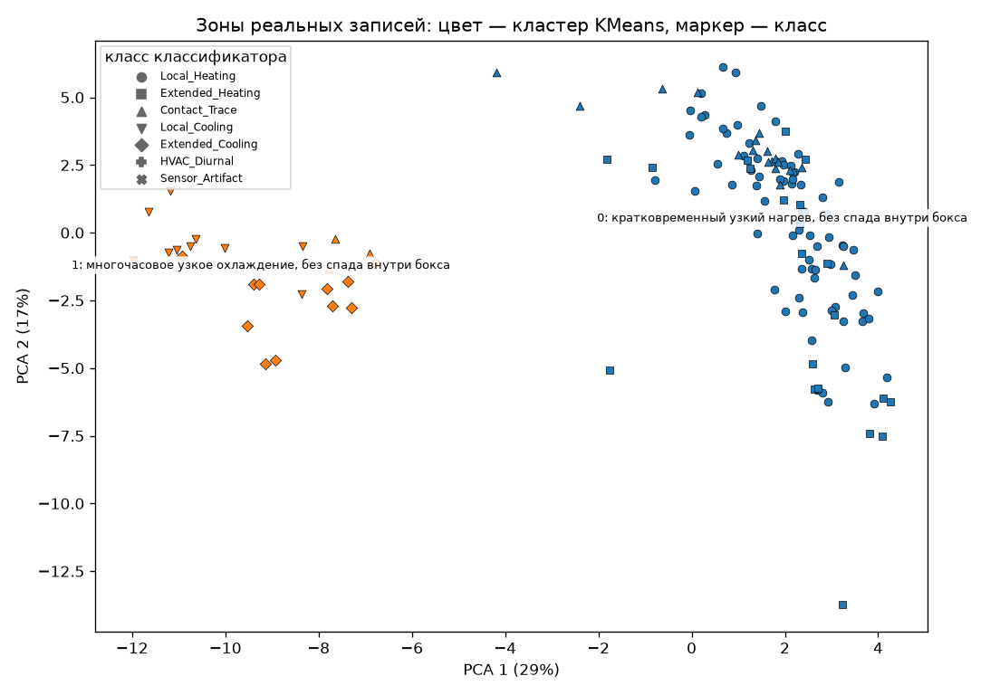
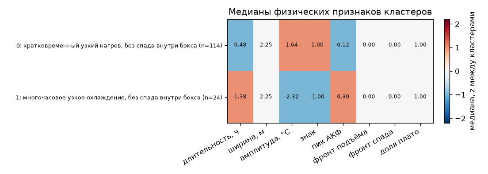

# Кластеры зон на реальных записях МГТС

Шесть файлов `/workspace/mgts/MGTS_data/1.csv`–`6.csv`. Зоны взяты из опубликованной таблицы, детектор в этом прогоне не запускался. Порог в шапке — текущий выпуск `models_release/` и по этим записям не подбирался. Классификатор этапа 2 не дообучался. Стандартизация и выбор числа кластеров описывают уже найденные зоны.

Файл зон `artifacts/eval/real_zones.csv`. Каналы вырезок — `features.make_channels` на сетке детектора. Рабочая точка `far_1e-3`, порог выпуска 0.8608, метод `ens_u2ft_tcn_lgbm`. Зон: **138**.

## Признаки

На каждую зону — вырезка `crop_and_features` и 19 скаляров `SCALAR_NAMES`, плюс эмбеддинг: вход последнего слоя EventNet.head (ReLU после первого Linear, усреднение с отражением по x) (размер 64). В кластеризацию идёт конкатенация, затем `StandardScaler` по этим зонам. Класс классификатора в признаки не входит.

Скаляры, как их считает `crop_and_features`:

- `log_dur_h`, `log_width_m` — log1p длительности в часах и ширины в метрах.
- `width_frac`, `row_frac_cable` — доля ширины зоны от длины кабеля (две одинаковые колонки).
- `amp_med`, `amp_peak`, `amp_min` — медиана, 99-й и 1-й перцентиль ΔT внутри бокса, °C.
- `sign` — +1, если медиана неотрицательна, иначе −1.
- `space_peak` — 95-й перцентиль модуля пространственного канала.
- `rise_frac`, `fall_frac` — доля профиля до выхода на полумаксимум и после ухода с него. Малые значения — резкий фронт.
- `plateau_frac` — доля отсчётов выше полумаксимума.
- `n_sign_changes` — число смен знака производной, делённое на длину профиля.
- `acf_period`, `acf_peak` — лаг пика автокорреляции (доля длины) и высота этого пика. По ним судим периодичность.
- `edge_ratio` — контраст модуля ΔT внутри бокса к полю вырезки.
- `valid_frac` — доля валидных пикселей.
- `t_frac_start`, `t_frac_end` — положение начала и конца зоны внутри записи.

Имя кластера собирается только из медиан длительности, ширины, знака, пика АКФ и фронтов. Пороги: кратко < 1 ч, многочасовой < 6 ч, иначе длительный; узкий < 8 м, умеренный < 25 м, иначе обширный; знак > 0.25 нагрев, < −0.25 охлаждение.

## Записи

| запись | зон | секунд каналов |
|---|---:|---:|
| 1 | 38 | 9.1 |
| 2 | 7 | 2.5 |
| 3 | 49 | 2.1 |
| 4 | 17 | 1.6 |
| 5 | 6 | 6.8 |
| 6 | 21 | 8.0 |

## Выбор числа кластеров

KMeans, `n_init=10`, `random_state=0`, евклидово расстояние после стандартизации. Критерий — silhouette.

| k | silhouette |
|---:|---:|
| 2 | 0.397 ← выбран |
| 3 | 0.247 |
| 4 | 0.225 |
| 5 | 0.232 |
| 6 | 0.267 |
| 7 | 0.275 |
| 8 | 0.275 |

Выбран k = **2**, silhouette KMeans 0.397. Агломеративная кластеризация (Ward) при том же k: silhouette 0.397, ARI с KMeans 1.000.

## Кластеры KMeans

| id | имя | n | ч | м | °C мед. | знак | АКФ | доля АКФ≥0.4 | подъём | спад | плато | частый класс |
|---:|---|---:|---:|---:|---:|---:|---:|---:|---:|---:|---:|---|
| 0 | кратковременный узкий нагрев, без спада внутри бокса | 114 | 0.48 | 2.25 | 1.64 | 1.00 | 0.12 | 0.21 | 0.00 | 0.00 | 1.00 | Local_Heating (65%) |
| 1 | многочасовое узкое охлаждение, без спада внутри бокса | 24 | 1.38 | 2.25 | -2.32 | -1.00 | 0.30 | 0.38 | 0.00 | 0.00 | 1.00 | Extended_Cooling (46%) |

## Сопоставление с классификатором

ARI кластеров KMeans и классов классификатора: **0.329**. ARI агломеративных кластеров и тех же классов: 0.329. Единица была бы при полном совпадении разбиений, ноль — при случайном согласии.

| кластер | Local_Heating | Extended_Heating | Contact_Trace | Local_Cooling | Extended_Cooling | HVAC_Diurnal | Sensor_Artifact |
|---:|---:|---:|---:|---:|---:|---:|---:|
| 0 | 74 | 21 | 19 | 0 | 0 | 0 | 0 |
| 1 | 0 | 0 | 3 | 10 | 11 | 0 | 0 |

Доля дисперсии PCA: 29% и 17%. Подписи — имена кластеров в их центроидах. Маркер точки — класс классификатора, цвет — кластер.

## Выводы

- На 138 зонах шести записей silhouette максимален при k=2 (0.397). Ward-кластеризация при том же k согласована с KMeans на ARI 1.000 (silhouette 0.397).
- Согласие с классами классификатора умеренное либо слабое: ARI 0.329. Кластеры собраны по форме вырезки и эмбеддингу, а не по голосу классификатора, поэтому разбиение не обязано повторять семь имён.
- Крупнейший кластер 0 «кратковременный узкий нагрев, без спада внутри бокса»: 114 зон, медиана 0.48 ч и 2.3 м, чаще всего классификатор ставит Local_Heating (65%).
- По знаку медианы нагрев у 114 зон (1 кластер), охлаждение у 24 зон (1 кластер).
- Ни один кластер не набирает медиану пика АКФ 0.4: устойчивой периодичности в типичной зоне нет. Кластер 0 — 0.12. Кластер 1 — 0.30.
