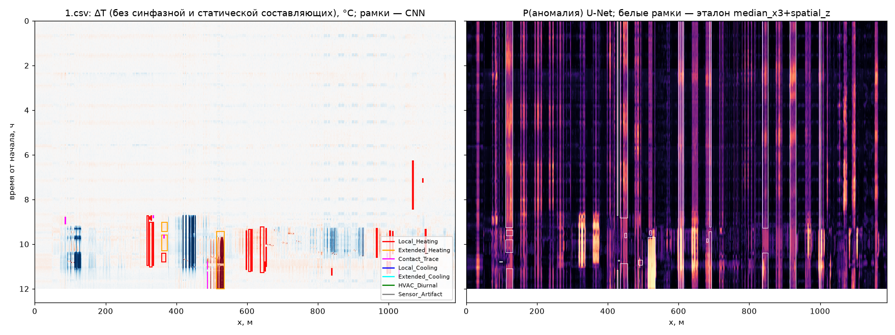
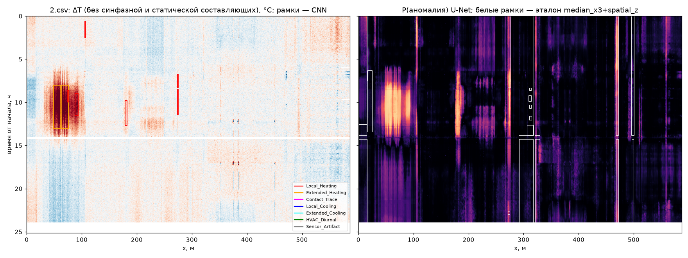
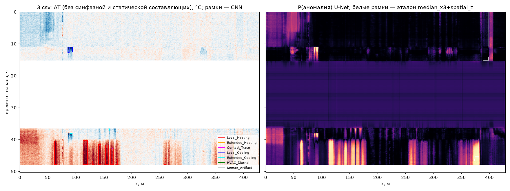
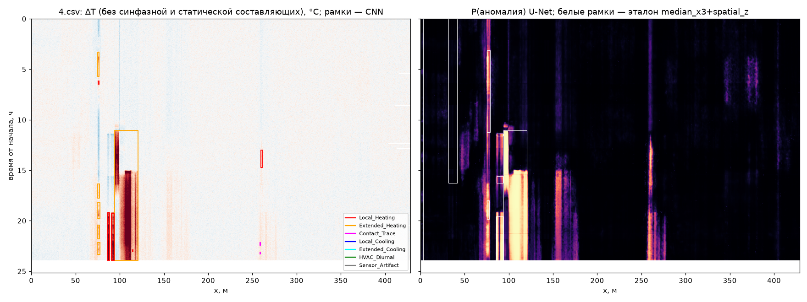
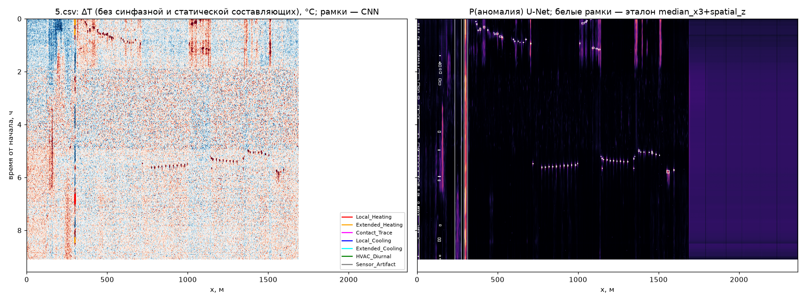
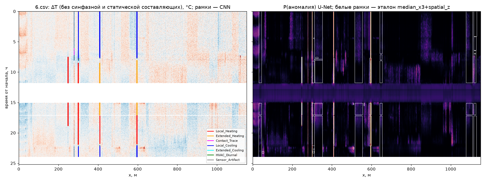

# Экспертный отчёт по реальным записям МГТС (Итоговый отчёт)

> **Итоговый отчёт** по релизу, который передан в `--release` (или по последней строке `RELEASE_DECISION`, если флаг не задан). Числа ниже — этого прогона.

Сгенерирован 2026-10-16 03:03 UTC. Релиз `ens_gen2`. Прогон занял 6.4 мин. Это укладывается в окно 20 минут.

## Краткое заключение

Шесть записей МГТС, файлы 1.csv–6.csv: температура оптического волокна вдоль кабеля и по времени. Это оценка готовой модели. На этих файлах метки не ставились и порог не подбирался.

Этот текст собран с релиза `ens_gen2`. Журнал называет решение `ens_gen2`: 02:56 RELEASE_DECISION ens_gen2 (prev ens_u2ft_tcn_lgbm) reason: 2 seeds held-out41 +0.018 each, test/v10/v11 +0.05 CI excl 0, nested k5 +0.05; val CI covers 0 (documented deviation); cards 7/15 vs 8/15, false 0/5 both; doc docs/RELEASE_DECISION.md

Тревог 95, в короткий список для разбора 16. По файлам тревоги/в списке: 1: 32/4, 2: 8/1, 3: 18/4, 4: 13/2, 5: 4/1, 6: 20/4.

До пяти мест для выезда. Выше в списке — сильнее по амплитуде, длительности и уверенности суждения. Это не журнал дефектов.

1. Файл 1, 514.5–535.5 м, 2026-09-14 06:29–2026-09-14 09:01 UTC, ΔT +30.29 °C. Причина: солнце, окна или вывод наружу. Уверенность: высокая. Почему: пятно 21 м и 2 ч 32 мин: одна муфта так широко не греет.
2. Файл 6, 594.5–598.5 м, 2026-02-11 21:02–2026-02-12 04:36 UTC, ΔT -9.20 °C. Причина: труба, шахта или сквозняк. Уверенность: высокая. Почему: охлаждение 9.2 °C на 4.0 м держится 7 ч 34 мин.
3. Файл 4, 94.0–120.8 м, 2026-05-26 11:05–2026-05-26 23:55 UTC, ΔT +10.43 °C. Причина: климат, солнце или вентиляция. Уверенность: высокая. Почему: пятно 27 м и 12 ч 50 мин: одна муфта так широко не греет.
4. Файл 6, 299.8–301.8 м, 2026-02-11 21:06–2026-02-12 04:38 UTC, ΔT -7.06 °C. Причина: труба, шахта или сквозняк. Уверенность: высокая. Почему: охлаждение 7.1 °C на 2.0 м держится 7 ч 32 мин.
5. Файл 4, 85.8–88.2 м, 2026-05-26 19:13–2026-05-26 23:55 UTC, ΔT +10.22 °C. Причина: муфта, ввод или труба. Уверенность: высокая. Почему: нагрев 2.5 м держится 4 ч 42 мин, это шире шума одной клетки.

Надёжность. Модель хорошо видит локальный нагрев от 3–5 °C, который держится часами. Плохо видит слабое охлаждение до 2 °C, постоянные узкие горячие точки и перенос с синтетики на реальную трассу.

## Качество модели на синтетике

IoU при FAR 1e-3 — доля пикселей, где модель и синтетическая разметка вместе отметили аномалию, среди всех пикселей, которые отметила хотя бы одна из сторон. Порог ставится так, чтобы на спокойном фоне синтетики ложных пикселей было около одной тысячной. Реальные CSV в эту таблицу не входят.

| сплит | ens_u2ft_tcn_lgbm | ens_gen2 (ens_blend) |
|---|---:|---:|
| v8 val | 0.3867 | 0.4106 |
| v8 test | 0.4053 | 0.4579 |
| v10 test | 0.4039 | 0.4576 |
| v11 test | 0.4039 | 0.4575 |

Дальше — проверка, что прирост не держится на четырёх файлах, по которым выбирали чекпойнт. Held-out 41 — остальные последовательности v8 val. Вложенные k=5 и k=2 считают порог на обучающей части фолда, а IoU — на отложенной. Дельта — IoU смеси минус IoU победителя. 95% ДИ — процентили 2.5 и 97.5 бутстрэпа по последовательностям. Нет ключа в json — «н/д».

| проверка | победитель | ens_gen2 | дельта |
|---|---:|---:|---:|
| held-out 41, порог полного v8 val | 0.3784 | 0.3952 | +0.0168 |
| held-out 41, порог заново на этих 41 | 0.3784 | 0.3965 | +0.0181 |
| вложенная k=5 | 0.3296 | 0.3801 | +0.0505 |
| вложенная k=2 | 0.3817 | 0.3897 | +0.0080 |

| бутстрэп дельты | точка и 95% ДИ |
|---|---|
| held-out 41, порог полного v8 val | +0.0168 [-0.0243; +0.0587] |
| held-out 41, порог заново на этих 41 | +0.0181 [-0.0231; +0.0591] |
| v8 test | +0.0526 [+0.0253; +0.0875] |
| v10 test | +0.0537 [+0.0279; +0.0943] |
| v11 test | +0.0536 [+0.0278; +0.0942] |

По флагу `covers_zero` в json: held-out 41, порог полного v8 val — интервал включает ноль; held-out 41, порог заново на этих 41 — интервал включает ноль; v8 test — интервал не включает ноль; v10 test — интервал не включает ноль; v11 test — интервал не включает ноль.

Источники: `artifacts/eval/s3_gen2_v8.json`, `artifacts/eval/s3_gen2_check.json`, `artifacts/eval/s3_combo_report.json`, `artifacts/eval/v10_ens_u2ft_tcn_lgbm.json`, `artifacts/eval/v11_ens_u2ft_tcn_lgbm.json`.

Рисунок каждой записи — поле ΔT (температура минус синфазная и статическая составляющие) и карта вероятности аномалии. Цвет рамки — тип зоны. Сплошная рамка — тревога, пунктир — зона без тревоги. Белые рамки на правой панели — классический детектор median_x3+spatial_z, ориентир сравнения, не ответ оператора и не вход модели. Рядом лежит рисунок контуров `real_final_cv_<файл>.png`: та же ΔT, контур зоны и линия фронта. Порог он не меняет.

## Релиз и флаги

Смесь ens_blend из `models_release_gen2` (`--gen2 on`): score = 0.5 * (ens_u2ft_tcn_lgbm + unet_gen2); hotness = 0.5 * (winner_hot + unet_gen2_hot). U-Net ширины 16, дообученная на синтетике с физическим генератором: узкие статичные точки, широкие сдвиги, периодика HVAC, приборные провалы −20°C как негативы. Порог FAR 1e-3 равен 0.8579896092424856. Источник порога: full v8 val background of ens_blend, artifacts/eval/s3_gen2_v8.json val.ens_blend.threshold. The four proxy files used to pick the checkpoint stay inside that background. Test, v10, v11 and real files do not move the threshold. Реальные CSV и карточки порог не двигают, метки не назначаются. `models_release` только читается. Со `--static on` этот релиз запрещён.

Флаги `scripts/run_real.py` в этом прогоне:

| флаг | значение |
|---|---|
| `--detector` | winner |
| `--static` | off |
| `--mae` | off |
| `--gen2` | on |
| `--calib` | global |
| `--op` | far_1e-3 |
| `--zones` | cc |
| `--cv-annot` | да |

Порог в json этого прогона: **0.8579896092424856**. Калибровка `global`, рабочая точка `far_1e-3`, режим зон `cc`. static=`off`, mae=`off`, gen2=`on`.

Порог заморожен на синтетике. Карточки ниже только показывают, попала ли уже найденная тревога в рамку оператора.

Ветка GEN2 в json: score = 0.5 * (ens_u2ft_tcn_lgbm + unet_gen2); hotness = 0.5 * (winner_hot + unet_gen2_hot). Порог ens_blend заморожен на synth v8 val. Карточки и реальные CSV его не двигают и в обучение не входят.

## Обзор по файлам

Длина — по валидным метрам кабеля. Длительность — от первой до последней метки времени. «Тревога» — зона, чей тип не HVAC_Diurnal и не Sensor_Artifact. IoU с классикой — пересечение масок на сетке, не согласие с оператором.

| файл | часы | км | порог | зоны | тревоги | в разборе | зоны классики | IoU с классикой | без пояса |
|---|---:|---:|---:|---:|---:|---:|---:|---:|---|
| 1 | 12.02 | 1.188 | 0.8580 | 32 | 32 | 4 | 23 | 0.047 | нет |
| 2 | 23.95 | 0.587 | 0.8580 | 8 | 8 | 1 | 19 | 0.001 | нет |
| 3 | 47.96 | 0.428 | 0.8580 | 18 | 18 | 4 | 5 | 0.009 | нет |
| 4 | 23.95 | 0.429 | 0.8580 | 13 | 13 | 2 | 8 | 0.433 | нет |
| 5 | 9.12 | 1.688 | 0.8580 | 4 | 4 | 1 | 134 | 0.012 | да |
| 6 | 24.0 | 1.15 | 0.8580 | 20 | 20 | 4 | 43 | 0.050 | нет |

Всего зон 95, тревог 95. В экспертный разбор ниже взято 16 из них. Остальные тревоги остаются в csv.

### Файл 1

Длительность 12.02 ч, длина 1.188 км, исходная матрица [615, 11707], сетка модели [361, 4754]. Зон по типам: Local_Heating 22, Contact_Trace 7, Extended_Heating 3. Доля пикселей тревоги 0.0083, у классики 0.0422. Мёртвых тревог вне маски 0. В разбор: 1-0025, 1-0018, 1-0016, 1-0010.



Контуры и фронт: [real_final_cv_1.png](figures/real_final_cv_1.png).

### Файл 2

Длительность 23.95 ч, длина 0.587 км, исходная матрица [696, 2315], сетка модели [719, 2349]. Зон по типам: Local_Heating 6, Extended_Heating 2. Доля пикселей тревоги 0.0076, у классики 0.0544. Мёртвых тревог вне маски 0. В разбор: 2-0003.



Контуры и фронт: [real_final_cv_2.png](figures/real_final_cv_2.png).

### Файл 3

Длительность 47.96 ч, длина 0.428 км, исходная матрица [788, 1689], сетка модели [1439, 1714]. Зон по типам: Local_Heating 11, Extended_Cooling 3, Local_Cooling 2, Contact_Trace 1, Extended_Heating 1. Доля пикселей тревоги 0.0208, у классики 0.0051. Мёртвых тревог вне маски 0. В разбор: 3-0006, 3-0005, 3-0008, 3-0007.



Контуры и фронт: [real_final_cv_3.png](figures/real_final_cv_3.png).

### Файл 4

Длительность 23.95 ч, длина 0.429 км, исходная матрица [708, 1691], сетка модели [719, 1716]. Зон по типам: Extended_Heating 6, Local_Heating 5, Contact_Trace 2. Доля пикселей тревоги 0.0224, у классики 0.0271. Мёртвых тревог вне маски 0. Маски нейросети и классики здесь ближе, чем на остальных файлах (IoU 0.43). В разбор: 4-0006, 4-0002.



Контуры и фронт: [real_final_cv_4.png](figures/real_final_cv_4.png).

### Файл 5

Длительность 9.12 ч, длина 1.688 км, исходная матрица [2711, 2364], сетка модели [274, 9453]. Зон по типам: Extended_Heating 3, Local_Heating 1. Доля пикселей тревоги 0.0002, у классики 0.0181. Мёртвых тревог вне маски 0. Время в файле без пояса и прочитано как UTC: рамка карточки в UTC может съехать. Классика ставит много зон при почти нулевом IoU: median_x3+spatial_z на этой записи берёт шум, нейросеть при FAR 1e-3 его в тревогу не поднимает. В разбор: 5-0002.



Контуры и фронт: [real_final_cv_5.png](figures/real_final_cv_5.png).

### Файл 6

Длительность 24.0 ч, длина 1.15 км, исходная матрица [1231, 4534], сетка модели [720, 4602]. Зон по типам: Local_Heating 8, Local_Cooling 6, Extended_Heating 4, Contact_Trace 2. Доля пикселей тревоги 0.0074, у классики 0.0754. Мёртвых тревог вне маски 0. В разбор: 6-0005, 6-0002, 6-0000, 6-0001.



Контуры и фронт: [real_final_cv_6.png](figures/real_final_cv_6.png).

## Значимые зоны

Значимая зона здесь — не каждая тревога модели, а короткий список для выезда. Из 95 тревог оставлены 16 (не меньше 10 и не больше 18, если тревог достаточно). Счёт идёт по амплитуде |ΔT|, длительности и вероятности класса. Рядом стоящие рамки одного файла и одной полярности ближе 4 м сливаются в один очаг: в список берётся более сильный. Дальше список добирается так, чтобы были протяжённый нагрев, устойчивое охлаждение, объект уже разрешения ~1 м, начало линии, одиночная временная ячейка и хотя бы одна зона с каждого файла, где есть тревога. С одного файла не больше четырёх. Полный перечень тревог — в csv этого прогона, порог по короткому списку не двигался.

Пик в таблице подписан знаком полярности. В json поле `peak_dT_C` хранит max |ΔT| без знака. Время — UTC. P(класс) — вероятность назначенного типа.

Как устроен измеритель. Это Рамановский DTS: температура волокна получается из отношения антистоксова и стоксова рассеяния. Пространственное разрешение прибора около 1 м; шаг отсчёта в CSV (0.1–1 м) и клетка сетки модели (0.25 м) бывают мельче и не создают нового разрешения. По времени модель видит ячейки по 120 с (в сырых файлах шаг 10–240 с): каждая точка уже усреднение. К дальнему концу линии антистокс слабеет, шум растёт. Склейка, коннектор и изгиб портят поправку потерь и выглядят как ступенька температуры.

| зона | файл | x, м | начало UTC | конец UTC | длительность | пик ΔT, °C | тип | P | зачем в списке |
|---|---|---|---|---|---:|---:|---|---:|---|
| 1-0025 | 1 | 488.2–488.8 | 2026-09-14 07:49 | 2026-09-14 08:09 | 20 мин | +12.70 | Contact_Trace | 0.53 | уже разрешения ~1 м |
| 1-0018 | 1 | 514.5–535.5 | 2026-09-14 06:29 | 2026-09-14 09:01 | 2 ч 32 мин | +30.29 | Extended_Heating | 0.93 | амплитуда, длительность и уверенность |
| 1-0016 | 1 | 598.0–599.2 | 2026-09-14 06:27 | 2026-09-14 08:09 | 1 ч 42 мин | +7.51 | Local_Heating | 0.89 | амплитуда, длительность и уверенность |
| 1-0010 | 1 | 637.5–647.8 | 2026-09-14 06:17 | 2026-09-14 08:17 | 2 ч | +6.53 | Local_Heating | 0.90 | амплитуда, длительность и уверенность |
| 2-0003 | 2 | 63.5–75.5 | 2026-04-10 08:01 | 2026-04-10 13:01 | 5 ч | +6.62 | Extended_Heating | 0.68 | сильнейшая зона файла |
| 3-0006 | 3 | 61.8–66.0 | 2026-02-13 16:29 | 2026-02-13 23:55 | 7 ч 26 мин | +7.05 | Local_Heating | 0.52 | сильнейшая зона файла |
| 3-0005 | 3 | 113.0–121.2 | 2026-02-13 16:21 | 2026-02-13 23:55 | 7 ч 34 мин | +5.46 | Local_Heating | 0.51 | амплитуда, длительность и уверенность |
| 3-0008 | 3 | 140.5–145.0 | 2026-02-13 17:31 | 2026-02-13 23:55 | 6 ч 24 мин | +5.55 | Local_Heating | 0.54 | амплитуда, длительность и уверенность |
| 3-0007 | 3 | 370.8–382.2 | 2026-02-13 17:11 | 2026-02-13 23:55 | 6 ч 44 мин | +6.00 | Extended_Heating | 0.51 | амплитуда, длительность и уверенность |
| 4-0006 | 4 | 85.8–88.2 | 2026-05-26 19:13 | 2026-05-26 23:55 | 4 ч 42 мин | +10.22 | Local_Heating | 0.92 | амплитуда, длительность и уверенность |
| 4-0002 | 4 | 94.0–120.8 | 2026-05-26 11:05 | 2026-05-26 23:55 | 12 ч 50 мин | +10.43 | Extended_Heating | 0.58 | протяжённый нагрев |
| 5-0002 | 5 | 296.2–302.2 | 2025-10-16 18:38 | 2025-10-16 18:58 | 20 мин | +3.76 | Local_Heating | 0.90 | сильнейшая зона файла |
| 6-0005 | 6 | 246.8–249.5 | 2026-02-12 04:32 | 2026-02-12 08:46 | 4 ч 14 мин | +8.05 | Local_Heating | 0.66 | амплитуда, длительность и уверенность |
| 6-0002 | 6 | 299.8–301.8 | 2026-02-11 21:06 | 2026-02-12 04:38 | 7 ч 32 мин | -7.06 | Local_Cooling | 0.98 | амплитуда, длительность и уверенность |
| 6-0000 | 6 | 407.8–410.5 | 2026-02-11 21:02 | 2026-02-12 04:34 | 7 ч 32 мин | -8.35 | Local_Cooling | 0.79 | амплитуда, длительность и уверенность |
| 6-0001 | 6 | 594.5–598.5 | 2026-02-11 21:02 | 2026-02-12 04:36 | 7 ч 34 мин | -9.20 | Local_Cooling | 0.98 | устойчивое охлаждение |

## Физическая интерпретация

Ниже по каждой зоне из короткого списка: причина, которая согласуется с шириной, длительностью, знаком и амплитудой (муфта или кабельный ввод, климат и вентиляция, солнце и окна, контакт с трубой, приборный провал, шум концов линии, склейка), уровень уверенности и проверка на месте. Как устроен измеритель, сказано выше. Уверенность суждения — не вероятность класса: низкая P при долгой узкой рамке всё ещё может быть муфтой, а высокая P у одной ячейки усреднения наряд не оправдывает. Это не эталон и порог не двигает.

### Файл 1

Зоны 1-0018, 1-0016, 1-0010 начинаются почти вместе и стоят на разных метрах. Это один эпизод нагрева: общий режим трассы и несколько точек контакта. Выезд один.

**1-0025** (склейка или коннектор). Рамка 488.2–488.8 м, ширина 0.5 м (0.5× разрешения ~1 м), длительность 20 мин, около 10 усреднений по 120 с: короткое пятно. Пик ΔT +12.7 °C — max |ΔT| со знаком полярности, уже после вычитания синфазной составляющей и статического профиля. Класс Contact_Trace, P=0.53. Рамка уже пространственного разрешения (~1 м). Прибор не отделяет источник тоньше этой длины: отсчёт 0.1–1 м только дискретизация. Узкий и сильный пик типичен для склейки, коннектора или макроизгиба: они ломают поправку потерь, и отношение антистокс/стокс выглядит как температура. Держится 20 мин: для точечного контакта с трубой это коротко, для склейки — как раз масштаб сбоя поправки потерь. Класс Contact_Trace означает цепочку близких точек. При ширине меньше 1 м цепочка не разрешена: прибор видит одну клетку. Это 41% длины кабеля (1188 м). Ближайшая зона списка — 1-0018 в 26 м (hot, +30.3 °C, ширина 21.0 м), время пересекается. Узкая рамка на краю широкой читается как точечный контакт или склейка внутри общего участка, широкая — как климат этого участка.

Уверенность суждения: средняя. На месте: Муфта, коннектор или хомут в пределах 1 м от 488.2–488.8 м. На сырой температуре ступенька — склейка; гладкий горб шире 2–3 м — реальный нагрев, рамка его обрезала. На месте смотреть обе рамки вместе: сначала широкий участок, потом узкий пик внутри или рядом.

**1-0018** (солнце, окна или вывод наружу). Рамка 514.5–535.5 м, ширина 21.0 м (21.0× разрешения ~1 м), длительность 2 ч 32 мин, около 76 усреднений по 120 с. Пик ΔT +30.3 °C — max |ΔT| со знаком полярности, уже после вычитания синфазной составляющей и статического профиля. Класс Extended_Heating, P=0.93. Одна склейка даёт масштаб около 1 м, одиночный шум — одну ячейку по 120 с. Здесь 21 м и около 30 °C: оболочка прогрета на протяжённом куске, либо на этом куске другой тепловой режим. Правдоподобны солнце на фасаде и окнах, кабельный вывод из здания, длинный контакт с тёплой трубой. Вентиляция обычно даёт единицы градусов, не 30. Это 45% длины кабеля (1188 м). По времени рядом (старт в пределах 20 мин, та же полярность) стоят 1-0016, 1-0010. Общее окно — режим здания: отопление, вентиляция или ночь. Разнесённые по кабелю рамки — точки, где волокно этот режим чувствует, а не отдельные аварии. Ближайшая зона списка — 1-0025 в 26 м (hot, +12.7 °C, ширина 0.5 м), время пересекается. Узкая рамка на краю широкой читается как точечный контакт или склейка внутри общего участка, широкая — как климат этого участка.

Уверенность суждения: высокая. На месте: Пройти 514.5–535.5 м: окна и солнце в эти часы, трубы, ввод в здание, открытый участок. Сырая температура плавная по метрам — тепло; узкая ступенька внутри рамки — склейка. Обойти эти точки одним проходом: общая труба, шахта или режим вентиляции важнее, чем отдельный наряд на каждую рамку.

**1-0016** (муфта, ввод или труба). Рамка 598.0–599.2 м, ширина 1.2 м (1.2× разрешения ~1 м), длительность 1 ч 42 мин, около 51 усреднений по 120 с. Пик ΔT +7.5 °C — max |ΔT| со знаком полярности, уже после вычитания синфазной составляющей и статического профиля. Класс Local_Heating, P=0.89. Ширина 1.2 м — несколько клеток разрешения ~1 м. Так размазываются муфта, кабельный ввод и хомут к горячей трубе. P=0.89: форма пятна устойчивая, это не шум одной ячейки. Часы усреднений отделяют пятно от шума. Статический профиль постоянный горб частично вычитает, в ΔT остаётся меняющаяся часть. Это 50% длины кабеля (1188 м). По времени рядом (старт в пределах 20 мин, та же полярность) стоят 1-0018, 1-0010. Общее окно — режим здания: отопление, вентиляция или ночь. Разнесённые по кабелю рамки — точки, где волокно этот режим чувствует, а не отдельные аварии.

Уверенность суждения: высокая. На месте: Муфта, ввод и хомут к трубе на 598.0–599.2 м. Потрогать кабель и соседние трубы. Ступенька ~1 м на сырой T — склейка; гладкий горб в те же часы — реальный нагрев. Обойти эти точки одним проходом: общая труба, шахта или режим вентиляции важнее, чем отдельный наряд на каждую рамку.

**1-0010** (климат, солнце или вентиляция). Рамка 637.5–647.8 м, ширина 10.2 м (10.2× разрешения ~1 м), длительность 2 ч, около 60 усреднений по 120 с. Пик ΔT +6.5 °C — max |ΔT| со знаком полярности, уже после вычитания синфазной составляющей и статического профиля. Класс Local_Heating, P=0.90. Нагрев на 10 м дольше двух часов. Одна муфта так широко не греет. Амплитуда 6.5 °C — обычный масштаб климата помещения и вентиляции после снятия синфазной составляющей. Это 55% длины кабеля (1188 м). По времени рядом (старт в пределах 20 мин, та же полярность) стоят 1-0018, 1-0016. Общее окно — режим здания: отопление, вентиляция или ночь. Разнесённые по кабелю рамки — точки, где волокно этот режим чувствует, а не отдельные аварии.

Уверенность суждения: средняя. На месте: Чем закрыт участок 637.5–647.8 м: окна, лоток, вентканал, вывод из здания. На рисунке сравнить день и ночь. Обойти эти точки одним проходом: общая труба, шахта или режим вентиляции важнее, чем отдельный наряд на каждую рамку.

### Файл 2

**2-0003** (климат, солнце или вентиляция). Рамка 63.5–75.5 м, ширина 12.0 м (12.0× разрешения ~1 м), длительность 5 ч, около 150 усреднений по 120 с. Пик ΔT +6.6 °C — max |ΔT| со знаком полярности, уже после вычитания синфазной составляющей и статического профиля. Класс Extended_Heating, P=0.68. Нагрев на 12 м дольше двух часов. Одна муфта так широко не греет. Амплитуда 6.6 °C — обычный масштаб климата помещения и вентиляции после снятия синфазной составляющей. Это 13% длины кабеля (587 м).

Уверенность суждения: средняя. На месте: Чем закрыт участок 63.5–75.5 м: окна, лоток, вентканал, вывод из здания. На рисунке сравнить день и ночь.

### Файл 3

**3-0006** (муфта, ввод или труба). Рамка 61.8–66.0 м, ширина 4.2 м (4.2× разрешения ~1 м), длительность 7 ч 26 мин, около 223 усреднений по 120 с. Пик ΔT +7.1 °C — max |ΔT| со знаком полярности, уже после вычитания синфазной составляющей и статического профиля. Класс Local_Heating, P=0.52. Ширина 4.2 м шире одной муфты. Скорее ввод или короткий участок вдоль трубы, а не одиночная склейка. P=0.52 невысокая: форма для модели неоднозначна, на месте решать по сырой температуре. Часы усреднений отделяют пятно от шума. Статический профиль постоянный горб частично вычитает, в ΔT остаётся меняющаяся часть. Это 15% длины кабеля (428 м). По времени рядом (старт в пределах 20 мин, та же полярность) стоят 3-0005. Общее окно — режим здания: отопление, вентиляция или ночь. Разнесённые по кабелю рамки — точки, где волокно этот режим чувствует, а не отдельные аварии.

Уверенность суждения: средняя. На месте: Муфта, ввод и хомут к трубе на 61.8–66.0 м. Потрогать кабель и соседние трубы. Ступенька ~1 м на сырой T — склейка; гладкий горб в те же часы — реальный нагрев. Обойти эти точки одним проходом: общая труба, шахта или режим вентиляции важнее, чем отдельный наряд на каждую рамку.

**3-0005** (климат, солнце или вентиляция). Рамка 113.0–121.2 м, ширина 8.2 м (8.2× разрешения ~1 м), длительность 7 ч 34 мин, около 227 усреднений по 120 с. Пик ΔT +5.5 °C — max |ΔT| со знаком полярности, уже после вычитания синфазной составляющей и статического профиля. Класс Local_Heating, P=0.51. Нагрев на 8 м дольше двух часов. Одна муфта так широко не греет. Амплитуда 5.5 °C — обычный масштаб климата помещения и вентиляции после снятия синфазной составляющей. Это 28% длины кабеля (428 м). По времени рядом (старт в пределах 20 мин, та же полярность) стоят 3-0006. Общее окно — режим здания: отопление, вентиляция или ночь. Разнесённые по кабелю рамки — точки, где волокно этот режим чувствует, а не отдельные аварии. Ближайшая зона списка — 3-0008 в 19 м (hot, +5.5 °C, ширина 4.5 м), время пересекается. Узкая рамка на краю широкой читается как точечный контакт или склейка внутри общего участка, широкая — как климат этого участка.

Уверенность суждения: средняя. На месте: Чем закрыт участок 113.0–121.2 м: окна, лоток, вентканал, вывод из здания. На рисунке сравнить день и ночь. Обойти эти точки одним проходом: общая труба, шахта или режим вентиляции важнее, чем отдельный наряд на каждую рамку.

**3-0008** (муфта, ввод или труба). Рамка 140.5–145.0 м, ширина 4.5 м (4.5× разрешения ~1 м), длительность 6 ч 24 мин, около 192 усреднений по 120 с. Пик ΔT +5.5 °C — max |ΔT| со знаком полярности, уже после вычитания синфазной составляющей и статического профиля. Класс Local_Heating, P=0.54. Ширина 4.5 м шире одной муфты. Скорее ввод или короткий участок вдоль трубы, а не одиночная склейка. P=0.54 невысокая: форма для модели неоднозначна, на месте решать по сырой температуре. Часы усреднений отделяют пятно от шума. Статический профиль постоянный горб частично вычитает, в ΔT остаётся меняющаяся часть. Это 34% длины кабеля (428 м). По времени рядом (старт в пределах 20 мин, та же полярность) стоят 3-0007. Общее окно — режим здания: отопление, вентиляция или ночь. Разнесённые по кабелю рамки — точки, где волокно этот режим чувствует, а не отдельные аварии. Ближайшая зона списка — 3-0005 в 19 м (hot, +5.5 °C, ширина 8.2 м), время пересекается. Узкая рамка на краю широкой читается как точечный контакт или склейка внутри общего участка, широкая — как климат этого участка.

Уверенность суждения: средняя. На месте: Муфта, ввод и хомут к трубе на 140.5–145.0 м. Потрогать кабель и соседние трубы. Ступенька ~1 м на сырой T — склейка; гладкий горб в те же часы — реальный нагрев. Обойти эти точки одним проходом: общая труба, шахта или режим вентиляции важнее, чем отдельный наряд на каждую рамку.

**3-0007** (климат, солнце или вентиляция). Рамка 370.8–382.2 м, ширина 11.5 м (11.5× разрешения ~1 м), длительность 6 ч 44 мин, около 202 усреднений по 120 с. Пик ΔT +6.0 °C — max |ΔT| со знаком полярности, уже после вычитания синфазной составляющей и статического профиля. Класс Extended_Heating, P=0.51. Нагрев на 12 м дольше двух часов. Одна муфта так широко не греет. Амплитуда 6.0 °C — обычный масштаб климата помещения и вентиляции после снятия синфазной составляющей. Это 89% длины кабеля (428 м). По времени рядом (старт в пределах 20 мин, та же полярность) стоят 3-0008. Общее окно — режим здания: отопление, вентиляция или ночь. Разнесённые по кабелю рамки — точки, где волокно этот режим чувствует, а не отдельные аварии. Отметка на 89% длины. Шум антистокса к концу выше, но часы ровного пятна — не шум одной ячейки. Амплитуду читать осторожнее, чем в начале линии; причину искать как на середине трассы.

Уверенность суждения: средняя. На месте: Чем закрыт участок 370.8–382.2 м: окна, лоток, вентканал, вывод из здания. На рисунке сравнить день и ночь. Обойти эти точки одним проходом: общая труба, шахта или режим вентиляции важнее, чем отдельный наряд на каждую рамку.

### Файл 4

4-0006 по времени сидит внутри 4-0002 и уже её в разы. Сначала смотреть протяжённый участок; узкий пик — вероятная муфта или склейка на его краю, а не второй источник.

**4-0006** (муфта, ввод или труба). Рамка 85.8–88.2 м, ширина 2.5 м (2.5× разрешения ~1 м), длительность 4 ч 42 мин, около 141 усреднений по 120 с. Пик ΔT +10.2 °C — max |ΔT| со знаком полярности, уже после вычитания синфазной составляющей и статического профиля. Класс Local_Heating, P=0.92. Ширина 2.5 м — несколько клеток разрешения ~1 м. Так размазываются муфта, кабельный ввод и хомут к горячей трубе. P=0.92: форма пятна устойчивая, это не шум одной ячейки. Часы усреднений отделяют пятно от шума. Статический профиль постоянный горб частично вычитает, в ΔT остаётся меняющаяся часть. Это 21% длины кабеля (429 м). Ближайшая зона списка — 4-0002 в 6 м (hot, +10.4 °C, ширина 26.8 м), время пересекается. Узкая рамка на краю широкой читается как точечный контакт или склейка внутри общего участка, широкая — как климат этого участка.

Уверенность суждения: высокая. На месте: Муфта, ввод и хомут к трубе на 85.8–88.2 м. Потрогать кабель и соседние трубы. Ступенька ~1 м на сырой T — склейка; гладкий горб в те же часы — реальный нагрев. На месте смотреть обе рамки вместе: сначала широкий участок, потом узкий пик внутри или рядом.

**4-0002** (климат, солнце или вентиляция). Рамка 94.0–120.8 м, ширина 26.8 м (26.8× разрешения ~1 м), длительность 12 ч 50 мин, около 385 усреднений по 120 с. Пик ΔT +10.4 °C — max |ΔT| со знаком полярности, уже после вычитания синфазной составляющей и статического профиля. Класс Extended_Heating, P=0.58. Протяжённый нагрев на 27 м. Одна муфта такой ширины не собирает: точечный источник размазывается примерно на 1 м. Амплитуда 10.4 °C выше обычных 2–4 °C вентиляции и ниже десятков градусов на открытом солнце. Подходят фасад с окнами, тёплый лоток и техническое помещение. Это 28% длины кабеля (429 м). Ближайшая зона списка — 4-0006 в 6 м (hot, +10.2 °C, ширина 2.5 м), время пересекается. Узкая рамка на краю широкой читается как точечный контакт или склейка внутри общего участка, широкая — как климат этого участка.

Уверенность суждения: высокая. На месте: Чем закрыт участок 94.0–120.8 м: окна, лоток, вентканал. На рисунке сравнить день и ночь: суточный ход — солнце или климат помещения. На месте смотреть обе рамки вместе: сначала широкий участок, потом узкий пик внутри или рядом.

### Файл 5

**5-0002** (локальный источник). Рамка 296.2–302.2 м, ширина 6.0 м (6.0× разрешения ~1 м), длительность 20 мин, около 10 усреднений по 120 с: короткое пятно. Пик ΔT +3.8 °C — max |ΔT| со знаком полярности, уже после вычитания синфазной составляющей и статического профиля. Класс Local_Heating, P=0.90. По ширине это несколько длин разрешения. Правдоподобны муфта, кабельный ввод, контакт с трубой или короткое солнечное пятно у окна. Вентиляция и климат дают более широкие рамки. Это 18% длины кабеля (1688 м). У файла нет пояса времени, метки прочитаны как UTC и могут быть сдвинуты относительно карточек.

Уверенность суждения: низкая. На месте: Осмотр 296.2–302.2 м: муфта, ввод, труба, окно. Сырая T рядом с рисунком ΔT.

### Файл 6

Зоны 6-0002, 6-0000, 6-0001 начинаются почти вместе и стоят на разных метрах. Это один эпизод охлаждения: общий режим трассы и несколько точек контакта. Выезд один.

**6-0005** (муфта, ввод или труба). Рамка 246.8–249.5 м, ширина 2.8 м (2.8× разрешения ~1 м), длительность 4 ч 14 мин, около 127 усреднений по 120 с. Пик ΔT +8.1 °C — max |ΔT| со знаком полярности, уже после вычитания синфазной составляющей и статического профиля. Класс Local_Heating, P=0.66. Ширина 2.8 м — несколько клеток разрешения ~1 м. Так размазываются муфта, кабельный ввод и хомут к горячей трубе. Часы усреднений отделяют пятно от шума. Статический профиль постоянный горб частично вычитает, в ΔT остаётся меняющаяся часть. Это 22% длины кабеля (1150 м). По часам стыкуется с 6-0002 (cold -7.1 °C): одно заканчивается около того часа, когда другое уже идёт. Похоже на смену режима помещения, а не на два независимых дефекта.

Уверенность суждения: высокая. На месте: Муфта, ввод и хомут к трубе на 246.8–249.5 м. Потрогать кабель и соседние трубы. Ступенька ~1 м на сырой T — склейка; гладкий горб в те же часы — реальный нагрев.

**6-0002** (труба, шахта или сквозняк). Рамка 299.8–301.8 м, ширина 2.0 м (2.0× разрешения ~1 м), длительность 7 ч 32 мин, около 226 усреднений по 120 с. Пик ΔT -7.1 °C — max |ΔT| со знаком полярности, уже после вычитания синфазной составляющей и статического профиля. Класс Local_Cooling, P=0.98. Ширина 2.0 м — точечный контакт: холодная труба или устье шахты. Склейка обычно ещё уже, около 1 м, и на сырой T выглядит ступенькой, а не ночным провалом. Провал 7.1 °C для холодной трубы или уличного воздуха правдоподобен. Для комнатного воздуха это много, но не тот провал −15…−25 °C, который рисует срыв поправки. Это 26% длины кабеля (1150 м). По времени рядом (старт в пределах 20 мин, та же полярность) стоят 6-0000, 6-0001. Общее окно — режим здания: отопление, вентиляция или ночь. Разнесённые по кабелю рамки — точки, где волокно этот режим чувствует, а не отдельные аварии. По часам стыкуется с 6-0005 (hot +8.1 °C): одно заканчивается около того часа, когда другое уже идёт. Похоже на смену режима помещения, а не на два независимых дефекта.

Уверенность суждения: высокая. На месте: Трубы, тяга воздуха и колодец на 299.8–301.8 м. Сырая температура: плавный провал — контакт или климат, ступенька ~1 м — склейка. Обойти эти точки одним проходом: общая труба, шахта или режим вентиляции важнее, чем отдельный наряд на каждую рамку.

**6-0000** (труба, шахта или сквозняк). Рамка 407.8–410.5 м, ширина 2.8 м (2.8× разрешения ~1 м), длительность 7 ч 32 мин, около 226 усреднений по 120 с. Пик ΔT -8.4 °C — max |ΔT| со знаком полярности, уже после вычитания синфазной составляющей и статического профиля. Класс Local_Cooling, P=0.79. Ширина 2.8 м — точечный контакт: холодная труба или устье шахты. Склейка обычно ещё уже, около 1 м, и на сырой T выглядит ступенькой, а не ночным провалом. Провал 8.4 °C для холодной трубы или уличного воздуха правдоподобен. Для комнатного воздуха это много, но не тот провал −15…−25 °C, который рисует срыв поправки. Это 36% длины кабеля (1150 м). По времени рядом (старт в пределах 20 мин, та же полярность) стоят 6-0002, 6-0001. Общее окно — режим здания: отопление, вентиляция или ночь. Разнесённые по кабелю рамки — точки, где волокно этот режим чувствует, а не отдельные аварии.

Уверенность суждения: средняя. На месте: Трубы, тяга воздуха и колодец на 407.8–410.5 м. Сырая температура: плавный провал — контакт или климат, ступенька ~1 м — склейка. Обойти эти точки одним проходом: общая труба, шахта или режим вентиляции важнее, чем отдельный наряд на каждую рамку.

**6-0001** (труба, шахта или сквозняк). Рамка 594.5–598.5 м, ширина 4.0 м (4.0× разрешения ~1 м), длительность 7 ч 34 мин, около 227 усреднений по 120 с. Пик ΔT -9.2 °C — max |ΔT| со знаком полярности, уже после вычитания синфазной составляющей и статического профиля. Класс Local_Cooling, P=0.98. Ширина 4.0 м уже не одна муфта. Короткий участок в холодном колодце, вдоль холодной трубы или на сквозняке. Провал 9.2 °C для холодной трубы или уличного воздуха правдоподобен. Для комнатного воздуха это много, но не тот провал −15…−25 °C, который рисует срыв поправки. Это 52% длины кабеля (1150 м). По времени рядом (старт в пределах 20 мин, та же полярность) стоят 6-0002, 6-0000. Общее окно — режим здания: отопление, вентиляция или ночь. Разнесённые по кабелю рамки — точки, где волокно этот режим чувствует, а не отдельные аварии.

Уверенность суждения: высокая. На месте: Трубы, тяга воздуха и колодец на 594.5–598.5 м. Сырая температура: плавный провал — контакт или климат, ступенька ~1 м — склейка. Обойти эти точки одним проходом: общая труба, шахта или режим вентиляции важнее, чем отдельный наряд на каждую рамку.

## Согласие с карточками оператора

Только описание. Попадание — хотя бы одна тревожная зона этого прогона (любая, не только короткий список) пересекает рамку карточки по метрам и по времени. Порог из-за этих рамок не менялся. Ответ оператора — быстрое мнение по графику, не эталон.

### Партии 1 и 2

Файлы `data/operator_cards/cards_batch1.jsonl` и `cards_batch2.jsonl`. Счёт ниже снят с поля `cards` json этого прогона (тот же проход, что и зоны).

| ответ оператора | рамок | рамок с тревогой модели |
|---|---:|---:|
| yes | 15 | 7 |
| no | 5 | 0 |
| unclear | 1 | 0 |

Из 15 рамок с ответом yes без тревоги модели остались 8. Счёт идёт по всем тревогам файла, не по короткому списку выше. Знак не совпал в 1 рамке (gap-r1-x295.736-x358.173-t0-344): оператор отметил один знак, главный тип модели — другой. Рамка пересеклась, физика нагрева и охлаждения — нет. Карточка смотрит сырой график, модель — ΔT после вычитания профиля; остаток может сменить знак. Ответы no: тревога попала в 0 из 5. На этих рамках модель почти не рисует лишнего. Порог из-за этого не двигался.

| id | файл | ответ | тип у оператора | тревог в рамке | главный тип модели |
|---|---|---|---|---:|---|
| gap-r1-x295.736-x358.173-t0-344 | 1 | yes | Local_Cooling | 6 | Local_Heating |
| next-0006 | 1 | no | — | 0 | — |
| next-0011 | 1 | yes | несколько участков, Local_Heating | 0 | — |
| gap-r2-x202.258-x266.971-t0-410 | 2 | no | — | 0 | — |
| gap-r2-x271.285-x276.107-t0-246 | 2 | yes | Local_Heating | 1 | Local_Heating |
| gap-r2-x495.875-x500.443-t0-409 | 2 | yes | Local_Cooling | 0 | — |
| next-0004 | 2 | yes | Local_Heating | 4 | Extended_Heating |
| next-0007 | 2 | no | — | 0 | — |
| next-0010 | 2 | no | — | 0 | — |
| gap-r3-x0.000-x72.325-t0-465 | 3 | yes | Local_Cooling | 0 | — |
| gap-r3-x388.523-x398.674-t0-330 | 3 | yes | Local_Cooling | 0 | — |
| gap-r3-x388.777-x397.913-t419-451 | 3 | yes | Local_Cooling | 0 | — |
| next-0001 | 3 | yes | Local_Heating, Local_Heating | 1 | Extended_Heating |
| next-0003 | 3 | yes | Local_Heating | 8 | Local_Heating |
| next-0005 | 4 | no | — | 0 | — |
| next-0009 | 4 | yes | Local_Heating | 2 | Extended_Heating |
| gap-r5-x0.000-x127.000-t0-1537 | 5 | unclear | — | 0 | — |
| gap-r5-x155.000-x213.000-t0-1537 | 5 | yes | — | 0 | — |
| next-0002 | 5 | yes | Local_Cooling | 0 | — |
| gap-r6-x1116.100-x1129.296-t251-383 | 6 | yes | — | 0 | — |
| next-0008 | 6 | yes | Local_Heating | 1 | Local_Heating |

### CARDS_REVIEW_2

150 рамок из jsonl разбора `docs/CARDS_REVIEW_2.md` (тот же файл, что читает `run_real` для mae/static). Колонка `winner` в `artifacts/eval/cards2_review.csv` — прошлый описательный подсчёт выпуска. Этот прогон её не подгоняет и порог по ней не двигает.

| ответ | рамок в этом прогоне | с тревогой | колонка winner (прошлый подсчёт) |
|---|---:|---:|---|
| yes | 91 | 14 | 14/91 |
| no | 19 | 3 | 3/19 |
| unclear | 40 | 14 | 17/40 |

Счёт этого прогона отличается от колонки `winner`. В отчёт записан свежий пересчёт. Порог из-за расхождения не двигался.

Среди ответов yes, если тип указан (рамка может нести несколько типов):

| тип в карточке | рамок | с тревогой |
|---|---:|---:|
| Local_Heating | 67 | 13 |
| Local_Cooling | 17 | 0 |
| Periodic_Thermal | 23 | 7 |
| Broad_Shift | 20 | 2 |

Узкий срез прошлого разбора (yes, колонка winner = 0, ширина ≤ 12 м, dT_hi ≥ 3 °C): тревога этого прогона попала в 0 из 16. Определение взято из `docs/CARDS_REVIEW_2.md`. Порог по этому списку не выбирался.

| id | файл | ширина, м | dT_hi, °C | тревога сейчас |
|---|---|---:|---:|---|
| ask-r1-x417.259-x421.015-t0-344 | 1 | 3.8 | 6.90 | нет |
| ask-r1-x425.787-x429.036-t0-230 | 1 | 3.2 | 6.93 | нет |
| ask-r1-x812.893-x816.142-t0-344 | 1 | 3.2 | 3.86 | нет |
| ask-r1-x880.609-x888.629-t399-463 | 1 | 8.0 | 7.53 | нет |
| ask-r1-x889.746-x894.010-t399-463 | 1 | 4.3 | 5.35 | нет |
| ask-r5-x1108.000-x1120.000-t397-408 | 5 | 12.0 | 7.29 | нет |
| ask-r5-x1146.000-x1150.000-t1328-1339 | 5 | 4.0 | 9.08 | нет |
| ask-r5-x1147.000-x1151.000-t1461-1469 | 5 | 4.0 | 8.12 | нет |
| ask-r5-x1350.000-x1354.000-t1299-1309 | 5 | 4.0 | 5.64 | нет |
| ask-r5-x1372.000-x1381.000-t1217-1241 | 5 | 9.0 | 7.24 | нет |
| ask-r5-x387.000-x395.000-t126-157 | 5 | 8.0 | 12.83 | нет |
| ask-r5-x410.000-x422.000-t100-124 | 5 | 12.0 | 13.50 | нет |
| ask-r5-x793.000-x798.000-t1444-1460 | 5 | 5.0 | 11.27 | нет |
| ask-r5-x886.000-x891.000-t1430-1441 | 5 | 5.0 | 13.28 | нет |
| ask-r5-x980.000-x985.000-t1414-1431 | 5 | 5.0 | 12.35 | нет |
| ask-r5-x995.000-x999.000-t1397-1408 | 5 | 4.0 | 8.98 | нет |

Смысл таблиц тот же, что в `docs/CARDS_REVIEW_2.md`, и это описание, не новая разметка. Local_Cooling 0 из 17: слабое охлаждение около 1–2.5 °C сидит на уровне шума при FAR 1e-3 и часто уходит в статический профиль. Local_Heating 13 из 67 виден лучше, но узкий долгий горб (таблица узкого среза: 0 из 16) вычитается вместе с профилем: оператор отмечает его на сырой температуре, в ΔT его уже нет. Periodic_Thermal и Broad_Shift попадают в тревогу только там, где пятно не снято синфазной составляющей. Опубликованный разбор называет те же места: запись 1 около 417, 425, 491, 803, 812, 880–894 м и узкие точки записи 5. Порог по этим долям не подбирался.

## Сравнение победителя и ens_gen2

Оба прогона уже есть, поэтому здесь они стоят рядом. Победитель прочитан из `artifacts/eval/real_v8.json`, ens_gen2 — из `artifacts/eval/real_final.json`. Голый `run_real.py --gen2 on` кладёт свой json в `artifacts/eval/real_gen2.json`, csv в `artifacts/eval/real_gen2.csv`, рисунки в `artifacts/eval/real_gen2_fig`. Эти пути не подменяют `real_v8.json` и `docs/figures/real_1.png` … `real_6.png`. Порог победителя 0.8608087301264272, порог ens_gen2 0.8579896092424856. Оба заморожены на синтетике. Этот раздел описание: по нему порог не двигался.

| файл | зоны победителя | тревоги победителя | зоны ens_gen2 | тревоги ens_gen2 |
|---|---:|---:|---:|---:|
| 1 | 38 | 38 | 32 | 32 |
| 2 | 7 | 7 | 8 | 8 |
| 3 | 49 | 49 | 18 | 18 |
| 4 | 17 | 17 | 13 | 13 |
| 5 | 6 | 6 | 4 | 4 |
| 6 | 21 | 21 | 20 | 20 |
| всего | 138 | 138 | 95 | 95 |

Значимые зоны — тот же короткий список, что в разделе выше (у победителя 16, у ens_gen2 16). Общая зона — тот же файл, та же полярность и пересечение рамок по метрам и по времени. Сосед без пересечения остаётся зоной только одного детектора.

Общие значимые зоны:

- 1-0017 (514.5–536.0 м, нагрев (hot)) и 1-0018 (514.5–535.5 м, нагрев (hot))
- 2-0000 (41.5–77.5 м, нагрев (hot)) и 2-0003 (63.5–75.5 м, нагрев (hot))
- 3-0030 (62.0–65.8 м, нагрев (hot)) и 3-0006 (61.8–66.0 м, нагрев (hot))
- 3-0035 (140.0–145.8 м, нагрев (hot)) и 3-0008 (140.5–145.0 м, нагрев (hot))
- 3-0033 (369.5–382.5 м, нагрев (hot)) и 3-0007 (370.8–382.2 м, нагрев (hot))
- 4-0009 (85.5–88.2 м, нагрев (hot)) и 4-0006 (85.8–88.2 м, нагрев (hot))
- 4-0002 (94.2–121.0 м, нагрев (hot)) и 4-0002 (94.0–120.8 м, нагрев (hot))
- 6-0004 (246.8–249.5 м, нагрев (hot)) и 6-0005 (246.8–249.5 м, нагрев (hot))
- 6-0000 (299.2–302.0 м, охлаждение (cold)) и 6-0002 (299.8–301.8 м, охлаждение (cold))
- 6-0001 (407.5–410.5 м, охлаждение (cold)) и 6-0000 (407.8–410.5 м, охлаждение (cold))
- 6-0002 (594.5–598.5 м, охлаждение (cold)) и 6-0001 (594.5–598.5 м, охлаждение (cold))

Только у победителя: 1-0037 (496.8–497.2 м, нагрев (hot)); 2-0001 (84.8–94.2 м, нагрев (hot)); 3-0020 (0.2–8.2 м, нагрев (hot)); 5-0000 (703.8–707.0 м, нагрев (hot)); 5-0005 (1562.5–1566.0 м, нагрев (hot)).

Только у ens_gen2: 1-0025 (488.2–488.8 м, нагрев (hot)); 1-0016 (598.0–599.2 м, нагрев (hot)); 1-0010 (637.5–647.8 м, нагрев (hot)); 3-0005 (113.0–121.2 м, нагрев (hot)); 5-0002 (296.2–302.2 м, нагрев (hot)).

Карточки партий 1 и 2. Попадание — тревожная зона прогона пересекает рамку. Ответ оператора остаётся мнением по графику. Порог из-за этих долей не менялся.

| ответ | рамок у победителя | с тревогой | рамок у ens_gen2 | с тревогой |
|---|---:|---:|---:|---:|
| yes | 15 | 8 | 15 | 7 |
| no | 5 | 0 | 5 | 0 |

Yes с тревогой у обоих: gap-r1-x295.736-x358.173-t0-344, next-0001, next-0003, next-0004, next-0008, next-0009. Yes с тревогой только у победителя: gap-r3-x0.000-x72.325-t0-465, gap-r5-x155.000-x213.000-t0-1537. Yes с тревогой только у ens_gen2: gap-r2-x271.285-x276.107-t0-246.

No с тревогой у обоих: нет. No с тревогой только у победителя: нет. No с тревогой только у ens_gen2: нет.

Те же 150 рамок `CARDS_REVIEW_2`, пересчитанные по зонам каждого прогона. Колонка прошлого `winner` в csv не подгонялась.

| ответ | рамок | тревога победителя | тревога ens_gen2 |
|---|---:|---:|---:|
| yes | 91 | 14 | 14 |
| no | 19 | 3 | 3 |
| unclear | 40 | 17 | 14 |

Счёт описательный. Порог по этим рамкам не выбирался.

Ранее записанный `artifacts/eval/real_gen2.json` даёт те же 95 зон и 95 тревог при пороге 0.8579896092424856. Этот черновик его не переписывал.

## Ограничения

- Рамановский DTS меряет температуру волокна по отношению антистокс/стокс, а не воздух в комнате. Оболочка кабеля отстаёт от воздуха, а склейка и изгиб меняют потери и рисуют ложную ступеньку.
- Оверлей классического детектора (белые рамки) показан только как ориентир сравнения и в решениях модели не используется.
- Пространственное разрешение около 1 м. Шаг CSV 0.1–1 м и клетка модели 0.25 м мельче разрешения: рамка уже 1 м — это одна ячейка прибора (склейка, коннектор, шум), а не измеренная длина объекта.
- Время усреднения. Сетка модели — 120 с, сырой шаг файлов 10–240 с. Зона с совпавшими метками начала и конца — одно усреднение. Такое пятно не подтверждено во времени.
- Концы линии. У прибора (первые метры) обычны пигтейл, коннектор и ступенька калибровки. К дальнему концу антистокс слабеет, шум растёт. Короткое пятно там прежде всего шум конца, а не дефект трассы.
- Слабые события с |ΔT| примерно до 2 °C при пороге FAR 1e-3 почти не видны. Порог ставится так, чтобы на фоне синтетики ложных пикселей было около одной тысячной.
- Узкие статичные точки (несколько метров, много часов: муфта, которая греет постоянно) вычитаются вместе со статическим профилем. Детектор видит появление и исчезновение. Постоянный горб в ΔT часто уже пустой.
- Доменный разрыв synth→real: модель училась на синтетике. Шум, профиль и климат трассы МГТС другие. Тип зоны — подсказка формы, не диагноз с объекта.
- Широкий сдвиг, общий для длинного куска кабеля, частично снимается вычитанием синфазной составляющей. Рамка может быть короче пятна на сырой температуре.
- Карточки оператора порог не двигали и в обучение не входили. Ответ «yes» на всю рамку и пиксели модели внутри рамки — разные вопросы.
- Глубокие провалы около −15…−25 °C для воздуха в помещении неправдоподобны. Пока осмотр не покажет иное, это склейка, коннектор, изгиб или участок вне помещения.
- Если у файла нет пояса, наивное время читается как UTC. Сдвиг часов относительно карточки возможен и помечен у файла.
- Реальных меток семи классов на этих CSV нет, и этот отчёт их не назначает. Короткий список зон — не журнал дефектов.

## Как воспроизвести

Один скрипт. Два потока, без дообучения. Каталог рисунков прогона — временный, опубликованные `docs/figures/real_1.png` … `real_6.png` и `real_cv_*.png` он не затирает.

Текущий выпуск — `ens_gen2` (решение и обоснование: `docs/RELEASE_DECISION.md`). Этот отчёт собран командой:

```bash
cd /workspace/dts_solution
OMP_NUM_THREADS=4 /workspace/repo/run/.venv/bin/python scripts/make_expert_report.py \
  --release ens_gen2 --static off --out-prefix final
```

В Python API: `dts.infer` с `gen2="on"` (по умолчанию `off` = прежний выпуск `ens_u2ft_tcn_lgbm`, откат).

Прежний выпуск `ens_u2ft_tcn_lgbm`, static выключен:

```bash
cd /workspace/dts_solution
OMP_NUM_THREADS=2 MKL_NUM_THREADS=2 OPENBLAS_NUM_THREADS=2 \
  /workspace/repo/run/.venv/bin/python scripts/make_expert_report.py \
  --release ens_u2ft_tcn_lgbm --static off --out-prefix final
```

Финал со StaticNet (`--static on`). Только вместе с `ens_u2ft_tcn_lgbm`: порог ветви заморожен на синтетике, карточки его не двигают.

```bash
/workspace/repo/run/.venv/bin/python scripts/make_expert_report.py \
  --release ens_u2ft_tcn_lgbm --static on --out-prefix final
```

Финал смеси с MAE (`ens_mean4`, флаг `--mae on`). Со `--static on` скрипт останавливается: эти две ветви вместе не калибровались.

```bash
/workspace/repo/run/.venv/bin/python scripts/make_expert_report.py \
  --release ens_mean4 --out-prefix final
```

Финал смеси GEN2 (`ens_gen2`, флаг `--gen2 on`, детектор победителя, зоны `cc`). Со `--static on` скрипт останавливается: ветви вместе не калибровались. Порог берётся из `models_release_gen2/stage1_thresholds.json`.

```bash
/workspace/repo/run/.venv/bin/python scripts/make_expert_report.py \
  --release ens_gen2 --out-prefix final
```

Голый прогон без префикса отчёта пишет `artifacts/eval/real_gen2.json`, `artifacts/eval/real_gen2.csv` и `artifacts/eval/real_gen2_fig`. Сравнение в этом отчёте читает эти файлы, когда текущий релиз сам не ens_gen2. Прогон с `--out-prefix` пишет `artifacts/eval/real_<prefix>.json` и рисунки `docs/figures/real_<prefix>_*.png`, а `real_v8.json` и `real_gen2.json` не затирает.

Пересобрать текст из уже посчитанного json, без нового инференса:

```bash
/workspace/repo/run/.venv/bin/python scripts/make_expert_report.py \
  --release ens_gen2 --out-prefix final --report-only
```

Если `--release` не передан, скрипт берёт последнее известное имя из строки `RELEASE_DECISION` в `/workspace/grok_logs/_events.log`. Пока такой строки нет, остаётся `ens_u2ft_tcn_lgbm`. Неизвестное имя — останов, а не тихий прогон победителя. Сейчас известны: ens_u2ft_tcn_lgbm, ens_mean4, ens_dom, ens_gen2. `--static` по умолчанию `off`.

Выходы:

- `artifacts/eval/real_final.json`
- `artifacts/eval/real_final.csv`
- `docs/figures/real_final_<файл>.png` и `docs/figures/real_final_cv_<файл>.png`
- `docs/REAL_EXPERT_REPORT.md` (этот файл; префикс `draft` помечает его как черновик, `final` — как итог)

Внутренний вызов — `scripts/run_real.py` с флагами из раздела «Релиз и флаги», плюс `--cv-annot` и обе партии карточек. Последний измеренный прогон: 6.4 мин.
